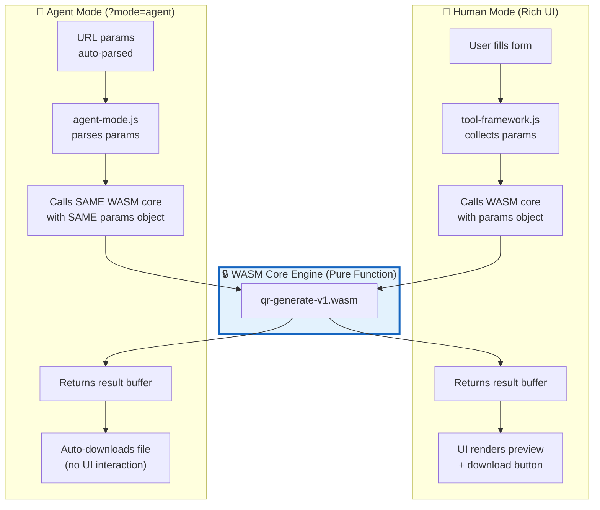
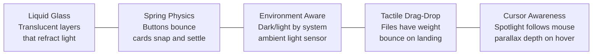
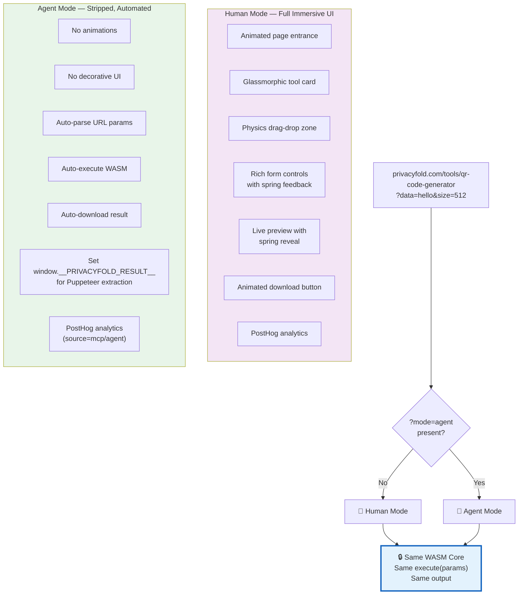

# PrivacyFold — Deterministic Core + Immersive UI Spec

---

## Part 1: One WASM Core, Identical Output — Everywhere

### The Iron Rule

```
Same WASM module + Same input params = Byte-identical output
Whether triggered by a human clicking a button or an agent calling via MCP URL.
```



> [!IMPORTANT]
> **Both paths call the exact same function on the exact same WASM binary with the exact same parameter format.** The WASM core is a pure function — no randomness, no timestamps, no side effects. Input → Output. Period.

### The Shared Core Architecture

Every tool page uses the same wrapper pattern:

```javascript
// /assets/js/tool-framework.js — shared across ALL tool pages

class PrivacyFoldTool {
  constructor(config) {
    this.toolId = config.toolId;
    this.wasmPath = config.wasmPath;       // e.g., "/wasm/utility/qr-generate-v1.wasm"
    this.exportFn = config.exportFn;       // e.g., "generate"
    this.module = null;
  }

  // ━━━━━━━━━━━━━━━━━━━━━━━━━━━━━━━━━━
  // Load WASM (once, then cached by browser)
  // ━━━━━━━━━━━━━━━━━━━━━━━━━━━━━━━━━━
  async init() {
    const response = await fetch(this.wasmPath);
    const { instance } = await WebAssembly.instantiateStreaming(response);
    this.module = instance.exports;
  }

  // ━━━━━━━━━━━━━━━━━━━━━━━━━━━━━━━━━━
  // THE CORE: One function, both modes call this
  // ━━━━━━━━━━━━━━━━━━━━━━━━━━━━━━━━━━
  execute(params) {
    // Normalize params to ensure identical input regardless of source
    const normalized = this.normalizeParams(params);

    // Call WASM — pure function, deterministic
    const result = this.module[this.exportFn](normalized);

    return result;  // Same input = same output. Always.
  }

  normalizeParams(params) {
    // Sort keys, cast types, apply defaults — guarantees identical
    // input structure whether from UI form or URL query string
    const schema = this.schema;
    const normalized = {};

    for (const [key, def] of Object.entries(schema.params)) {
      let value = params[key] ?? def.default;

      // Type casting — UI sends numbers, URL sends strings
      if (def.type === 'number') value = Number(value);
      if (def.type === 'boolean') value = value === true || value === 'true';
      if (def.type === 'string') value = String(value);

      normalized[key] = value;
    }

    return normalized;
  }
}
```

### How Each Mode Uses It

```javascript
// /tools/qr-code-generator/index.html

import { PrivacyFoldTool } from '/assets/js/tool-framework.js';
import { initAgentMode } from '/assets/js/agent-mode.js';
import { initHumanUI } from '/assets/js/human-ui.js';

const tool = new PrivacyFoldTool({
  toolId: 'qr-code-generator',
  wasmPath: '/wasm/utility/qr-generate-v1.wasm',
  exportFn: 'generate'
});

await tool.init();

// ━━━ Detect mode from URL ━━━
const params = Object.fromEntries(new URLSearchParams(location.search));

if (params.mode === 'agent') {
  // AGENT MODE: Parse URL params → execute WASM → auto-download
  initAgentMode(tool, params);
} else {
  // HUMAN MODE: Render rich UI → user fills form → execute WASM → preview
  initHumanUI(tool);
}
// Both call tool.execute(params) with the SAME WASM underneath
```

```javascript
// /assets/js/agent-mode.js — Minimal, zero UI, auto-execute

export function initAgentMode(tool, params) {
  // Strip all decorative UI
  document.body.classList.add('agent-mode');

  // Execute immediately with URL params
  const result = tool.execute(params);

  // Auto-trigger download
  const blob = new Blob([result.data], { type: result.mimeType });
  const url = URL.createObjectURL(blob);
  const a = document.createElement('a');
  a.href = url;
  a.download = result.filename;
  a.click();

  // Signal completion for Puppeteer agents
  document.title = `✅ DONE: ${result.filename}`;
  window.__PRIVACYFOLD_RESULT__ = {
    status: 'complete',
    filename: result.filename,
    size: result.data.byteLength,
    checksum: result.sha256
  };
}
```

```javascript
// /assets/js/human-ui.js — Rich, animated, immersive

export function initHumanUI(tool) {
  // Render the full beautiful UI (next section)
  // User interacts with form controls
  // On submit/change: calls tool.execute(params)
  // Shows animated preview, download button, etc.
}
```

### Determinism Guarantees

| Guarantee | How It's Achieved |
|---|---|
| Same WASM binary | Both modes load the exact same `.wasm` file from the same URL |
| Same function call | Both call `module.exports.generate(normalizedParams)` |
| Same param normalization | `normalizeParams()` ensures type-cast consistency (string → number, etc.) |
| No floating-point drift | WASM compiled with NaN canonicalization, no relaxed SIMD |
| No randomness | WASM core uses seeded PRNG where needed (seed passed as param) |
| No timestamps | WASM never calls `Date.now()` — metadata timestamps are added in JS layer after output |
| Reproducible WASM build | CI builds in locked Docker container with frozen toolchain version |
| Verifiable | WASM file's SHA-256 hash published alongside version, auditable |

### Proving It — Automated Test

```javascript
// test/determinism.test.js — runs in CI
import { PrivacyFoldTool } from '../assets/js/tool-framework.js';

test('QR: identical input produces identical output', async () => {
  const tool = new PrivacyFoldTool({
    toolId: 'qr-code-generator',
    wasmPath: './wasm/utility/qr-generate-v1.wasm',
    exportFn: 'generate'
  });
  await tool.init();

  const params = { data: 'https://privacyfold.com', size: 512, format: 'svg', error_correction: 'M' };

  const result1 = tool.execute(params);
  const result2 = tool.execute(params);

  // Byte-for-byte identical
  expect(result1.data).toEqual(result2.data);
  expect(result1.sha256).toBe(result2.sha256);
});

test('QR: URL params produce same result as form params', async () => {
  const tool = new PrivacyFoldTool({ /* ... */ });
  await tool.init();

  // Simulated form input (numbers)
  const fromForm = tool.execute({ data: 'hello', size: 256, format: 'png', error_correction: 'H' });

  // Simulated URL params (strings — as agents would send)
  const fromURL = tool.execute({ data: 'hello', size: '256', format: 'png', error_correction: 'H' });

  // Must be identical after normalization
  expect(fromForm.sha256).toBe(fromURL.sha256);
});
```

---

## Part 2: Immersive, Physics-Based UI/UX

### Design Philosophy

> PrivacyFold doesn't look like a "utility site." It looks like a product built by a design-obsessed team. Every interaction has **weight, momentum, and soul.**



### Tech Stack for UI

| Layer | Technology | Why |
|---|---|---|
| **Framework** | Vanilla JS + Web Components (or Astro) | Static site, no SSR needed, tiny bundle |
| **Spring Animations** | Motion One (`motion.dev`) | Lightweight (3.5KB), framework-agnostic, spring physics |
| **Complex Orchestration** | GSAP (with ScrollTrigger) | Timeline control for landing page, scroll effects |
| **Interactive Animations** | Rive | State-machine-driven animations for tool icons and loading states |
| **3D Touches** | CSS 3D transforms + `perspective()` | Zero-dependency depth, tilt, and parallax |
| **Glassmorphism** | CSS `backdrop-filter` + custom properties | Native, GPU-accelerated, no library |
| **Drag & Drop** | Custom with spring physics | Physics-based landing, magnetic snap |
| **Icons** | Phosphor Icons or Lucide | Clean, consistent, lightweight |
| **Type** | Inter / Geist (variable font) | Modern, crisp, system-like feel |

### 2.1 — The Glassmorphic Tool Card

Every tool on the homepage is a glowing, translucent card that reacts to the cursor:

```css
/* Liquid Glass Card */
.tool-card {
  --glass-bg: light-dark(
    rgba(255, 255, 255, 0.6),
    rgba(30, 30, 40, 0.5)
  );
  --glass-border: light-dark(
    rgba(255, 255, 255, 0.3),
    rgba(255, 255, 255, 0.08)
  );
  --glass-shadow: light-dark(
    0 8px 32px rgba(0, 0, 0, 0.08),
    0 8px 32px rgba(0, 0, 0, 0.4)
  );

  background: var(--glass-bg);
  backdrop-filter: blur(20px) saturate(1.8);
  -webkit-backdrop-filter: blur(20px) saturate(1.8);
  border: 1px solid var(--glass-border);
  border-radius: 20px;
  padding: 1.5rem;
  box-shadow: var(--glass-shadow);

  /* 3D tilt reacting to cursor (set by JS) */
  transform: perspective(800px)
    rotateY(calc(var(--card-rx, 0) * 1deg))
    rotateX(calc(var(--card-ry, 0) * 1deg));
  transition: transform 0.15s ease-out, box-shadow 0.3s ease;

  /* Cursor spotlight overlay */
  position: relative;
  overflow: hidden;
}

.tool-card::before {
  content: '';
  position: absolute;
  inset: 0;
  border-radius: inherit;
  background: radial-gradient(
    400px circle at var(--spot-x, 50%) var(--spot-y, 50%),
    rgba(255, 255, 255, 0.1),
    transparent 50%
  );
  pointer-events: none;
  opacity: 0;
  transition: opacity 0.3s;
}

.tool-card:hover::before {
  opacity: 1;
}

/* Spring hover lift */
.tool-card:hover {
  box-shadow: 0 20px 60px rgba(0, 0, 0, 0.15);
}

/* Accessibility: respect reduced motion */
@media (prefers-reduced-motion: reduce) {
  .tool-card {
    transform: none !important;
    transition: none !important;
  }
  .tool-card::before {
    display: none;
  }
}
```

```javascript
// Cursor-tracking tilt + spotlight on tool cards
document.querySelectorAll('.tool-card').forEach(card => {
  card.addEventListener('mousemove', (e) => {
    const rect = card.getBoundingClientRect();
    const x = (e.clientX - rect.left) / rect.width;   // 0 → 1
    const y = (e.clientY - rect.top) / rect.height;    // 0 → 1

    // 3D tilt (subtle, max ±8 degrees)
    card.style.setProperty('--card-rx', (x - 0.5) * 16);
    card.style.setProperty('--card-ry', (y - 0.5) * -16);

    // Spotlight position
    card.style.setProperty('--spot-x', `${x * 100}%`);
    card.style.setProperty('--spot-y', `${y * 100}%`);
  });

  card.addEventListener('mouseleave', () => {
    // Spring back to neutral
    card.style.setProperty('--card-rx', 0);
    card.style.setProperty('--card-ry', 0);
  });
});
```

### 2.2 — Physics Drag & Drop Zone

The file drop zone feels **physical** — files have weight, bounce on landing, and snap into place:

```javascript
// Physics-based drag & drop with spring animation
import { animate, spring } from 'motion';

const dropZone = document.querySelector('.drop-zone');
const dropText = dropZone.querySelector('.drop-text');
const dropIcon = dropZone.querySelector('.drop-icon');

// ━━━ Drag Enter: Zone breathes open ━━━
dropZone.addEventListener('dragenter', (e) => {
  e.preventDefault();

  // Zone expands with spring physics
  animate(dropZone, { scale: 1.03 }, {
    easing: spring({ stiffness: 400, damping: 15 })
  });

  // Border glows
  animate(dropZone, {
    borderColor: ['rgba(99, 102, 241, 0.3)', 'rgba(99, 102, 241, 0.8)'],
    boxShadow: ['0 0 0 0 rgba(99, 102, 241, 0)', '0 0 0 20px rgba(99, 102, 241, 0.1)']
  }, { duration: 0.4 });

  // Icon bounces up
  animate(dropIcon, { y: -12, scale: 1.2 }, {
    easing: spring({ stiffness: 300, damping: 10 })
  });
});

// ━━━ Drag Leave: Zone settles back ━━━
dropZone.addEventListener('dragleave', () => {
  animate(dropZone, { scale: 1 }, {
    easing: spring({ stiffness: 300, damping: 20 })
  });
  animate(dropIcon, { y: 0, scale: 1 }, {
    easing: spring({ stiffness: 200, damping: 12 })
  });
});

// ━━━ Drop: File lands with bounce ━━━
dropZone.addEventListener('drop', async (e) => {
  e.preventDefault();
  const file = e.dataTransfer.files[0];

  // 1. Impact bounce — zone squishes then springs back
  await animate(dropZone, { scale: [1.03, 0.97, 1.01, 1] }, {
    duration: 0.5,
    easing: spring({ stiffness: 500, damping: 12 })
  }).finished;

  // 2. File thumbnail materializes with physics pop
  const thumb = createThumbnail(file);
  dropZone.appendChild(thumb);

  animate(thumb, { scale: [0, 1.1, 1], opacity: [0, 1] }, {
    easing: spring({ stiffness: 400, damping: 14 }),
    delay: 0.1
  });

  // 3. Ripple wave from drop point
  createRipple(dropZone, e.clientX, e.clientY);

  // 4. Process file with WASM
  processFile(file);
});
```

```css
/* Drop Zone — alive and breathing */
.drop-zone {
  --zone-bg: light-dark(
    rgba(245, 245, 255, 0.7),
    rgba(25, 25, 40, 0.6)
  );

  background: var(--zone-bg);
  backdrop-filter: blur(16px);
  border: 2px dashed rgba(99, 102, 241, 0.3);
  border-radius: 24px;
  padding: 3rem;
  text-align: center;
  cursor: pointer;

  /* Subtle idle breathing animation */
  animation: breathe 4s ease-in-out infinite;
  will-change: transform;
}

@keyframes breathe {
  0%, 100% { transform: scale(1); }
  50% { transform: scale(1.005); }
}

/* File thumbnail after drop */
.file-thumb {
  display: inline-flex;
  align-items: center;
  gap: 0.75rem;
  padding: 0.75rem 1.25rem;
  background: light-dark(rgba(255,255,255,0.8), rgba(40,40,60,0.8));
  backdrop-filter: blur(12px);
  border-radius: 14px;
  border: 1px solid light-dark(rgba(0,0,0,0.06), rgba(255,255,255,0.08));
  box-shadow: 0 4px 20px rgba(0, 0, 0, 0.08);
}

@media (prefers-reduced-motion: reduce) {
  .drop-zone { animation: none; }
}
```

### 2.3 — Processing State: Alive Progress

While WASM processes, the UI shows a **living, physical** progress indicator:

```javascript
// Organic progress with spring-interpolated micro-steps
function showProgress(tool, file) {
  const bar = document.querySelector('.progress-fill');
  const percent = document.querySelector('.progress-percent');
  const status = document.querySelector('.progress-status');

  const stages = [
    { at: 0,   label: 'Reading file...', icon: '📂' },
    { at: 20,  label: 'Analyzing...', icon: '🔍' },
    { at: 50,  label: 'Processing with WASM...', icon: '⚙️' },
    { at: 85,  label: 'Optimizing output...', icon: '✨' },
    { at: 100, label: 'Done!', icon: '✅' }
  ];

  let currentProgress = 0;

  tool.onProgress = (p) => {
    // Spring-interpolated smooth progress (never jumps)
    animate(
      (progress) => {
        currentProgress = progress;
        bar.style.width = `${progress}%`;
        percent.textContent = `${Math.round(progress)}%`;
      },
      { from: currentProgress, to: p, easing: spring({ stiffness: 100, damping: 20 }) }
    );

    // Update stage label
    const stage = stages.findLast(s => p >= s.at);
    if (stage) {
      status.textContent = `${stage.icon} ${stage.label}`;
    }
  };
}
```

```css
.progress-bar {
  height: 6px;
  border-radius: 3px;
  background: light-dark(rgba(0,0,0,0.06), rgba(255,255,255,0.06));
  overflow: hidden;
  position: relative;
}

.progress-fill {
  height: 100%;
  border-radius: 3px;
  background: linear-gradient(90deg, #6366f1, #8b5cf6, #a78bfa);
  background-size: 200% 100%;
  animation: shimmer 2s linear infinite;
  transition: width 0.3s cubic-bezier(0.22, 1, 0.36, 1);
}

@keyframes shimmer {
  0% { background-position: 200% 0; }
  100% { background-position: -200% 0; }
}

.progress-percent {
  font-variant-numeric: tabular-nums;
  font-weight: 600;
  font-size: 2rem;
}
```

### 2.4 — Result Preview: Satisfying Reveal

When processing completes, the result appears with a **cinematic reveal**:

```javascript
// Result reveal with staggered spring sequence
async function showResult(result) {
  const container = document.querySelector('.result-container');
  container.style.display = 'block';

  // 1. Container fades in and slides up
  await animate(container,
    { opacity: [0, 1], y: [30, 0] },
    { easing: spring({ stiffness: 200, damping: 18 }), duration: 0.6 }
  ).finished;

  // 2. Preview image/content pops in
  const preview = container.querySelector('.result-preview');
  await animate(preview,
    { scale: [0.85, 1.02, 1], opacity: [0, 1] },
    { easing: spring({ stiffness: 300, damping: 15 }), delay: 0.1 }
  ).finished;

  // 3. Metadata badges cascade in
  const badges = container.querySelectorAll('.result-badge');
  badges.forEach((badge, i) => {
    animate(badge,
      { opacity: [0, 1], x: [-20, 0] },
      { easing: spring({ stiffness: 250, damping: 18 }), delay: 0.2 + i * 0.08 }
    );
  });

  // 4. Download button appears with a bounce
  const btn = container.querySelector('.download-btn');
  animate(btn,
    { scale: [0, 1.08, 1], opacity: [0, 1] },
    { easing: spring({ stiffness: 350, damping: 12 }), delay: 0.4 }
  );

  // 5. Confetti burst for completed tool (subtle, not childish)
  spawnParticles(container, { count: 12, colors: ['#6366f1', '#a78bfa', '#c4b5fd'] });
}
```

### 2.5 — Environment-Aware Theming

```javascript
// /assets/js/theme.js

// ━━━ Layer 1: System preference ━━━
const systemDark = window.matchMedia('(prefers-color-scheme: dark)');
document.documentElement.setAttribute('data-theme', systemDark.matches ? 'dark' : 'light');
systemDark.addEventListener('change', (e) => {
  if (!userManuallyOverrode) {
    document.documentElement.setAttribute('data-theme', e.matches ? 'dark' : 'light');
  }
});

// ━━━ Layer 2: Ambient Light Sensor (if available) ━━━
if ('AmbientLightSensor' in window) {
  try {
    const sensor = new AmbientLightSensor({ frequency: 1 });
    sensor.addEventListener('reading', () => {
      if (userManuallyOverrode) return;

      const lux = sensor.illuminance;
      if (lux < 15) {
        // Dark room → dark mode with dimmed accents
        document.documentElement.setAttribute('data-theme', 'dark');
        document.documentElement.style.setProperty('--ambient-dim', '0.85');
      } else if (lux > 500) {
        // Bright sunlight → boost contrast
        document.documentElement.setAttribute('data-theme', 'light');
        document.documentElement.style.setProperty('--ambient-contrast', '1.1');
      }
    });
    sensor.start();
  } catch (e) { /* Sensor unavailable or denied — graceful fallback */ }
}

// ━━━ Layer 3: Time-of-day warmth ━━━
const hour = new Date().getHours();
if (hour >= 20 || hour < 6) {
  // Evening/night → warmer tones
  document.documentElement.style.setProperty('--color-temp', 'warm');
}
```

```css
:root {
  color-scheme: light dark;

  /* Adaptive tokens */
  --bg-primary: light-dark(#fafafa, #0a0a0f);
  --bg-surface: light-dark(rgba(255,255,255,0.7), rgba(20,20,30,0.7));
  --text-primary: light-dark(#111, #f0f0f5);
  --text-secondary: light-dark(#666, #999);
  --accent: light-dark(#6366f1, #818cf8);
  --accent-glow: light-dark(rgba(99,102,241,0.15), rgba(129,140,248,0.2));

  /* Ambient adjustments */
  --ambient-dim: 1;
  --ambient-contrast: 1;
}

/* Warm evening shift */
[data-color-temp="warm"] {
  --bg-primary: light-dark(#fdf8f0, #0f0a08);
  --accent: light-dark(#d97706, #f59e0b);
}

/* Global glass surface */
.surface {
  background: var(--bg-surface);
  backdrop-filter: blur(20px) saturate(1.6) brightness(var(--ambient-dim));
  border: 1px solid light-dark(rgba(0,0,0,0.05), rgba(255,255,255,0.06));
  border-radius: 20px;
}
```

### 2.6 — Micro-Interactions Everywhere

```css
/* Every interactive element has spring-feel feedback */

/* Buttons — press and bounce */
.btn {
  transition: transform 0.15s cubic-bezier(0.34, 1.56, 0.64, 1);
}
.btn:hover {
  transform: translateY(-2px) scale(1.02);
}
.btn:active {
  transform: translateY(1px) scale(0.97);
  transition-duration: 0.08s;
}

/* Toggle switches — satisfying snap */
.toggle-track {
  transition: background-color 0.3s ease;
}
.toggle-thumb {
  transition: transform 0.25s cubic-bezier(0.34, 1.56, 0.64, 1);
}
.toggle-track[aria-checked="true"] .toggle-thumb {
  transform: translateX(24px) scale(1.05);
}

/* Input fields — focus glow expansion */
.input {
  box-shadow: 0 0 0 0 var(--accent-glow);
  transition: box-shadow 0.3s ease, border-color 0.2s ease;
}
.input:focus {
  border-color: var(--accent);
  box-shadow: 0 0 0 4px var(--accent-glow);
}

/* Slider controls — thumb has weight */
.slider::-webkit-slider-thumb {
  transition: transform 0.2s cubic-bezier(0.34, 1.56, 0.64, 1),
              box-shadow 0.2s ease;
}
.slider::-webkit-slider-thumb:active {
  transform: scale(1.3);
  box-shadow: 0 0 0 8px var(--accent-glow);
}

/* Nav links — underline slides in */
.nav-link::after {
  content: '';
  position: absolute;
  bottom: -2px;
  left: 50%;
  width: 0;
  height: 2px;
  background: var(--accent);
  border-radius: 1px;
  transition: width 0.3s cubic-bezier(0.34, 1.56, 0.64, 1),
              left 0.3s cubic-bezier(0.34, 1.56, 0.64, 1);
}
.nav-link:hover::after {
  width: 100%;
  left: 0;
}
```

---

## Part 3: Agent Mode vs Human Mode — Same Core, Different Shell



```css
/* Agent mode — strip all decorative UI */
body.agent-mode {
  background: transparent !important;
}
body.agent-mode .hero,
body.agent-mode .nav,
body.agent-mode .footer,
body.agent-mode .ad-slot,
body.agent-mode .animation-layer {
  display: none !important;
}
body.agent-mode .tool-container {
  padding: 0;
  margin: 0;
  border: none;
  backdrop-filter: none;
  background: transparent;
  animation: none;
}
body.agent-mode * {
  animation-duration: 0s !important;
  transition-duration: 0s !important;
}
```

---

## Part 4: Page Load Choreography — First Impression

When a user lands on any tool page, they see a **choreographed entrance** — not a flash of unstyled content:

```javascript
// /assets/js/page-entrance.js

import { animate, stagger, spring } from 'motion';

document.addEventListener('DOMContentLoaded', () => {
  // Skip all animation in agent mode
  if (new URLSearchParams(location.search).get('mode') === 'agent') return;

  // Skip if user prefers reduced motion
  if (window.matchMedia('(prefers-reduced-motion: reduce)').matches) {
    document.querySelectorAll('[data-animate]').forEach(el => el.style.opacity = 1);
    return;
  }

  const timeline = [
    // 1. Background gradient materializes
    { el: '.bg-gradient', props: { opacity: [0, 1] }, timing: { duration: 0.8 } },

    // 2. Nav slides down
    { el: '.nav', props: { y: [-20, 0], opacity: [0, 1] },
      timing: { easing: spring({ stiffness: 200, damping: 20 }), delay: 0.1 } },

    // 3. Tool title scales up
    { el: '.tool-title', props: { scale: [0.9, 1], opacity: [0, 1] },
      timing: { easing: spring({ stiffness: 250, damping: 15 }), delay: 0.15 } },

    // 4. Tool description fades in
    { el: '.tool-description', props: { y: [15, 0], opacity: [0, 1] },
      timing: { easing: spring({ stiffness: 200, damping: 18 }), delay: 0.2 } },

    // 5. Drop zone materializes with a subtle pop
    { el: '.drop-zone', props: { scale: [0.95, 1.01, 1], opacity: [0, 1] },
      timing: { easing: spring({ stiffness: 300, damping: 14 }), delay: 0.3 } },

    // 6. Control panels cascade in
    { el: '.control-panel', props: { x: [-20, 0], opacity: [0, 1] },
      timing: { easing: spring({ stiffness: 200, damping: 18 }), delay: 0.35 } },

    // 7. Privacy badge glows in
    { el: '.privacy-badge', props: { scale: [0, 1.05, 1], opacity: [0, 1] },
      timing: { easing: spring({ stiffness: 350, damping: 12 }), delay: 0.5 } },
  ];

  timeline.forEach(({ el, props, timing }) => {
    const element = document.querySelector(el);
    if (element) animate(element, props, timing);
  });
});
```

### Visual: What the User Sees

````carousel
<!-- slide -->
### Frame 1: Page Load (0ms)
```
┌─────────────────────────────────┐
│                                 │
│         (empty, loading)        │
│                                 │
│                                 │
│                                 │
└─────────────────────────────────┘
```
Gradient background begins to materialize...

<!-- slide -->
### Frame 2: Nav + Title (100-200ms)
```
┌─────────────────────────────────┐
│  ⬇ Nav slides down smoothly    │
│                                 │
│     📸 Passport Photo Resizer   │
│     ↑ Title scales up with pop  │
│                                 │
└─────────────────────────────────┘
```
Spring physics — title slightly overshoots then settles

<!-- slide -->
### Frame 3: Drop Zone + Controls (300-400ms)
```
┌─────────────────────────────────┐
│  🏠 PrivacyFold  |  Tools  |   │
│                                 │
│     📸 Passport Photo Resizer   │
│     Resize to exact specs...    │
│                                 │
│  ┌─ ─ ─ ─ ─ ─ ─ ─ ─ ─ ─ ─ ┐  │
│  │  📂 Drop your photo here  │  │  ← Pops in with bounce
│  │     or click to browse    │  │
│  └─ ─ ─ ─ ─ ─ ─ ─ ─ ─ ─ ─ ┘  │
│                                 │
│  🇺🇸 Country  [  US ▾  ]       │  ← Slides in from left
│  🔲 Auto-crop  [✓]            │
└─────────────────────────────────┘
```

<!-- slide -->
### Frame 4: Fully Loaded (500ms)
```
┌─────────────────────────────────┐
│  🏠 PrivacyFold  |  Tools  |   │
│                                 │
│     📸 Passport Photo Resizer   │
│     Resize to exact passport    │
│     specs. 100% in-browser.     │
│                                 │
│  ┌─────────────────────────┐    │
│  │   📂 Drop your photo    │    │
│  │    or click to browse   │    │  ← Subtly breathing
│  └─────────────────────────┘    │
│                                 │
│  🇺🇸 US  🇬🇧 UK  🇪🇺 EU  🇨🇦 CA  │
│  🔲 Auto-crop  [✓]            │
│  🔲 Remove BG  [✓]            │
│                                 │
│  🔒 Your file never leaves      │  ← Glows in last
│     your device                  │
└─────────────────────────────────┘
```
Total entrance: ~500ms — fast, purposeful, cinematic.
````

---

## Summary: Two Guarantees

| # | Guarantee | How |
|---|---|---|
| **1** | **Deterministic output** | Single WASM core per tool. Both UI form and agent URL params go through `normalizeParams()` → same `execute()` call → identical output bytes. Verified in CI with automated determinism tests. |
| **2** | **Immersive experience** | Every element has spring physics, every surface is glassmorphic, every interaction gives tactile feedback. Environment-aware theming. Agent mode strips all UI for raw WASM execution. Accessibility-first with `prefers-reduced-motion`. |
