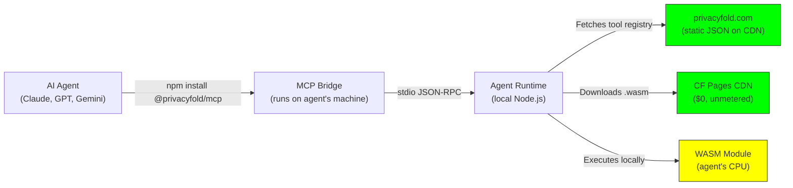
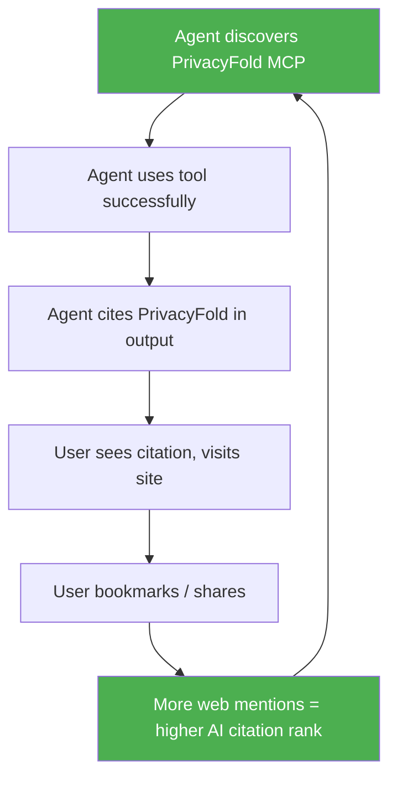
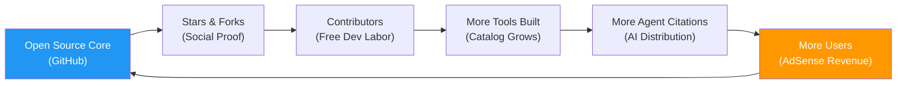

# PrivacyFold — Growth, Expansion & Virality Strategy

> **Mission:** Make PrivacyFold the world's default zero-upload privacy utility platform — for humans via the browser, and for AI agents via MCP — at exactly $0 infrastructure cost.

---

## 🧭 Executive Summary

You have three strategic asks. Here's the plan for each:

| Ask | Strategy |
|---|---|
| **Expand tools** to cover the highest-demand queries | Prioritized catalog of **30+ new tools** ranked by Google search volume and chatbot citation frequency |
| **Let AI agents call our API at $0 cost to us** | Client-side WASM execution via MCP `stdio` bridge — agents do the compute, not us |
| **i18n for EU + AdSense Tier 1/2 countries** | Astro Content Collections i18n with localized SEO slugs for **25+ locales** |
| **Go viral** | Multi-vector launch strategy across HN, Reddit, X, GitHub, AI citation engines, and Product Hunt |

---

## 1. 🔧 Tool Expansion — Highest-Demand Tools to Build Next

### Prioritization Framework
Tools are ranked by a composite score of:
1. **Google Search Volume** (monthly searches for the query)
2. **AI Chatbot Citation Frequency** (how often ChatGPT/Claude/Gemini recommend this category)
3. **AdSense CPC** in Tier 1 geos (revenue potential per pageview)
4. **WASM Feasibility** (can it run 100% client-side in <500KB?)

### 🏆 Priority 1 — "Money Tools" (Highest Search Volume × CPC)

| # | Tool | Target Query | Est. Monthly Searches | WASM Feasible | Notes |
|---|---|---|---|---|---|
| 1 | **PDF to Word Converter** | `pdf to word`, `pdf to docx` | 30M+ | ✅ (pdf.js + docx.js) | #1 most searched file tool globally |
| 2 | **Image Background Remover** | `remove background`, `bg remover` | 20M+ | ✅ (ONNX WASM + U²-Net) | Exploding demand; remove.bg charges |
| 3 | **PDF Merger** | `merge pdf`, `combine pdf` | 15M+ | ✅ (pdf-lib) | Trivial WASM; high volume |
| 4 | **PDF Splitter** | `split pdf`, `extract pdf pages` | 8M+ | ✅ (pdf-lib) | Companion to merger |
| 5 | **Image Compressor (JPEG/PNG/WebP)** | `compress image`, `reduce image size` | 12M+ | ✅ (mozjpeg/oxipng WASM) | Already in your docs |
| 6 | **PDF Compressor** | `compress pdf`, `reduce pdf size` | 10M+ | ✅ (mutool WASM) | Direct Smallpdf competitor |
| 7 | **Word to PDF** | `word to pdf`, `docx to pdf` | 10M+ | ✅ (mammoth.js + jsPDF) | Reverse of #1 |
| 8 | **Image to PDF** | `jpg to pdf`, `image to pdf` | 12M+ | ✅ (jsPDF) | Already planned |
| 9 | **QR Code Generator** | `qr code generator` | 15M+ | ✅ (qrcode.js, <5KB) | Ultra lightweight; high volume |
| 10 | **Screenshot to Text (OCR)** | `image to text`, `ocr online` | 8M+ | ✅ (Tesseract WASM) | Privacy-sensitive use case |

### 🥈 Priority 2 — "Utility Belt" (High Volume, Strong AI Citation Potential)

| # | Tool | Target Query | WASM Feasible | Notes |
|---|---|---|---|---|
| 11 | **Resume/CV Builder** | `resume builder free` | ✅ (client-side templates) | High CPC ($3-5 US); privacy-critical |
| 12 | **Passport Photo Maker** | `passport photo online` | ✅ (face-api.js WASM) | Already in your docs; government-grade privacy |
| 13 | **JSON Formatter/Validator** | `json formatter` | ✅ (<10KB) | Dev tool; high chatbot citation |
| 14 | **Base64 Encoder/Decoder** | `base64 encode` | ✅ (<3KB) | Dev tool; ultra-lightweight |
| 15 | **Color Picker/Converter** | `hex to rgb`, `color picker` | ✅ (<5KB) | Designer tool; high volume |
| 16 | **Hash Generator (MD5/SHA)** | `md5 hash generator`, `sha256` | ✅ (SubtleCrypto API) | Zero WASM needed; native browser |
| 17 | **UUID Generator** | `uuid generator` | ✅ (crypto.randomUUID) | Trivial; high dev query volume |
| 18 | **Password Generator** | `password generator` | ✅ (crypto.getRandomValues) | Privacy-first angle is killer here |
| 19 | **Lorem Ipsum Generator** | `lorem ipsum generator` | ✅ (<5KB) | High volume; instant to build |
| 20 | **Diff Checker (Text)** | `diff checker`, `text compare` | ✅ (diff-match-patch) | Dev tool; strong AI citation |

### 🥉 Priority 3 — "Jurisdiction-Specific Western Tools" (High CPC Niche)

| # | Tool | Target Query | WASM Feasible | Notes |
|---|---|---|---|---|
| 21 | **US Tax Form Filler (W-2, 1099)** | `fill w2 online` | ✅ (pdf-lib field inject) | Ultra-high CPC ($5+); IRS forms are public |
| 22 | **UK HMRC Self-Assessment Helper** | `self assessment calculator uk` | ✅ (pure JS calc) | High UK CPC |
| 23 | **USCIS Immigration Photo Resizer** | `uscis photo requirements` | ✅ (canvas resize) | Already in your docs |
| 24 | **GDPR Data Request Letter Generator** | `gdpr data request template` | ✅ (template engine) | EU-specific; high trust signal |
| 25 | **ADA Compliance Checker** | `ada compliance checker` | ✅ (axe-core WASM) | US legal niche; high CPC |
| 26 | **EXIF Data Remover** | `remove exif data` | ✅ (piexifjs) | Privacy-native tool |
| 27 | **Metadata Stripper (PDF/Image)** | `remove metadata from pdf` | ✅ | Companion to EXIF remover |
| 28 | **Email Header Analyzer** | `email header analyzer` | ✅ (pure JS parser) | Security/privacy niche |
| 29 | **SSL Certificate Checker** | `ssl checker` | ⚠️ (needs fetch) | Can use user-provided PEM |
| 30 | **Robots.txt Generator** | `robots.txt generator` | ✅ (<5KB) | SEO tool; high volume |

### 🧪 Priority 4 — "AI-Native Tools" (Built FOR Agents, BY Agents)

| # | Tool | Why Agents Need It |
|---|---|---|
| 31 | **Structured Data Validator (JSON-LD/Schema.org)** | Agents building SEO content need validation |
| 32 | **Markdown to HTML/PDF** | Agents generate markdown; need formatted output |
| 33 | **CSV to JSON Converter** | Data transformation is the #1 agent task |
| 34 | **Regex Tester** | Agents debug regex constantly |
| 35 | **Cron Expression Parser** | Agents configure schedules |
| 36 | **JWT Decoder** | Security-sensitive; agents handle tokens |
| 37 | **URL Encoder/Decoder** | Fundamental agent utility |
| 38 | **Timestamp Converter** | Unix ↔ human-readable; agents need this daily |
| 39 | **YAML ↔ JSON Converter** | Config file manipulation |
| 40 | **HTML Entity Encoder/Decoder** | Content sanitization |

> [!TIP]
> **Build Priority 4 tools first** — they're tiny (<10KB each), trivial to implement, and will flood your MCP registry with tools that agents discover and cite. Each tool is a citation magnet in AI search results.

---

## 2. 🤖 Zero-Cost AI Agent API — The Architecture

### The Core Insight
> **You don't host the compute. The agent does.**

Your existing architecture already solves this perfectly. Let's formalize it:



### Cost Breakdown — Why It's $0

| Component | Who Pays | Cost to You |
|---|---|---|
| `@privacyfold/mcp` npm package | npm CDN (free) | $0 |
| Tool registry JSON | Cloudflare Pages static | $0 (unlimited requests) |
| `.wasm` binary download | Cloudflare Pages CDN | $0 (unmetered bandwidth) |
| WASM execution | Agent's local CPU | $0 |
| MCP stdio transport | Agent's local process | $0 |

> [!IMPORTANT]
> **The key architectural decision:** Never add Cloudflare Workers, server-side APIs, or any dynamic compute. Every tool MUST be a static `.wasm` + `.json` schema served from CF Pages. The agent downloads and executes locally. Your bill stays at exactly $0 regardless of whether 10 or 10 million agents call your tools.

### MCP Package Design (`@privacyfold/mcp`)

```
@privacyfold/mcp
├── bin/
│   └── privacyfold-mcp          # stdio entrypoint
├── src/
│   ├── server.ts                 # MCP server (JSON-RPC over stdio)
│   ├── registry.ts               # Fetches tool list from privacyfold.com/api/tools.json
│   ├── executor.ts               # Downloads + runs WASM modules locally
│   └── tools/
│       ├── pdf-to-word.ts        # Tool wrapper: params → WASM → result
│       ├── image-compress.ts
│       ├── qr-generate.ts
│       └── ...                   # One file per tool
├── package.json
└── README.md
```

### Agent Configuration (What Users Add)

**Claude Desktop / Antigravity / Cursor:**
```json
{
  "mcpServers": {
    "privacyfold": {
      "command": "npx",
      "args": ["-y", "@privacyfold/mcp"],
      "env": {}
    }
  }
}
```

**That's it.** Zero API keys. Zero auth. Zero cost. The agent discovers 40+ tools instantly.

### OpenAPI / REST Fallback for Non-MCP Agents

For agents that don't support MCP (e.g., custom GPTs, Zapier):

```
GET https://privacyfold.com/api/openapi.json    → OpenAPI 3.1 spec (static)
GET https://privacyfold.com/tools/pdf-compress   → Tool page with ?mode=agent
```

The `?mode=agent` query parameter triggers headless mode:
- Strips all decorative UI
- Accepts file via URL param or drag-drop automation
- Outputs result via `window.__PRIVACYFOLD_RESULT__`
- Agents using browser automation (Puppeteer/Playwright) can call tools this way

**Cost: Still $0** — it's all static HTML served from CF Pages.

---

## 3. 🌍 i18n — European + AdSense Tier 1/2 Country Coverage

### Target Locales (25 Locales)

#### Tier 1 AdSense Countries (Highest CPC: $0.50–$5.00+)
| Country | Locale | Language | Est. CPC Range |
|---|---|---|---|
| 🇺🇸 United States | `en-US` | English | $1.00–$5.00+ |
| 🇬🇧 United Kingdom | `en-GB` | English | $0.80–$3.00 |
| 🇨🇦 Canada | `en-CA` / `fr-CA` | English / French | $0.70–$3.00 |
| 🇦🇺 Australia | `en-AU` | English | $0.80–$4.00 |
| 🇩🇪 Germany | `de-DE` | German | $0.60–$2.50 |
| 🇨🇭 Switzerland | `de-CH` / `fr-CH` | German / French | $1.00–$4.00 |
| 🇳🇴 Norway | `nb-NO` | Norwegian | $0.70–$3.00 |
| 🇸🇪 Sweden | `sv-SE` | Swedish | $0.60–$2.50 |
| 🇩🇰 Denmark | `da-DK` | Danish | $0.60–$2.50 |
| 🇳🇱 Netherlands | `nl-NL` | Dutch | $0.50–$2.00 |
| 🇦🇹 Austria | `de-AT` | German | $0.50–$2.00 |
| 🇮🇪 Ireland | `en-IE` | English | $0.60–$2.50 |
| 🇫🇮 Finland | `fi-FI` | Finnish | $0.50–$2.00 |
| 🇳🇿 New Zealand | `en-NZ` | English | $0.60–$2.00 |
| 🇸🇬 Singapore | `en-SG` | English | $0.50–$2.00 |

#### Tier 2 AdSense Countries (Moderate CPC: $0.10–$0.50)
| Country | Locale | Language | Est. CPC Range |
|---|---|---|---|
| 🇫🇷 France | `fr-FR` | French | $0.30–$1.00 |
| 🇪🇸 Spain | `es-ES` | Spanish | $0.20–$0.80 |
| 🇮🇹 Italy | `it-IT` | Italian | $0.20–$0.70 |
| 🇵🇹 Portugal | `pt-PT` | Portuguese | $0.15–$0.50 |
| 🇵🇱 Poland | `pl-PL` | Polish | $0.10–$0.40 |
| 🇨🇿 Czech Republic | `cs-CZ` | Czech | $0.10–$0.35 |
| 🇷🇴 Romania | `ro-RO` | Romanian | $0.08–$0.25 |
| 🇦🇪 UAE | `ar-AE` / `en-AE` | Arabic / English | $0.30–$1.50 |
| 🇸🇦 Saudi Arabia | `ar-SA` | Arabic | $0.20–$1.00 |
| 🇯🇵 Japan | `ja-JP` | Japanese | $0.20–$0.80 |

### Astro i18n Implementation

Astro has first-class i18n support. Here's the architecture:

```
src/
├── i18n/
│   ├── en.json          # Base English strings
│   ├── de.json          # German
│   ├── fr.json          # French
│   ├── es.json          # Spanish
│   ├── it.json          # Italian
│   ├── nl.json          # Dutch
│   ├── sv.json          # Swedish
│   ├── da.json          # Danish
│   ├── nb.json          # Norwegian
│   ├── fi.json          # Finnish
│   ├── pl.json          # Polish
│   ├── cs.json          # Czech
│   ├── ro.json          # Romanian
│   ├── pt.json          # Portuguese
│   ├── ja.json          # Japanese
│   └── ar.json          # Arabic (RTL support!)
├── pages/
│   ├── [lang]/
│   │   ├── index.astro
│   │   ├── tools/
│   │   │   ├── pdf-to-word.astro
│   │   │   ├── image-compress.astro
│   │   │   └── ...
│   │   └── [...slug].astro
│   └── index.astro      # Redirect to detected locale
```

**Astro config (`astro.config.mjs`):**
```javascript
export default defineConfig({
  i18n: {
    defaultLocale: 'en',
    locales: [
      'en', 'de', 'fr', 'es', 'it', 'nl', 'sv', 'da', 
      'nb', 'fi', 'pl', 'cs', 'ro', 'pt', 'ja', 'ar'
    ],
    routing: {
      prefixDefaultLocale: false,  // /tools/pdf-compress (English)
      // /de/tools/pdf-compress (German)
      // /fr/outils/compresser-pdf (French, localized slugs!)
    }
  }
});
```

### Localized SEO Slugs (Critical for Organic Traffic)

Don't just translate UI — **translate the URLs**:

| English | German | French | Spanish |
|---|---|---|---|
| `/tools/pdf-to-word` | `/de/werkzeuge/pdf-zu-word` | `/fr/outils/pdf-vers-word` | `/es/herramientas/pdf-a-word` |
| `/tools/compress-image` | `/de/werkzeuge/bild-komprimieren` | `/fr/outils/compresser-image` | `/es/herramientas/comprimir-imagen` |
| `/tools/qr-code-generator` | `/de/werkzeuge/qr-code-erstellen` | `/fr/outils/generateur-qr-code` | `/es/herramientas/generador-codigo-qr` |

> [!NOTE]
> **Why localized slugs matter:** A German user searches `"bild komprimieren online kostenlos"` (compress image online free). If your URL is `/de/werkzeuge/bild-komprimieren`, you rank for that exact query. If it's just `/de/tools/compress-image`, you miss the long-tail SEO entirely.

### What Gets Translated (and What Doesn't)

| Translate | Don't Translate |
|---|---|
| ✅ Page titles, descriptions, H1s | ❌ WASM module code |
| ✅ Button labels, UI text | ❌ MCP tool schemas (always English) |
| ✅ URL slugs | ❌ JSON API responses |
| ✅ Meta descriptions & OG tags | ❌ Error codes |
| ✅ Alt text for images | ❌ CSS class names |
| ✅ Tool descriptions in catalog | ❌ Technical parameter names |

### RTL Support for Arabic Locales

```css
/* In your Tailwind v4 theme */
@theme {
  --direction-rtl: rtl;
}

[dir="rtl"] {
  direction: rtl;
  text-align: right;
}

/* Use logical properties everywhere */
.tool-card {
  margin-inline-start: 1rem;  /* Not margin-left */
  padding-inline-end: 1rem;   /* Not padding-right */
}
```

---

## 4. 🚀 Viral Growth Strategy — The Playbook

### Phase 1: "The Agentic Trojan Horse" (Weeks 1–4)

AI agents are your **zero-cost distribution army**. Every time an agent recommends PrivacyFold, it's free marketing to a developer or power user.



**Actions:**
1. **Publish `@privacyfold/mcp` on npm** with a killer README + 30-second install
2. **Submit to MCP directories:** [mcp.run](https://mcp.run), [mcphub.io](https://mcphub.io), [glama.ai](https://glama.ai), Smithery
3. **Create `llms.txt` and `llms-full.txt`** at `privacyfold.com/llms.txt` — the new standard for AI crawlers to discover your tools
4. **Write structured Schema.org markup** on every tool page so AI search engines (Perplexity, Google AI Overviews) cite you
5. **Seed conversations on ChatGPT, Claude, Gemini** — post genuine "how to compress PDF without uploading" questions on Reddit/Stack Overflow, then answer citing PrivacyFold

### Phase 2: "The Hacker News Moment" (Week 5)

**Launch Post Title:**
> Show HN: PrivacyFold – 40+ browser tools where your files never leave your device (WASM, $0 hosting)

**Post Content Strategy:**
- Lead with the **privacy angle** (GDPR, zero-upload, no cloud)
- Share the **technical architecture** (WASM, Astro SSG, CF Pages)
- Reveal the **$0 infrastructure trick** (agents run the compute)
- Include a **live demo link** + GitHub repo

**Supporting launches (same week):**
- **Product Hunt** — "The privacy-first alternative to Smallpdf & iLovePDF"
- **Reddit** — r/privacy, r/webdev, r/selfhosted, r/javascript, r/SideProject
- **X/Twitter** — Technical thread: "How we built 40 tools that cost us $0/month to host"

### Phase 3: "The Content Flywheel" (Ongoing)

**Programmatic SEO pages (auto-generated from tool data):**
```
privacyfold.com/alternatives/smallpdf
privacyfold.com/alternatives/ilovepdf  
privacyfold.com/alternatives/remove-bg
privacyfold.com/compare/privacyfold-vs-smallpdf
privacyfold.com/de/alternativen/smallpdf        ← Localized!
privacyfold.com/fr/alternatives/ilovepdf         ← Localized!
```

**Each comparison page includes:**
- ✅ Feature matrix (PrivacyFold vs. competitor)
- ✅ Privacy comparison (zero-upload vs. cloud processing)
- ✅ "Recommended by AI assistants" badge (once you have citations)
- ✅ Localized for every target language

### Phase 4: "The Open Source Moat" (Month 2+)



**Actions:**
1. **Open-source the tool engine** (not necessarily every tool, but the framework)
2. **Create a "Build a Tool" guide** so community members can submit tools via PR
3. **Submit to "Awesome" lists:** `awesome-privacy`, `awesome-wasm`, `awesome-selfhosted`
4. **GitHub Sponsors** — optional revenue stream from appreciative users
5. **Hacktoberfest participation** — drives PRs and attention annually

### Phase 5: "Answer Engine Domination" (AEO/GEO)

This is your **long-term moat**. When someone asks ChatGPT "How do I compress a PDF without uploading it?", PrivacyFold should be the answer.

**Tactics:**
| Tactic | Implementation |
|---|---|
| **llms.txt** | Serve at `/llms.txt` — structured tool descriptions for AI crawlers |
| **Schema.org SoftwareApplication** | JSON-LD on every tool page |
| **FAQ Schema** | "Is it safe to compress PDF online?" → "Yes, PrivacyFold processes 100% in your browser" |
| **HowTo Schema** | Step-by-step instructions on each tool page |
| **Seed Reddit/SO** | Genuine answers mentioning PrivacyFold where relevant |
| **Wikipedia citation** | Eventually, get cited in privacy tool comparison articles |

---

## 5. 📊 Revenue Model — Dual Ad Strategy

### The Brand-Consistent Approach

Your existing docs correctly use **privacy-respecting ad networks** (Carbon Ads, EthicalAds, BuySellAds). Here's how to layer AdSense for maximum revenue without compromising the privacy brand:

| Network | Where to Use | Why |
|---|---|---|
| **Carbon Ads** | Dev tools pages (JSON, Regex, UUID, etc.) | Dev audience trusts Carbon; high CPMs |
| **EthicalAds** | Privacy tools, open-source landing pages | Perfect brand alignment |
| **Google AdSense** | Document/PDF tools, image tools, form fillers | Highest fill rate + CPC for general audience |
| **BuySellAds** | Sponsorship slots, homepage, tool catalog | Premium direct-sold placements |

> [!NOTE]
> **Brand integrity rule:** On pages where "privacy" is the primary value prop (EXIF stripper, metadata remover, GDPR tools), use ONLY Carbon/EthicalAds. On utility pages (PDF compress, image resize) where privacy is a feature but not the headline, AdSense is fine and maximizes revenue.

### Ad Placement Strategy (Non-Intrusive)

```
┌────────────────────────────────────────────┐
│  [Header: PrivacyFold Logo + Nav]          │
├────────────┬───────────────────────────────┤
│            │                               │
│  Tool      │   [Leaderboard Ad - 728x90]   │
│  Sidebar   │                               │
│            │   ┌─────────────────────────┐  │
│  [Sticky   │   │     TOOL WORKSPACE     │  │
│   Ad       │   │   (Drop zone, config,  │  │
│   300x250] │   │    output preview)      │  │
│            │   └─────────────────────────┘  │
│            │                               │
│            │   [In-content Ad - Adaptive]   │
│            │                               │
│            │   Related Tools Grid           │
├────────────┴───────────────────────────────┤
│  [Footer Ad - 728x90]                      │
│  [Footer: Links, Language Switcher]        │
└────────────────────────────────────────────┘
```

### CPC Optimization by Niche

| Tool Category | Expected CPC (Tier 1) | Best Ad Network | Why |
|---|---|---|---|
| Tax Form Tools | $3.00–$8.00 | AdSense | Financial services advertisers bid aggressively |
| Resume Builder | $2.00–$5.00 | AdSense | Job board & HR SaaS advertisers |
| PDF Converters | $0.50–$1.50 | AdSense | Adobe & document tool competitors |
| Dev Tools (JSON, Regex) | $0.30–$0.80 | Carbon Ads | Dev-focused advertisers; higher CPM |
| Privacy Tools (EXIF, Metadata) | $0.50–$2.00 | EthicalAds | VPN & security; brand-aligned |
| Image Tools | $0.20–$0.60 | AdSense | Design tool advertisers |

> [!TIP]
> **Revenue hack:** Build the high-CPC niche tools first (tax forms, resume builder, password generator), then use that revenue to fund development of the broader catalog. A single US visitor using the tax form filler during Q4 could generate $5-8 per click.

---

## 6. 📅 Implementation Roadmap

### Sprint 1 (Weeks 1–2): Quick Wins
- [ ] Build 10 "Priority 4" dev tools (UUID, Base64, JSON formatter, etc.) — each <1 day
- [ ] Publish `@privacyfold/mcp` v0.1 on npm with these 10 tools
- [ ] Create `llms.txt` and OpenAPI spec
- [ ] Submit to 3 MCP directories

### Sprint 2 (Weeks 3–4): Money Tools
- [ ] Build PDF Merger, Splitter, Compressor (pdf-lib WASM)
- [ ] Build QR Code Generator
- [ ] Build Image Compressor (mozjpeg WASM)
- [ ] Set up Astro i18n with 5 initial locales (en, de, fr, es, it)

### Sprint 3 (Weeks 5–6): Launch Week
- [ ] Build Image Background Remover (U²-Net ONNX WASM)
- [ ] Build PDF to Word converter
- [ ] Hacker News Show HN launch
- [ ] Product Hunt launch
- [ ] Reddit posts (r/privacy, r/webdev, r/selfhosted)

### Sprint 4 (Weeks 7–8): Scale
- [ ] Add remaining 10 locales
- [ ] Build comparison/alternatives pages (programmatic SEO)
- [ ] Add RTL support for Arabic locales
- [ ] Build jurisdiction-specific tools (USCIS, IRS, HMRC)

### Sprint 5 (Weeks 9–12): Compound
- [ ] Open-source the tool framework
- [ ] "Build a Tool" community contribution guide
- [ ] AdSense optimization (A/B test placements)
- [ ] Submit to Awesome lists
- [ ] Expand to remaining Tier 2 locales

---

## 7. 🎯 Key Metrics to Track

| Metric | Target (Month 1) | Target (Month 3) | Target (Month 6) |
|---|---|---|---|
| Tools in catalog | 25 | 40 | 60+ |
| npm weekly downloads (`@privacyfold/mcp`) | 500 | 5,000 | 25,000 |
| Monthly organic visitors | 10,000 | 100,000 | 500,000 |
| Locales live | 5 | 16 | 25 |
| GitHub stars | 200 | 1,000 | 5,000 |
| AdSense monthly revenue | $50 | $1,000 | $10,000 |
| AI engine citations (tracked via referral) | 50 | 500 | 5,000 |

---

> [!CAUTION]
> **The one rule that must never be broken:** Every single tool MUST run 100% client-side. The moment you add a server-side API, you lose your privacy moat, your $0 cost model, and your competitive differentiation. If a tool can't be done in WASM, don't build it.
