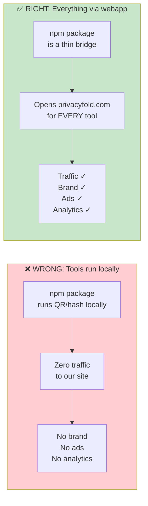
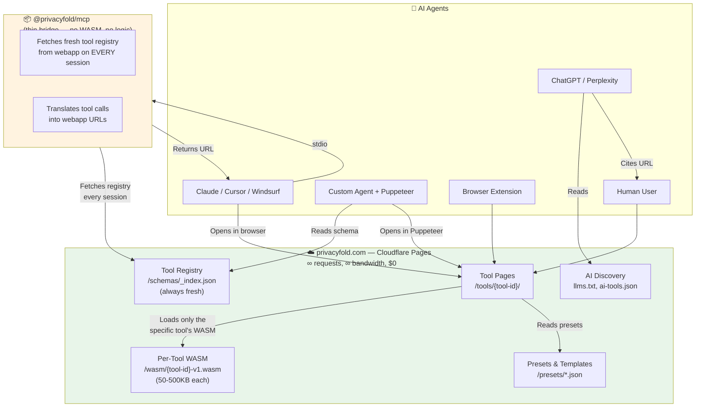
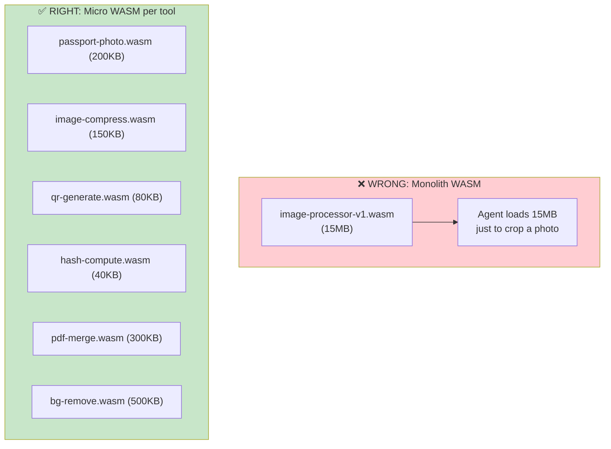
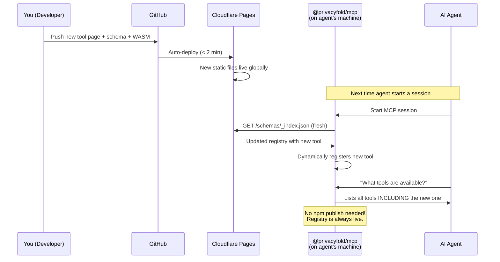
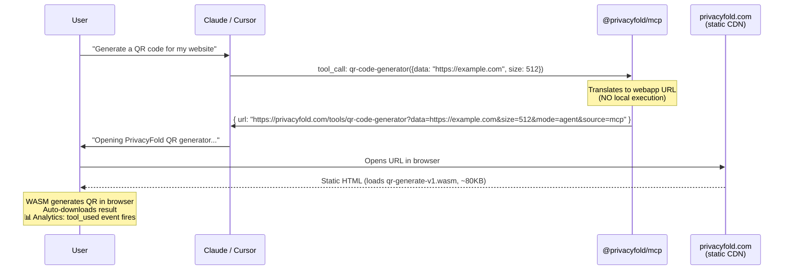
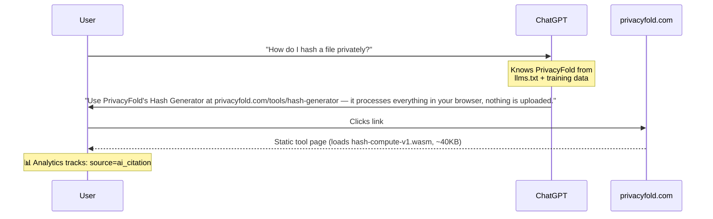
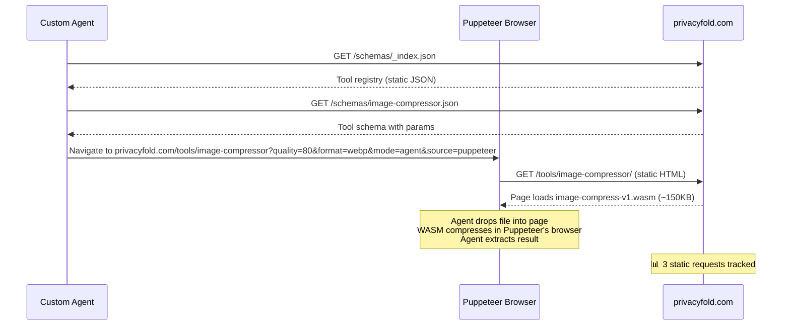
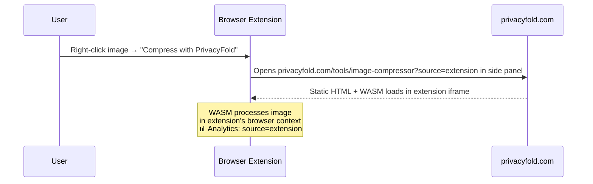

# PrivacyFold — Final Infrastructure Blueprint (v3)

> **Iron Rule:** Every tool execution — no matter how small — goes through **privacyfold.com**. The npm package is a thin bridge, not a standalone runner. All traffic flows to us.

---

## 1. The Philosophy



> [!IMPORTANT]
> **The npm package bundles ZERO WASM. It carries ZERO tool logic.** It is purely a thin MCP client that translates tool calls into privacyfold.com URLs. Every tool — QR code, hash, UUID, image resize, PDF merge — runs on our static webapp via per-tool WASM modules.

---

## 2. Architecture Overview



---

## 3. The npm Package — Thin Bridge Design

### What it IS:
- A ~20KB MCP server shell
- Translates MCP `tool_call` → privacyfold.com URL
- Fetches fresh tool registry from webapp on **every session start**
- Zero bundled WASM, zero tool logic

### What it is NOT:
- Not a standalone tool runner
- Not a cached offline tool
- Not a heavy download

```typescript
// @privacyfold/mcp — the entire package (~20KB)
import { McpServer } from "@modelcontextprotocol/sdk/server/mcp.js";
import { StdioServerTransport } from "@modelcontextprotocol/sdk/server/stdio.js";

const BASE = "https://privacyfold.com";
const REGISTRY_URL = `${BASE}/schemas/_index.json`;

// ━━━━━━━━━━━━━━━━━━━━━━━━━━━━━━━━━━━━━━━━━━━
// ALWAYS fetch fresh registry — never stale
// ━━━━━━━━━━━━━━━━━━━━━━━━━━━━━━━━━━━━━━━━━━━
async function fetchRegistry() {
  // Fetches from static Pages CDN — free, unlimited
  // cache-busted with timestamp to always get latest
  const res = await fetch(`${REGISTRY_URL}?_t=${Date.now()}`);
  return await res.json();
}

async function fetchToolSchema(toolId: string) {
  // Fresh schema for this specific tool
  const res = await fetch(`${BASE}/schemas/${toolId}.json?_t=${Date.now()}`);
  return await res.json();
}

async function main() {
  // 1. Fetch fresh registry on EVERY startup
  const registry = await fetchRegistry();

  const server = new McpServer({
    name: "privacyfold",
    version: registry.mcp_version || "1.0.0",
    description: registry.description
  });

  // 2. Dynamically register ALL tools from the live registry
  for (const tool of registry.tools) {
    const schema = await fetchToolSchema(tool.id);

    server.tool(
      tool.id,
      schema.description,
      schema.input_schema,  // zod-compatible schema from JSON
      async (params) => {
        // Build URL with all params — ALWAYS points to webapp
        const qs = new URLSearchParams();
        for (const [key, value] of Object.entries(params)) {
          if (value !== undefined && value !== null) {
            qs.set(key, String(value));
          }
        }
        qs.set("mode", "agent");
        qs.set("source", "mcp");

        const toolUrl = `${BASE}/tools/${tool.id}?${qs}`;

        return {
          content: [{
            type: "text",
            text: JSON.stringify({
              action: "open_in_browser",
              url: toolUrl,
              privacy: "zero-upload — all processing in browser via WASM",
              instructions: schema.agent_instructions ||
                "Open this URL in a browser. The tool will auto-configure " +
                "from URL parameters. Drop/load your file. Processing happens " +
                "100% client-side. Download the result.",
              tool_name: tool.name,
              category: tool.category
            }, null, 2)
          }]
        };
      }
    );
  }

  // 3. Also register a discovery tool
  server.tool(
    "list-tools",
    "List all available PrivacyFold tools with descriptions",
    {},
    async () => {
      // Fetch fresh list (catches newly launched tools immediately)
      const fresh = await fetchRegistry();
      const list = fresh.tools.map((t: any) =>
        `• ${t.name} (${t.id}): ${t.short_description}`
      ).join("\n");
      return {
        content: [{
          type: "text",
          text: `PrivacyFold Tools (${fresh.tools.length} available):\n\n${list}\n\n` +
            `All tools run at privacyfold.com — 100% client-side, zero upload.`
        }]
      };
    }
  );

  // 4. Register an updates/changelog tool
  server.tool(
    "whats-new",
    "Check latest updates, new tools, and changelog from PrivacyFold",
    {},
    async () => {
      const res = await fetch(`${BASE}/changelog.json?_t=${Date.now()}`);
      const changelog = await res.json();
      return {
        content: [{ type: "text", text: JSON.stringify(changelog, null, 2) }]
      };
    }
  );

  const transport = new StdioServerTransport();
  await server.connect(transport);
}

main().catch(console.error);
```

### Why this design is perfect:

| Behaviour | Effect |
|---|---|
| Registry fetched on **every session start** | New tools available instantly — no npm re-publish needed |
| Tool schemas fetched **live** | Updated params, defaults, presets picked up immediately |
| `?_t=timestamp` cache-bust | Agent always gets the latest version |
| Every tool returns a **webapp URL** | All traffic flows to privacyfold.com |
| `?mode=agent&source=mcp` params | Analytics tracks agent vs human, MCP vs direct |
| `list-tools` fetches fresh | Newly launched tools are discoverable immediately |
| `whats-new` reads changelog | Agents can tell users about new features |
| npm package is ~20KB | Instant `npx` startup, minimal download |

> [!TIP]
> **When you launch a new tool:** Just add it to `_index.json` and create the tool page + schema. Every MCP client picks it up on their next session — zero npm publish, zero downtime.

---

## 4. Per-Tool Micro WASM Modules

### Design Principle: One small WASM per tool, loaded on demand



### Full WASM Module Map

```
/wasm/
├── image/
│   ├── passport-photo-v1.wasm         ~200KB   Face detect + crop + resize
│   ├── image-compress-v1.wasm         ~150KB   JPG/PNG/WebP compression
│   ├── image-convert-v1.wasm          ~120KB   Format conversion (HEIC→JPG etc)
│   ├── image-resize-v1.wasm           ~100KB   Simple resize/scale
│   ├── bg-remove-v1.wasm             ~500KB   Background removal (light ML)
│   ├── exif-strip-v1.wasm             ~30KB   EXIF metadata remover
│   ├── watermark-v1.wasm              ~80KB   Image watermarking
│   └── screenshot-annotate-v1.wasm    ~90KB   Screenshot markup
│
├── pdf/
│   ├── pdf-merge-v1.wasm             ~300KB   Merge multiple PDFs
│   ├── pdf-split-v1.wasm             ~250KB   Split PDF pages
│   ├── pdf-compress-v1.wasm          ~200KB   Compress PDF
│   ├── pdf-flatten-v1.wasm           ~150KB   Flatten form fields
│   ├── pdf-redact-v1.wasm            ~180KB   Redact/black-out text
│   └── pdf-to-image-v1.wasm          ~350KB   PDF page to JPG/PNG
│
├── utility/
│   ├── qr-generate-v1.wasm            ~80KB   QR code + barcode
│   ├── hash-compute-v1.wasm           ~40KB   MD5/SHA/HMAC
│   ├── crypto-aes-v1.wasm             ~60KB   AES-256 encrypt/decrypt
│   ├── base64-v1.wasm                 ~20KB   Base64 encode/decode
│   ├── uuid-v1.wasm                   ~15KB   UUID v4 generator
│   ├── jwt-decode-v1.wasm             ~25KB   JWT parser
│   └── color-convert-v1.wasm          ~20KB   HEX↔RGB↔HSL↔CMYK
│
├── text/
│   ├── json-format-v1.wasm            ~30KB   JSON formatter/validator
│   ├── csv-convert-v1.wasm            ~45KB   CSV↔JSON↔XML
│   ├── diff-check-v1.wasm             ~50KB   Text/code diff
│   ├── markdown-render-v1.wasm        ~60KB   Markdown preview
│   ├── regex-test-v1.wasm             ~35KB   Regex tester
│   └── sql-format-v1.wasm             ~25KB   SQL formatter
│
└── generators/
    ├── password-gen-v1.wasm            ~15KB   Password generator
    ├── lorem-ipsum-v1.wasm             ~10KB   Lorem ipsum text
    ├── cron-parse-v1.wasm              ~20KB   Cron expression builder
    └── privacy-letter-v1.wasm          ~30KB   GDPR/CCPA letter generator
```

**Key stats:**
- Largest module: `bg-remove-v1.wasm` at ~500KB
- Smallest module: `lorem-ipsum-v1.wasm` at ~10KB
- Average: ~100-150KB per module
- Total all modules: ~3.5MB (well within Pages' 20K file / 25MB-per-file limits)
- Each tool page loads **only its specific WASM** — agent never downloads unnecessary bytes

### How a tool page loads its micro WASM:

```html
<!-- /tools/qr-code-generator/index.html -->
<script type="module">
  // This page ONLY loads qr-generate (~80KB), nothing else
  const wasm = await WebAssembly.instantiateStreaming(
    fetch('/wasm/utility/qr-generate-v1.wasm')
  );

  // Read configuration from URL params (set by MCP bridge or agent)
  const params = Object.fromEntries(new URLSearchParams(location.search));

  // If agent mode: auto-generate from params and trigger download
  if (params.mode === 'agent') {
    const result = wasm.instance.exports.generate(
      params.data,
      parseInt(params.size) || 512,
      params.format || 'svg',
      params.error_correction || 'M'
    );
    autoDownloadResult(result, `qr-code.${params.format || 'svg'}`);
  }
</script>
```

---

## 5. Complete File Structure

```
privacyfold.com/                                    Cloudflare Pages (∞, $0)
│
│── index.html                                      Landing page
│── llms.txt                                        AI discovery — always fresh
│── llms-full.txt                                   Full content dump for LLMs
│── robots.txt                                      Allow GPTBot, ClaudeBot, etc.
│── sitemap.xml                                     All tool URLs
│── changelog.json                                  Latest updates (npm reads this)
│── _headers                                        CORS + caching rules
│
├── .well-known/
│   └── ai-tools.json                               Machine-readable tool registry
│
├── schemas/
│   ├── _index.json                                 ⭐ Master registry (npm fetches this)
│   ├── passport-photo-resizer.json                 Per-tool schema + agent instructions
│   ├── qr-code-generator.json
│   ├── hash-generator.json
│   ├── image-compressor.json
│   ├── pdf-merge.json
│   ├── uuid-generator.json
│   ├── jwt-decoder.json
│   └── ... (one per tool — agents read these)
│
├── tools/
│   ├── passport-photo-resizer/
│   │   └── index.html                              Self-contained tool + loads its WASM
│   ├── qr-code-generator/
│   │   └── index.html
│   ├── hash-generator/
│   │   └── index.html
│   ├── image-compressor/
│   │   └── index.html
│   ├── uuid-generator/
│   │   └── index.html
│   └── ... (100+ tools, each loads only its micro WASM)
│
├── wasm/
│   ├── image/
│   │   ├── passport-photo-v1.wasm                  ~200KB
│   │   ├── image-compress-v1.wasm                  ~150KB
│   │   └── ...
│   ├── pdf/
│   │   ├── pdf-merge-v1.wasm                       ~300KB
│   │   └── ...
│   ├── utility/
│   │   ├── qr-generate-v1.wasm                     ~80KB
│   │   ├── hash-compute-v1.wasm                    ~40KB
│   │   └── ...
│   ├── text/
│   │   ├── json-format-v1.wasm                     ~30KB
│   │   └── ...
│   └── generators/
│       ├── password-gen-v1.wasm                     ~15KB
│       └── ...
│
├── presets/
│   ├── passport-photos.json                        Country specs
│   ├── social-media-sizes.json                     Platform dimensions
│   ├── ecommerce-sizes.json                        Marketplace requirements
│   ├── print-sizes.json                            Paper sizes
│   └── developer-icons.json                        App icon sizes
│
├── templates/
│   ├── invoice-us.json
│   ├── nda-us.json
│   ├── gdpr-request-eu.json
│   ├── ccpa-optout-ca.json
│   └── resume-ats.json
│
└── assets/
    ├── css/                                        Shared styles
    ├── js/
    │   ├── tool-framework.js                       Shared tool UI framework
    │   ├── agent-mode.js                           Auto-execute from URL params
    │   └── analytics.js                            PostHog + CF Web Analytics
    ├── fonts/
    └── images/
```

### `_headers` — Caching Strategy

```
# WASM — cached forever (versioned filenames force re-fetch on update)
/wasm/**/*.wasm
  Content-Type: application/wasm
  Cache-Control: public, max-age=31536000, immutable
  Access-Control-Allow-Origin: *

# Schemas — short cache so agents get updates fast
/schemas/*.json
  Content-Type: application/json
  Cache-Control: public, max-age=300
  Access-Control-Allow-Origin: *

# Master registry — very short cache (npm fetches this every session)
/schemas/_index.json
  Content-Type: application/json
  Cache-Control: public, max-age=60
  Access-Control-Allow-Origin: *

# Changelog — very short cache
/changelog.json
  Cache-Control: public, max-age=60
  Access-Control-Allow-Origin: *

# AI discovery files — short cache
/.well-known/*
  Content-Type: application/json
  Cache-Control: public, max-age=300
  Access-Control-Allow-Origin: *

/llms.txt
  Content-Type: text/markdown; charset=utf-8
  Cache-Control: public, max-age=300

# Presets & templates — medium cache
/presets/*.json
  Cache-Control: public, max-age=3600
  Access-Control-Allow-Origin: *

/templates/*.json
  Cache-Control: public, max-age=3600
  Access-Control-Allow-Origin: *

# Tool pages — medium cache
/tools/*/index.html
  Cache-Control: public, max-age=1800
```

> [!NOTE]
> **Caching strategy is intentional:**
> - WASM = `immutable` (versioned filenames like `v1`, `v2` — update version = new URL)
> - Registry/schemas = 60-300s cache (agents get updates within minutes)
> - Tool pages = 30min cache (balance freshness vs CDN efficiency)

---

## 6. The Master Registry — Heartbeat of the System

`/schemas/_index.json` is the single source of truth. The npm package reads it every session. Updating this file = instantly updating what every agent sees.

```json
{
  "name": "PrivacyFold",
  "version": "1.4.0",
  "mcp_version": "1.4.0",
  "description": "Privacy-first browser tools. Zero upload. All WASM. Free forever.",
  "total_tools": 52,
  "last_updated": "2027-03-15T10:00:00Z",
  "base_url": "https://privacyfold.com",
  "mcp_package": "@privacyfold/mcp",
  "mcp_install": "npx -y @privacyfold/mcp@latest",

  "announcements": [
    {
      "date": "2027-03-15",
      "message": "🆕 3 new tools: HEIC Converter, Cron Builder, SSL Cert Decoder"
    }
  ],

  "categories": [
    { "id": "image", "name": "Image Tools", "icon": "📸" },
    { "id": "pdf", "name": "PDF Tools", "icon": "📄" },
    { "id": "utility", "name": "Developer Utilities", "icon": "🔧" },
    { "id": "text", "name": "Text & Data Tools", "icon": "📊" },
    { "id": "generators", "name": "Generators", "icon": "⚡" },
    { "id": "privacy", "name": "Privacy & Security", "icon": "🔒" },
    { "id": "business", "name": "Business Tools", "icon": "📋" }
  ],

  "tools": [
    {
      "id": "passport-photo-resizer",
      "name": "Passport Photo Resizer",
      "short_description": "Resize to US/UK/EU/CA/AU passport specs with face detection",
      "category": "image",
      "wasm_module": "/wasm/image/passport-photo-v1.wasm",
      "wasm_size_kb": 200,
      "schema_url": "/schemas/passport-photo-resizer.json",
      "tool_url": "/tools/passport-photo-resizer",
      "supports_agent_mode": true,
      "tags": ["passport", "visa", "photo", "resize", "crop"],
      "added": "2027-01-01",
      "updated": "2027-03-10"
    },
    {
      "id": "qr-code-generator",
      "name": "QR Code Generator",
      "short_description": "Custom QR codes with colors, logos, SVG/PNG export",
      "category": "utility",
      "wasm_module": "/wasm/utility/qr-generate-v1.wasm",
      "wasm_size_kb": 80,
      "schema_url": "/schemas/qr-code-generator.json",
      "tool_url": "/tools/qr-code-generator",
      "supports_agent_mode": true,
      "tags": ["qr", "barcode", "generator"],
      "added": "2027-01-01",
      "updated": "2027-02-20"
    },
    {
      "id": "hash-generator",
      "name": "Hash Generator",
      "short_description": "MD5, SHA-1, SHA-256, SHA-512 — instant client-side hashing",
      "category": "utility",
      "wasm_module": "/wasm/utility/hash-compute-v1.wasm",
      "wasm_size_kb": 40,
      "schema_url": "/schemas/hash-generator.json",
      "tool_url": "/tools/hash-generator",
      "supports_agent_mode": true,
      "tags": ["hash", "md5", "sha256", "sha512", "checksum"],
      "added": "2027-01-01",
      "updated": "2027-01-15"
    }
  ]
}
```

### The Update Flow — No Redeploy of npm Package Needed



> [!IMPORTANT]
> **Launch a new tool = `git push`.** That's it. The npm package discovers it on next session. Every agent in the world can use it within 60 seconds.

### The Content Engine: Astro Content Collections + Git (No Runtime CMS)

To keep this system **100% static, indestructible, immune to traffic spikes, and completely free**, PrivacyFold avoids edge databases (D1) or runtime CMS layers (like EmDash):

* **Single Source of Truth:** All 50+ tool configurations, parameter definitions, and presets live in typed JSON/MDX files (`src/content/tools/*.json`).
* **Build-Time Compilation:** Running `astro build` uses Zod schemas to validate types and statically compiles all tool HTML pages, per-tool schemas (`/schemas/[tool].json`), the master registry (`/schemas/_index.json`), and `/llms.txt`.
* **Zero Runtime Attack Surface:** No `/admin` endpoint, no session cookies, no database SQL injections.
* **Optional Visual Editing:** Run **Keystatic** locally (`npm run dev`) for a visual Notion-style GUI that writes directly to Git. Git push triggers an automated Cloudflare Pages deployment in < 60s.

---

## 7. Analytics Stack

### Layer 1: Cloudflare Web Analytics (free, zero-setup)

- Enable in Cloudflare dashboard → done
- Cookieless, GDPR-compliant by design
- Tracks: page views, unique visitors, referrers, countries, Core Web Vitals
- **Cost: \$0 forever, no limits**

### Layer 2: PostHog (free tier — 1M events/month)

```javascript
// /assets/js/analytics.js — loaded on every tool page
!function(t,e){var o,n,p,r;e.__SV||(window.posthog=e,e._i=[],e.init=function(i,s,a){function g(t,e){var o=e.split(".");2==o.length&&(t=t[o[0]],e=o[1]),t[e]=function(){t.push([e].concat(Array.prototype.slice.call(arguments,0)))}}(p=t.createElement("script")).type="text/javascript",p.async=!0,p.src=s.api_host+"/static/array.js",(r=t.getElementsByTagName("script")[0]).parentNode.insertBefore(p,r);var u=e;for(void 0!==a?u=e[a]=[]:a="posthog",u.people=u.people||[],u.toString=function(t){var e="posthog";return"posthog"!==a&&(e+="."+a),t||(e+=" (stub)"),e},u.people.toString=function(){return u.toString(1)+".people (stub)"},o="init capture register register_once unregister opt_out_capturing has_opted_out_capturing opt_in_capturing reset isFeatureEnabled onFeatureFlags getFeatureFlag getFeatureFlagPayload reloadFeatureFlags group identify setPersonProperties setPersonPropertiesForFlags".split(" "),n=0;n<o.length;n++)g(u,o[n]);e._i.push([i,s,a])},e.__SV=1)}(document,window.posthog||[]);

posthog.init('phc_YOUR_KEY', {
  api_host: 'https://us.i.posthog.com',
  autocapture: false,         // Privacy-first: no auto-tracking
  capture_pageview: true,
  capture_pageleave: true,
  persistence: 'memory',      // No cookies, no localStorage
});

// Custom events for tool usage
function trackToolUsage(toolId, source, params) {
  posthog.capture('tool_used', {
    tool_id: toolId,
    source: source,           // 'web', 'mcp', 'extension', 'agent'
    category: params.category,
    country: params.country,  // For passport tools etc.
    // NEVER track file contents, names, or PII
  });
}

// Read source from URL params (set by npm package)
const urlParams = new URLSearchParams(location.search);
const toolId = location.pathname.split('/tools/')[1]?.replace('/', '');
if (toolId) {
  trackToolUsage(toolId, urlParams.get('source') || 'web', Object.fromEntries(urlParams));
}
```

**PostHog free tier gives you:**
| Feature | Free Limit | Enough? |
|---|---|---|
| Events | 1M/month | ✅ Plenty for early-mid growth |
| Session replay | 5K/month | ✅ Useful for UX debugging |
| Feature flags | Unlimited | ✅ A/B test tool UIs |
| Funnels & paths | ✅ | ✅ Track tool completion rates |
| Cost | \$0 | ✅ |

### What you can track:

| Metric | How | Where |
|---|---|---|
| Total page views | Cloudflare Web Analytics | CF Dashboard |
| Tool usage by tool ID | PostHog `tool_used` event | PostHog Dashboard |
| Agent vs human traffic | `?source=mcp` vs `?source=web` | PostHog |
| Which tools agents use most | Filter by `source=mcp` | PostHog |
| Country breakdown | Cloudflare Analytics | CF Dashboard |
| Core Web Vitals | Cloudflare Analytics | CF Dashboard |
| Tool completion rate | PostHog funnel | PostHog |
| New tool discovery rate | PostHog | PostHog |

---

## 8. Every Agent Flow → Through the Webapp

### Flow A: Claude / Cursor via MCP



**Traffic to privacyfold.com: ✅ YES** (HTML page + 80KB WASM + analytics beacon)

### Flow B: ChatGPT / Perplexity (AI Citation)



**Traffic to privacyfold.com: ✅ YES**

### Flow C: Custom Agent with Puppeteer



**Traffic to privacyfold.com: ✅ YES** (3 requests: registry + schema + tool page)

### Flow D: Browser Extension



**Traffic to privacyfold.com: ✅ YES**

---

## 9. Cost Summary — Final

| Component | Provider | Request Limit | Monthly Cost |
|---|---|---|---|
| Static site + tool pages | Cloudflare Pages | **∞ unlimited** | **\$0** |
| Per-tool WASM modules | Cloudflare Pages | **∞ unlimited** | **\$0** |
| JSON schemas + registry | Cloudflare Pages | **∞ unlimited** | **\$0** |
| AI discovery files | Cloudflare Pages | **∞ unlimited** | **\$0** |
| Presets + templates | Cloudflare Pages | **∞ unlimited** | **\$0** |
| MCP server | npm package (agent's machine) | **∞** (not your server) | **\$0** |
| npm package hosting | npmjs.com registry | **∞** (npm pays) | **\$0** |
| Browser extension hosting | Chrome/Firefox/Edge stores | N/A | **\$0** |
| Basic analytics | Cloudflare Web Analytics | **∞ unlimited** | **\$0** |
| Rich analytics | PostHog free tier | 1M events/month | **\$0** |
| DNS | Cloudflare DNS | N/A | **\$0** |
| SSL | Cloudflare Universal SSL | N/A | **\$0** |
| CDN | Cloudflare CDN (300+ PoPs) | **∞ unlimited** | **\$0** |
| CI/CD | GitHub → Pages auto-deploy | 500 builds/month | **\$0** |
| Domain | privacyfold.com | N/A | **~\$10/year** |
| Workers | ~~Cloudflare Workers~~ | ~~100K/day~~ | **ELIMINATED** |
| | | | |
| **TOTAL** | | **Unlimited everything** | **\$0/month + \$10/year** |

> [!IMPORTANT]
> **No Workers. No Functions. No server compute. No API costs. No limits.**
>
> - npm package = thin bridge, runs on agent's machine, ~20KB
> - All WASM = micro modules, 15KB–500KB each, loaded per-tool
> - All traffic = static files on Cloudflare Pages = **∞ requests, \$0**
> - New tools launched with `git push` — agents discover them in 60 seconds
> - Analytics via Cloudflare Web Analytics (free) + PostHog (free tier)
>
> **The only cost is the domain name: \$10/year.**
