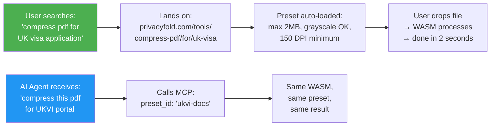
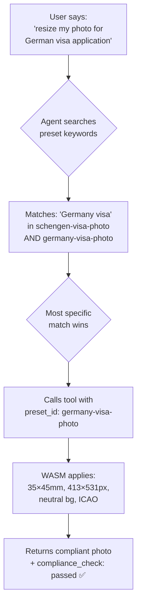
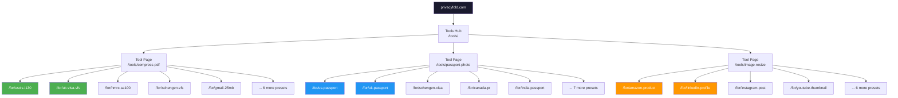

# PrivacyFold — Long-Tail Keyword × Preset Strategy

> **Core Insight:** We don't compete on "compress pdf" (Smallpdf owns that). We own "compress pdf for USCIS I-130 application" — a zero-competition, high-intent, high-CPC long-tail with exact requirements that map 1:1 to a preset. Every preset = a dedicated landing page = a long-tail SEO magnet = an AI-agent callable template.

---

## 🧠 The Fundamental Architecture

```
HEAD TERM (unwinnable)          LONG-TAIL + PRESET (we own this)
─────────────────────           ─────────────────────────────────
"compress pdf"                  "compress pdf for USCIS I-130 under 2MB"
"resize photo"                  "resize photo for UK passport 35x45mm"
"image compressor"              "compress image for Amazon product listing 1000px"
"pdf to word"                   "convert scanned W-2 pdf to editable form"
```

### How It Works End-to-End



### URL Architecture — Each Preset Gets Its Own Page

```
# Base tool page (head term — for internal linking, not ranking)
/tools/compress-pdf

# Long-tail preset pages (these are what we rank for)
/tools/compress-pdf/for/uscis-i130
/tools/compress-pdf/for/uscis-i485
/tools/compress-pdf/for/uk-visa-vfs
/tools/compress-pdf/for/hmrc-self-assessment
/tools/compress-pdf/for/schengen-visa-vfs
/tools/compress-pdf/for/email-under-25mb
/tools/compress-pdf/for/gmail-attachment

# Localized long-tail preset pages
/de/werkzeuge/pdf-komprimieren/fuer/schengen-visum
/fr/outils/compresser-pdf/pour/visa-schengen-vfs
/es/herramientas/comprimir-pdf/para/visa-schengen
```

### Astro Dynamic Route Structure

```
src/pages/
├── [lang]/
│   └── tools/
│       └── [tool]/
│           ├── index.astro          ← Base tool page
│           └── for/
│               └── [preset].astro   ← Long-tail preset page (programmatic)
```

Each `[preset].astro` page is **statically generated at build time** from the preset JSON registry — zero runtime cost.

---

## 📋 Complete Preset Registry

### Category 1: 🇺🇸 US Government & Immigration

| Preset ID | Long-Tail Keyword Target | Exact Requirements | Est. Monthly Searches | CPC |
|---|---|---|---|---|
| `uscis-i130-photo` | resize photo for USCIS I-130 petition | 2×2 in, 600×600px, white bg, <240KB JPEG | 12K | $2.50 |
| `uscis-i485-photo` | photo for I-485 adjustment of status | 2×2 in, 600×600px, white bg, no glasses | 8K | $2.50 |
| `uscis-i765-photo` | photo for I-765 EAD work permit | 2×2 in, 600×600px, white bg | 6K | $2.00 |
| `uscis-n400-photo` | photo for N-400 citizenship application | 2×2 in, 600×600px, white bg, 6mo recent | 5K | $2.00 |
| `us-passport-std` | resize photo for US passport application | 2×2 in, 600×600px, 300 DPI, white bg | 40K | $1.50 |
| `us-passport-renewal` | passport renewal photo requirements 2026 | Same as above + 6-month recency | 25K | $1.50 |
| `irs-w2-pdf` | compress W-2 pdf for tax filing | <2MB, PDF/A compliant, text-searchable | 15K | $5.00 |
| `irs-1099-pdf` | format 1099 for IRS e-filing | <2MB, flattened PDF, no editable fields | 10K | $5.00 |
| `irs-1040-pdf` | compress 1040 tax return pdf | <5MB, PDF/A, IRS e-file ready | 8K | $4.00 |
| `us-visa-ds160-photo` | photo for DS-160 visa application | 600×600px, JPEG, 240KB max, white bg | 20K | $2.00 |
| `uscis-docs-2mb` | compress documents for USCIS under 2MB | PDF, <2MB per file, grayscale OK | 5K | $2.00 |
| `ada-compliant-pdf` | make pdf ADA compliant | Tagged PDF, alt text, reading order | 3K | $4.00 |

### Category 2: 🇬🇧 UK Government & HMRC

| Preset ID | Long-Tail Keyword Target | Exact Requirements | Est. Monthly Searches | CPC |
|---|---|---|---|---|
| `uk-passport-photo` | UK passport photo requirements | 35×45mm, light grey bg, no glasses, 50KB–10MB | 30K | $1.00 |
| `uk-visa-ukvi-photo` | photo for UK visa UKVI application | 600×750px min, JPEG, 50KB–6MB, light grey/cream bg | 15K | $1.50 |
| `uk-visa-vfs-docs` | compress pdf for UK visa VFS Global | <2MB per PDF, grayscale OK, 150 DPI | 8K | $1.50 |
| `ukvcas-docs` | compress documents for UKVCAS portal | <6MB per file, PDF only | 5K | $1.50 |
| `hmrc-sa100` | compress pdf for HMRC self assessment | <5MB per attachment, PDF | 10K | $2.00 |
| `hmrc-sa103` | format documents for HMRC SA103 | <10MB, PDF, text-searchable | 4K | $2.00 |
| `uk-driving-licence-photo` | photo for UK driving licence DVLA | 35×45mm, plain light grey bg | 8K | $0.80 |
| `uk-brp-photo` | BRP biometric residence permit photo | 35×45mm, ICAO compliant | 3K | $1.00 |

### Category 3: 🇪🇺 European / Schengen

| Preset ID | Long-Tail Keyword Target | Exact Requirements | Est. Monthly Searches | CPC |
|---|---|---|---|---|
| `schengen-visa-photo` | Schengen visa photo requirements | 35×45mm, 413×531px at 300DPI, white/light bg, ICAO | 25K | $1.00 |
| `schengen-vfs-docs` | compress pdf for Schengen visa VFS portal | <2MB–5MB per PDF, grayscale OK | 10K | $1.00 |
| `germany-visa-photo` | photo for German visa application | 35×45mm, neutral/light grey bg, ICAO | 8K | $1.20 |
| `france-visa-photo` | photo for French visa France-Visas | 35×45mm, <120KB JPEG, 413×531px | 8K | $1.00 |
| `france-visas-docs` | compress pdf for France-Visas portal | <10MB, PDF preferred | 4K | $1.00 |
| `italy-visa-photo` | photo for Italian visa application | 35×45mm, white bg, ICAO | 5K | $0.80 |
| `spain-visa-photo` | photo for Spanish visa BLS portal | 35×45mm, white bg, ICAO | 5K | $0.80 |
| `netherlands-visa-photo` | photo for Netherlands visa IND | 35×45mm, light bg | 3K | $1.00 |
| `eu-id-card-photo` | photo for EU national ID card | 35×45mm, varies by country | 6K | $0.80 |
| `eu-blue-card-photo` | photo for EU Blue Card application | 35×45mm, ICAO, biometric | 2K | $1.50 |
| `gdpr-data-request-de` | GDPR Auskunftsersuchen Musterbrief | Pre-filled German GDPR template | 3K | $1.50 |
| `gdpr-data-request-fr` | demande d'accès données RGPD modèle | Pre-filled French GDPR template | 2K | $1.00 |

### Category 4: 🇨🇦🇦🇺🇯🇵 Other Tier 1/2 Countries

| Preset ID | Long-Tail Keyword Target | Exact Requirements | Est. Monthly Searches | CPC |
|---|---|---|---|---|
| `canada-pr-photo` | photo for Canada PR permanent residence | 50×70mm, white bg, 420×540px | 8K | $1.50 |
| `canada-passport-photo` | Canada passport photo requirements | 50×70mm, white bg | 12K | $1.20 |
| `canada-visa-docs` | compress pdf for IRCC portal | <4MB per PDF | 5K | $1.20 |
| `australia-visa-photo` | photo for Australian visa ImmiAccount | 35×45mm, light bg, <5MB JPEG | 6K | $1.00 |
| `australia-immi-docs` | compress documents for ImmiAccount | <5MB per file, PDF | 4K | $1.00 |
| `japan-visa-photo` | photo for Japan visa application | 45×45mm, white bg, 4.5×4.5cm | 5K | $0.80 |
| `japan-mynumber-photo` | photo for My Number card Japan | 3.5×4.5cm, white bg | 3K | $0.60 |
| `uae-emirates-id-photo` | photo for Emirates ID ICA | 43×55mm, white bg | 4K | $1.50 |
| `saudi-iqama-photo` | photo for Saudi Iqama renewal | 4×6cm, white bg | 3K | $1.00 |
| `india-passport-photo` | photo for Indian passport PSK portal | 2×2 in (51×51mm), white bg, <300KB | 20K | $0.30 |
| `india-aadhaar-photo` | resize photo for Aadhaar card update | <20KB, JPEG, 190×230px | 15K | $0.10 |
| `india-ssc-photo` | resize photo for SSC exam portal | 100×120px, <50KB, JPEG | 10K | $0.08 |
| `india-upsc-photo` | resize photo for UPSC exam form | 200×230px, <300KB | 8K | $0.08 |

### Category 5: 🛒 E-Commerce Platforms

| Preset ID | Long-Tail Keyword Target | Exact Requirements | Est. Monthly Searches | CPC |
|---|---|---|---|---|
| `amazon-product-photo` | resize image for Amazon product listing | 1000×1000px min (1600+ ideal), pure white bg, JPEG/TIFF, <10MB | 15K | $1.50 |
| `amazon-infographic` | resize infographic for Amazon A+ content | 970×600px, JPEG/PNG, <5MB | 5K | $1.50 |
| `ebay-listing-photo` | resize image for eBay listing | 500–1600px long side, JPEG/PNG, <12MB | 8K | $0.80 |
| `etsy-listing-photo` | resize image for Etsy product listing | 2000×2000px ideal, JPEG/PNG, <10MB | 6K | $0.60 |
| `shopify-product-photo` | resize image for Shopify product | 2048×2048px, JPEG/PNG/WebP, <20MB, compress to <500KB | 8K | $1.00 |
| `shopify-banner` | resize banner for Shopify store | 1200×400px, JPEG/PNG | 3K | $1.00 |
| `amazon-remove-bg` | remove background for Amazon listing white bg | 1000×1000px, pure #FFFFFF bg, JPEG | 8K | $2.00 |
| `ebay-remove-bg` | remove background for eBay product photo | 500×500px min, white bg | 3K | $0.80 |

### Category 6: 💼 Professional & Social Media

| Preset ID | Long-Tail Keyword Target | Exact Requirements | Est. Monthly Searches | CPC |
|---|---|---|---|---|
| `linkedin-photo` | resize photo for LinkedIn profile | 400×400px–7680×7680px, JPEG/PNG, <8MB | 10K | $1.50 |
| `linkedin-banner` | resize LinkedIn background banner image | 1584×396px, JPEG/PNG, <8MB | 5K | $1.00 |
| `linkedin-headshot-crop` | crop professional headshot for LinkedIn | 400×400px, face-centered, circle-safe | 4K | $1.50 |
| `instagram-post` | resize image for Instagram post | 1080×1080px (square), 1080×1350px (portrait) | 12K | $0.40 |
| `instagram-story` | resize image for Instagram story | 1080×1920px, 9:16 ratio | 8K | $0.40 |
| `twitter-header` | resize image for Twitter/X header | 1500×500px, JPEG/PNG | 5K | $0.30 |
| `twitter-profile` | resize photo for Twitter/X profile | 400×400px, JPEG/PNG | 3K | $0.30 |
| `youtube-thumbnail` | resize image for YouTube thumbnail | 1280×720px, JPEG/PNG, <2MB | 15K | $0.50 |
| `tiktok-cover` | resize image for TikTok profile cover | 200×200px profile, 1080×1920px cover | 3K | $0.20 |
| `facebook-cover` | resize image for Facebook cover photo | 820×312px (desktop), 640×360px (mobile) | 8K | $0.30 |
| `whatsapp-dp` | resize image for WhatsApp profile picture | 500×500px, <5MB | 5K | $0.10 |

### Category 7: 📄 PDF for Specific Portals

| Preset ID | Long-Tail Keyword Target | Exact Requirements | Est. Monthly Searches | CPC |
|---|---|---|---|---|
| `email-25mb` | compress pdf for email under 25MB | <25MB (Gmail/Outlook limit) | 20K | $0.30 |
| `email-10mb` | compress pdf for email under 10MB | <10MB (common corporate limit) | 8K | $0.30 |
| `gmail-attachment` | compress pdf for Gmail attachment limit | <25MB, suggest Drive link if larger | 12K | $0.30 |
| `outlook-attachment` | compress pdf for Outlook attachment | <20MB (Outlook limit) | 8K | $0.40 |
| `court-efiling-us` | compress pdf for US court e-filing | <5MB, PDF/A, text-searchable, no security | 3K | $5.00 |
| `court-efiling-uk` | compress pdf for UK court e-filing | <5MB, PDF, no encryption | 2K | $3.00 |
| `notary-pdf` | flatten pdf for notary submission | Flattened, no editable fields, PDF/A | 2K | $3.00 |
| `insurance-claim-pdf` | compress pdf for insurance claim upload | <2MB per doc, PDF, grayscale OK | 3K | $4.00 |
| `university-transcript` | compress transcript pdf for university | <5MB, PDF, color preserved | 5K | $0.50 |
| `job-application-pdf` | compress resume pdf for job portal | <2MB, PDF, ATS-compatible | 10K | $2.00 |
| `rental-application-pdf` | compress documents for rental application | <5MB per doc, PDF | 3K | $1.50 |

### Category 8: 🖥️ Developer Presets

| Preset ID | Long-Tail Keyword Target | Exact Requirements | Est. Monthly Searches | CPC |
|---|---|---|---|---|
| `favicon-gen` | generate favicon from image all sizes | 16×16, 32×32, 48×48, 180×180, 192×192, 512×512 | 8K | $0.30 |
| `ios-app-icon` | resize image for iOS app icon all sizes | 20×20 to 1024×1024 (11 sizes), PNG, no alpha on store | 5K | $0.80 |
| `android-app-icon` | resize image for Android app icon | 48×48 mdpi to 192×192 xxxhdpi, PNG | 4K | $0.80 |
| `og-image` | create og:image for social sharing | 1200×630px, JPEG/PNG | 6K | $0.50 |
| `pwa-icons` | generate PWA manifest icons all sizes | 72 to 512px, PNG, maskable | 2K | $0.30 |
| `apple-touch-icon` | generate apple-touch-icon 180x180 | 180×180px, PNG | 3K | $0.20 |
| `github-social-preview` | resize image for GitHub social preview | 1280×640px, <1MB | 2K | $0.30 |

---

## 🤖 How AI Agents Use Presets

### MCP Tool Call (Agent → PrivacyFold)

When an agent receives a user request like *"Compress my bank statement PDF for the UK visa application"*, it doesn't need to know the specs. It just calls:

```json
{
  "tool": "compress-pdf",
  "params": {
    "preset_id": "uk-visa-vfs-docs",
    "file": "<base64 or file path>"
  }
}
```

The preset automatically applies:
- Max file size: 2MB
- Compression: aggressive (grayscale OK for bank statements)
- DPI: downsample to 150
- Format: PDF (preserved)

### Agent Discovery — Preset Registry Schema

Each tool publishes its presets in the schema so agents can discover them:

```json
{
  "tool": "passport-photo-resizer",
  "version": "2.0.0",
  "description": "Resize and crop a photo to exact passport/visa specifications for any country.",
  "privacy": "zero-upload",
  
  "presets": [
    {
      "preset_id": "us-passport-std",
      "name": "US Passport Photo",
      "description": "2×2 inch, 600×600px, white background, 300 DPI, JPEG",
      "keywords": ["US passport", "American passport", "State Department"],
      "jurisdiction": "US",
      "portal": "travel.state.gov",
      "requirements": {
        "width_px": 600,
        "height_px": 600,
        "width_mm": 51,
        "height_mm": 51,
        "bg_color": "#FFFFFF",
        "dpi": 300,
        "max_file_kb": 240,
        "format": "jpeg",
        "quality": 95,
        "head_size_pct_min": 50,
        "head_size_pct_max": 69,
        "auto_crop_face": true,
        "remove_background": true,
        "glasses_allowed": false,
        "recency_months": 6
      },
      "long_tail_pages": [
        "/tools/passport-photo/for/us-passport",
        "/tools/passport-photo/for/us-passport-renewal",
        "/tools/passport-photo/for/us-passport-baby"
      ],
      "agent_instruction": "Use this preset when the user mentions US passport, American passport, or State Department photo requirements."
    },
    {
      "preset_id": "schengen-visa-photo",
      "name": "Schengen Visa Photo (EU)",
      "description": "35×45mm, 413×531px at 300DPI, ICAO compliant, white or light background",
      "keywords": ["Schengen visa", "EU visa", "Germany visa", "France visa", "Italy visa", "Spain visa", "VFS Global"],
      "jurisdiction": "EU",
      "portal": "VFS Global / BLS International / TLS Contact",
      "requirements": {
        "width_px": 413,
        "height_px": 531,
        "width_mm": 35,
        "height_mm": 45,
        "bg_color": "#F0F0F0",
        "dpi": 300,
        "max_file_kb": 120,
        "format": "jpeg",
        "quality": 90,
        "head_size_mm_min": 32,
        "head_size_mm_max": 36,
        "face_coverage_pct_min": 70,
        "face_coverage_pct_max": 80,
        "auto_crop_face": true,
        "remove_background": true,
        "glasses_allowed": false,
        "recency_months": 6
      },
      "long_tail_pages": [
        "/tools/passport-photo/for/schengen-visa",
        "/tools/passport-photo/for/germany-visa",
        "/tools/passport-photo/for/france-visa",
        "/tools/passport-photo/for/italy-visa",
        "/tools/passport-photo/for/spain-visa",
        "/tools/passport-photo/for/netherlands-visa"
      ],
      "agent_instruction": "Use this preset for any Schengen area visa photo. Covers Germany, France, Italy, Spain, Netherlands, Austria, Belgium, etc."
    }
  ]
}
```

### AI Agent Routing Logic



---

## 📄 Programmatic SEO Page Template

Every preset generates a dedicated landing page at build time. Here's what each page contains:

### Page Structure (`/tools/compress-pdf/for/uk-visa-vfs`)

```
┌─────────────────────────────────────────────────────┐
│  H1: Compress PDF for UK Visa (VFS Global Portal)   │
│  Subtitle: "Reduce your documents to under 2MB      │
│  — processed 100% in your browser, never uploaded"   │
│                                                      │
│  ┌──── REQUIREMENTS CARD ────┐                       │
│  │ ✅ Max file size: 2MB      │  ← Auto-applied      │
│  │ ✅ Format: PDF             │     by preset         │
│  │ ✅ Grayscale: OK           │                       │
│  │ ✅ Min DPI: 150            │                       │
│  └───────────────────────────┘                       │
│                                                      │
│  ┌──── DROP ZONE (preset pre-loaded) ────┐           │
│  │                                        │           │
│  │   Drop your bank statement,            │           │
│  │   payslips, or letter here             │           │
│  │                                        │           │
│  └────────────────────────────────────────┘           │
│                                                      │
│  ── FAQ Section (Schema.org FAQ markup) ──           │
│  Q: What is the max PDF size for UK visa VFS?        │
│  A: VFS Global portals accept 2MB-5MB per file...    │
│                                                      │
│  Q: Is it safe to compress visa documents online?    │
│  A: PrivacyFold processes 100% in your browser...    │
│                                                      │
│  Q: What documents need to be compressed for UK visa?│
│  A: Bank statements, payslips, employment letters... │
│                                                      │
│  ── Related Presets ──                               │
│  • Compress PDF for UKVCAS portal (6MB limit)        │
│  • UK Visa Photo (UKVI requirements)                 │
│  • Compress PDF for Schengen Visa VFS                │
│                                                      │
│  ── Schema.org Markup (invisible) ──                 │
│  SoftwareApplication + HowTo + FAQ + BreadcrumbList  │
└─────────────────────────────────────────────────────┘
```

### Schema.org Markup Per Preset Page

```json
{
  "@context": "https://schema.org",
  "@type": "SoftwareApplication",
  "name": "Compress PDF for UK Visa — PrivacyFold",
  "description": "Compress PDF documents to under 2MB for VFS Global UK visa portal. 100% browser-based, zero upload, free.",
  "applicationCategory": "UtilitiesApplication",
  "operatingSystem": "Web Browser",
  "offers": {
    "@type": "Offer",
    "price": "0",
    "priceCurrency": "GBP"
  },
  "featureList": [
    "Compresses to UK visa VFS portal requirements (2MB max)",
    "Zero file upload — processes in your browser",
    "No account or registration required",
    "GDPR compliant — no data leaves your device"
  ]
}
```

---

## 📊 Revenue Impact — Long-Tail vs Head Terms

| Metric | Head Term Page<br/>("/tools/compress-pdf") | Long-Tail Preset Page<br/>("/tools/compress-pdf/for/uscis-i130") |
|---|---|---|
| **Competition** | Impossible (Smallpdf DA 90+) | Zero to Low |
| **Search Intent** | Informational / navigational | Transactional (ready to use) |
| **Conversion Rate** | ~2-5% (browsing) | ~30-60% (knows exactly what they need) |
| **AdSense CPC** | $0.20–$0.50 (generic) | $2.00–$5.00 (immigration/tax niche) |
| **AI Citation Likelihood** | Low (generic answer) | Very High (specific, authoritative) |
| **Bounce Rate** | High (too generic) | Low (exact match to query) |

### Estimated Page Count from Presets

| Category | Preset Count | × Locales | = Total Pages |
|---|---|---|---|
| US Government & Immigration | 12 | × 1 (en only) | 12 |
| UK Government & HMRC | 8 | × 1 (en only) | 8 |
| EU / Schengen | 12 | × 8 (en, de, fr, es, it, nl, pt, pl) | 96 |
| CA / AU / JP / UAE / SA | 10 | × 2 (en + local) | 20 |
| India (Tier 3 but massive volume) | 4 | × 2 (en + hi) | 8 |
| E-Commerce | 8 | × 5 (en, de, fr, es, it) | 40 |
| Social Media | 11 | × 5 | 55 |
| PDF for Portals | 11 | × 5 | 55 |
| Developer | 7 | × 1 (en only) | 7 |
| **TOTAL** | **83 presets** | | **~301 pages** |

> **301 unique, programmatically generated, keyword-targeted landing pages — each one a specific long-tail SEO opportunity — all generated from a single preset JSON registry at build time. Zero manual content creation.**

---

## 🔗 Integration with `llms.txt` and AI Discovery

### Updated `llms.txt` Structure

```markdown
# PrivacyFold

> 60+ privacy-first browser tools. All processing in your browser via WASM. Zero upload. Free.

## Tools

### Passport Photo Resizer
- Presets: US Passport, UK Passport, Schengen Visa, Canada PR, Australia Visa, Japan Visa, India Passport
- Use when: User needs to resize/crop a photo for any passport or visa application
- Each preset knows the exact dimensions, DPI, background color, and file size requirements

### PDF Compressor
- Presets: USCIS (2MB), UK Visa VFS (2MB), HMRC (5MB), Schengen VFS (5MB), Gmail (25MB), Court e-filing (5MB)
- Use when: User needs to compress a PDF for a specific portal or email attachment limit
- Each preset auto-applies the correct maximum file size and compression level

### Image Resizer
- Presets: Amazon Product (1000px), Shopify Product (2048px), LinkedIn Profile (400px), Instagram Post (1080px), YouTube Thumbnail (1280×720)
- Use when: User needs to resize an image for a specific platform
- Each preset knows the exact dimensions and format requirements

[... full tool list with all presets ...]
```

### `/.well-known/ai-tools.json` — Preset-Aware

```json
{
  "name": "PrivacyFold",
  "description": "Privacy-first browser tools with 80+ presets for specific portals and platforms",
  "tools": [
    {
      "id": "compress-pdf",
      "presets": ["uscis-docs", "uk-visa-vfs", "hmrc-sa100", "schengen-vfs", "gmail-25mb", "court-efiling"],
      "schema_url": "/schemas/compress-pdf.json"
    },
    {
      "id": "passport-photo",
      "presets": ["us-passport-std", "uk-passport", "schengen-visa", "canada-pr", "australia-visa"],
      "schema_url": "/schemas/passport-photo.json"
    }
  ]
}
```

---

## 🏗️ Content Collection Schema (Astro)

### `src/content/config.ts` — Preset Collection

```typescript
import { defineCollection, z } from 'astro:content';

const presetsCollection = defineCollection({
  type: 'data',
  schema: z.object({
    preset_id: z.string(),
    tool_id: z.string(),
    name: z.string(),
    description: z.string(),
    keywords: z.array(z.string()),
    jurisdiction: z.string().optional(),
    portal: z.string().optional(),
    portal_url: z.string().url().optional(),
    
    // SEO
    long_tail_title: z.string(),         // "Compress PDF for UK Visa (VFS Global)"
    long_tail_description: z.string(),   // Meta description
    slug: z.string(),                    // "uk-visa-vfs"
    localized_slugs: z.record(z.string()).optional(), // { de: "uk-visum-vfs", fr: "visa-uk-vfs" }
    
    // Requirements (varies by tool type)
    requirements: z.record(z.any()),
    
    // FAQ for schema markup
    faq: z.array(z.object({
      question: z.string(),
      answer: z.string(),
    })).optional(),
    
    // Agent
    agent_instruction: z.string(),
    
    // Revenue
    estimated_cpc: z.number().optional(),
    estimated_monthly_searches: z.number().optional(),
  }),
});

export const collections = {
  presets: presetsCollection,
};
```

### Example Preset Data File: `src/content/presets/uk-visa-vfs-docs.json`

```json
{
  "preset_id": "uk-visa-vfs-docs",
  "tool_id": "compress-pdf",
  "name": "Compress PDF for UK Visa (VFS Global)",
  "description": "Compress your bank statements, payslips, and supporting documents to under 2MB for VFS Global UK visa portal upload.",
  "keywords": ["UK visa", "VFS Global", "compress pdf UK", "visa documents", "UKVI"],
  "jurisdiction": "UK",
  "portal": "VFS Global",
  "portal_url": "https://visa.vfsglobal.com/",
  
  "long_tail_title": "Compress PDF for UK Visa Application — VFS Global Portal | PrivacyFold",
  "long_tail_description": "Free online tool to compress PDF documents to under 2MB for UK visa VFS Global portal. 100% browser-based processing — your documents never leave your device.",
  "slug": "uk-visa-vfs",
  "localized_slugs": {
    "de": "uk-visum-vfs",
    "fr": "visa-uk-vfs",
    "es": "visa-uk-vfs"
  },
  
  "requirements": {
    "max_file_size_mb": 2,
    "format": "pdf",
    "grayscale_ok": true,
    "min_dpi": 150,
    "flatten": false,
    "compression_level": "aggressive"
  },
  
  "faq": [
    {
      "question": "What is the maximum PDF file size for UK visa VFS Global portal?",
      "answer": "VFS Global portals for UK visa applications typically accept PDF files up to 2MB–5MB per document. We recommend compressing to under 2MB to ensure reliable uploading."
    },
    {
      "question": "Is it safe to compress my visa documents online?",
      "answer": "PrivacyFold processes your documents 100% inside your browser using WebAssembly. Your files are never uploaded to any server. Zero data leaves your device."
    },
    {
      "question": "Which documents should I compress for a UK visa application?",
      "answer": "Common documents that may need compression include bank statements (often multi-page scans), payslips, employment letters, tenancy agreements, and travel itineraries."
    }
  ],
  
  "agent_instruction": "Use this preset when the user mentions UK visa, British visa, VFS Global UK, or needs to compress documents for a UKVI application.",
  
  "estimated_cpc": 1.50,
  "estimated_monthly_searches": 8000
}
```

---

## 📈 Long-Tail SEO Hierarchy



---

## 🎯 Summary — Why This Wins

| Smallpdf / iLovePDF | PrivacyFold |
|---|---|
| "Compress PDF" (one generic page) | 11+ pages: "Compress PDF for USCIS", "for UK Visa", "for HMRC", "for Gmail"... |
| No presets — user configures everything | Preset auto-applies exact portal requirements |
| Uploads to server | Zero-upload, browser-only |
| Can't be called by AI agents easily | MCP `preset_id: "uk-visa-vfs"` — one line |
| One language | 25 locales × 83 presets = 300+ pages |
| Competes on head terms (DA 90+) | Owns long-tail (zero competition) |
| Charges for premium features | Always free (ad-supported) |

> **The preset IS the product. The long-tail page IS the distribution. The MCP schema IS the moat.**

