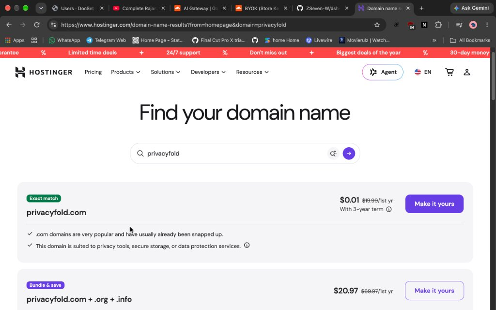
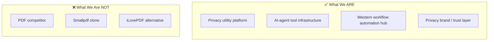
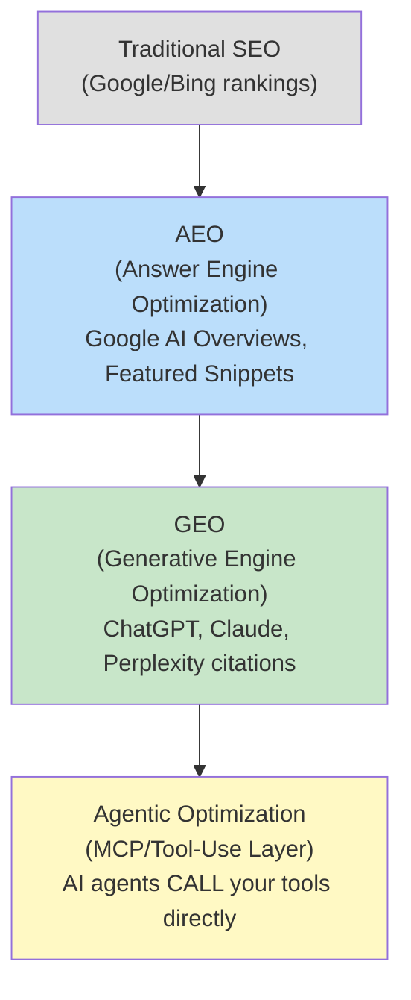
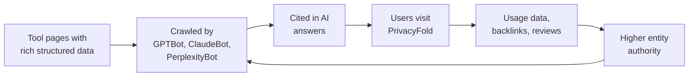
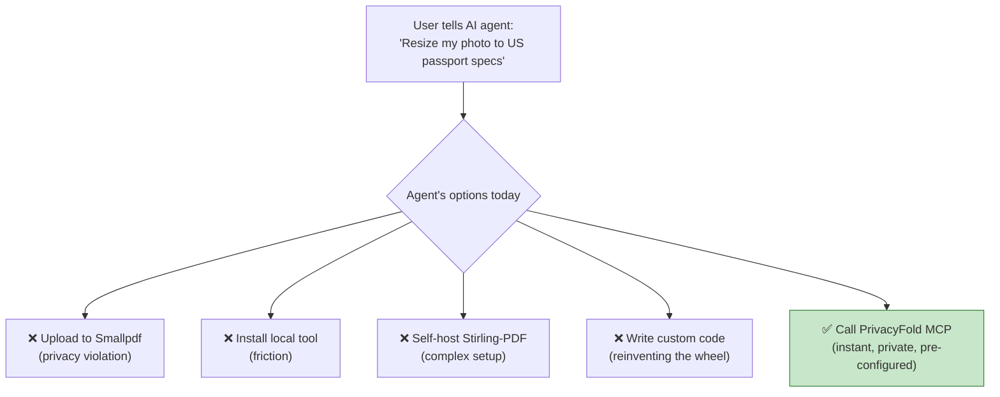
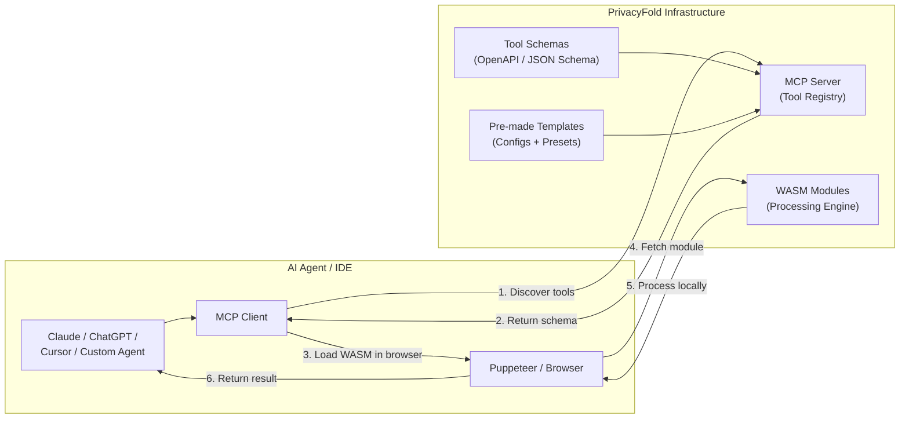
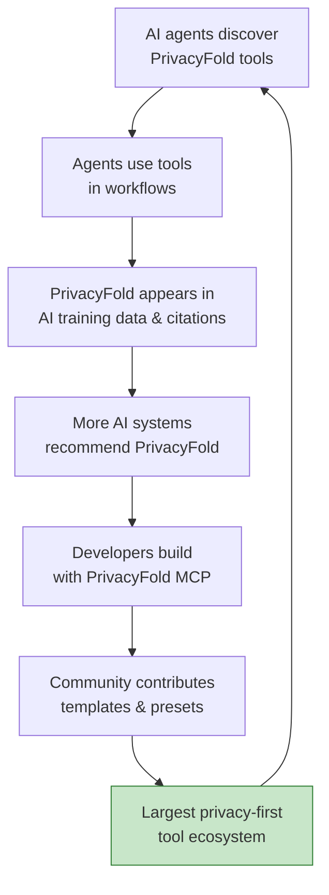
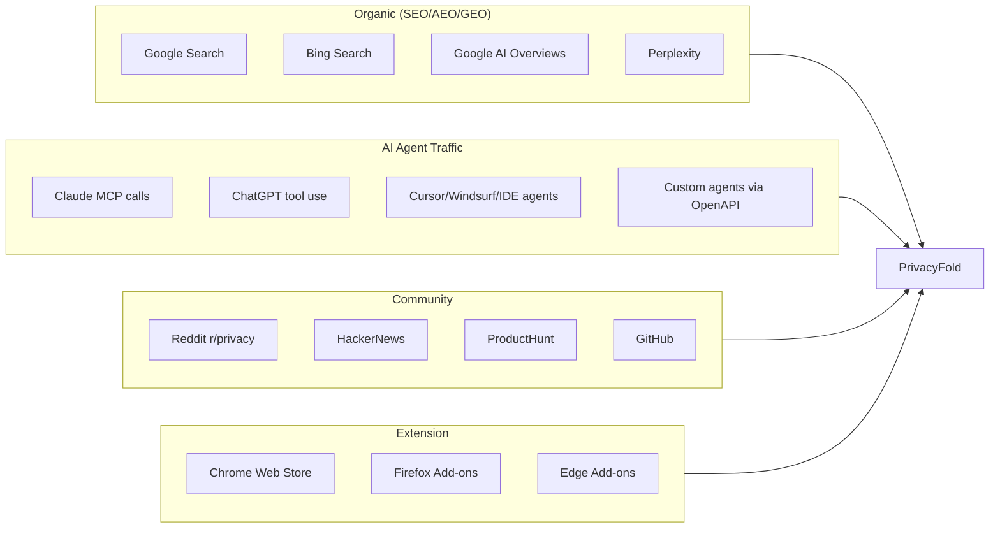

# PrivacyFold.com — Revised Strategy & Market Analysis



> **Vision:** A privacy-first, 100% client-side utility platform for Western markets — **not** a PDF competitor, but a **privacy infrastructure brand** that becomes the default tool layer for both humans and AI agents.

> [!IMPORTANT]
> **Core Principles (from your feedback):**
> - ❌ We do NOT compete with Smallpdf, iLovePDF, PDF24, etc.
> - ✅ Always free, non-intrusive ads only
> - ✅ Hosted and free (unlike Stirling-PDF which requires self-deployment)
> - ✅ Dominate AEO, GEO, AI Citations, and agentic workflows
> - ✅ MCP Server + Browser Extension for AI agent consumption
> - ✅ Pre-made templates with published schemas for zero-prompt tool use

---

## 1. Positioning: What PrivacyFold Actually Is



**PrivacyFold = The privacy-first utility layer that humans AND AI agents reach for when they need to process anything sensitive — documents, images, data, forms — without ever uploading to a server.**

---

## 2. Western-Specific Tools — Full Catalog with Competition Mapping

### 📄 Document & Form Tools

| Tool | Western Use Case | Existing Competition | Gap You Fill |
|---|---|---|---|
| **US Tax Form Viewer/Filler** (W-2, 1099, W-9, 1040-EZ) | 150M+ US tax filers annually | IRS Free File (clunky), TurboTax (paid), FreeTaxUSA | Free, private, no-upload form prep |
| **UK Self-Assessment Helper** (SA100, SA103, SA800) | 12M+ UK self-assessment filers | HMRC portal (basic), GoSimpleTax (paid) | Offline form prep before submission |
| **USCIS Immigration Form Formatter** (I-130, I-485, I-765, N-400) | ~8M applications/year | Boundless (paid), DocketWise (B2B) | Free formatting, no data leaves device |
| **EU Apostille Document Prep** | Cross-border document authentication | Manual notary processes | Template + formatting tool |
| **Lease/Rental Agreement Generator** | ~44M US renter households | LegalZoom (\$), Rocket Lawyer (\$) | Free templates, edit locally |
| **NDA / Simple Contract Generator** | Freelancers, small businesses | DocuSign (paid), PandaDoc (paid) | Private, no-upload, template-based |
| **ADA-Compliant PDF Generator** | US accessibility law compliance | Adobe (\$\$), CommonLook (\$\$) | Free accessibility checker/fixer |
| **eIDAS-Compliant Document Signer** | EU electronic signatures | DocuSign, Adobe Sign (paid) | Basic local signing, free |
| **PDF Flattener / Form Locker** | USCIS, HMRC, IRS submission prep | Adobe (\$), Sejda (limited free) | Unlimited, private |
| **Document Redactor** (PII blackout) | Legal, medical, financial docs | Adobe (\$\$), manual tools | AI-free local redaction |

### 📸 Photo & Image Tools

| Tool | Western Use Case | Existing Competition | Gap You Fill |
|---|---|---|---|
| **US Passport Photo** (2×2 in, 600×600px) | ~22M US passports issued/yr | ePassportPhoto (\$), IDPhoto4You (uploads) | ReSizer.AI exists but not a full suite |
| **UK Passport Photo** (35×45mm) | ~7M UK passports/yr | Passport Photo Online (uploads) | Zero-upload, instant |
| **EU/Schengen Visa Photo** (35×45mm, ICAO) | ~15M Schengen visas/yr | Scattered small sites | All-in-one with country presets |
| **Canadian PR/Visa Photo** (50×70mm) | ~500K applications/yr | Few reliable free tools | Country-specific presets |
| **Australian Visa Photo** (35×45mm) | ~8M visas/yr | Limited free options | Preset library |
| **Professional LinkedIn Headshot Cropper** | 310M+ US LinkedIn users | Canva (generic), Fotor | Optimized crop + compression |
| **Social Media Image Resizer** (all platforms) | Billions of posts/month | Canva, Kapwing (require accounts) | No account, instant, all presets |
| **HEIC → JPG/PNG Converter** | iPhone users worldwide | iMazing (paid), CloudConvert (uploads) | Client-side, instant |
| **WebP → JPG/PNG Converter** | Web developers, designers | Convertio (uploads), CloudConvert | No upload needed |
| **Image EXIF Stripper** | Privacy-conscious photo sharing | Scattered tools, Jimpl | Part of the suite |
| **Image Background Remover** | E-commerce, social media | Remove.bg (freemium), Canva | WASM-based, local |
| **Bulk Image Compressor** | Web developers, email marketing | TinyPNG (uploads, limits) | Unlimited, private |
| **Image Watermarker** | Photographers, creators | Canva, Watermarkly (uploads) | Never uploads originals |
| **Screenshot Annotator** | Bug reports, documentation | Markup Hero, Snagit (paid) | Browser-native, private |

### 🔧 Developer & Tech Tools

| Tool | Western Use Case | Existing Competition | Gap You Fill |
|---|---|---|---|
| **QR Code Generator** (custom, SVG) | Menus, marketing, payments | QRCode Monkey, QR Tiger (track users) | Zero-tracking QR codes |
| **Barcode Generator** (UPC-A, EAN-13, Code 128) | E-commerce, inventory | Online Barcode Generator (ads) | Clean, private, SVG output |
| **Hash Generator** (MD5, SHA-256, SHA-512) | DevOps, security, file verification | CyberChef (complex UI) | Simple UI, client-side |
| **Base64 Encoder/Decoder** | Web developers | Scattered tools | Part of dev toolkit |
| **JWT Decoder** | API developers | jwt.io (sends to server?) | Guaranteed client-side |
| **JSON Formatter / Validator** | Developers | JSONLint (basic) | With schema validation |
| **Regex Tester** | Developers | Regex101 (tracks queries) | Private, no tracking |
| **Color Picker / Converter** (HEX↔RGB↔HSL↔CMYK) | Designers, developers | Google's built-in (basic) | Full converter with accessibility checker |
| **Unit Converter** (Imperial↔Metric) | US/UK daily life | Google (basic) | Comprehensive, offline-capable |
| **Epoch/Unix Timestamp Converter** | Developers | EpochConverter.com | Client-side, dev toolkit |
| **UUID/GUID Generator** | Developers | Online UUID Generator | Bulk, client-side |
| **Cron Expression Builder** | DevOps, SREs | Crontab Guru | Visual builder |
| **Lorem Ipsum Generator** | Designers, developers | Lipsum.com | Multiple styles, languages |
| **Markdown Editor / Previewer** | Writers, developers | Dillinger.io, StackEdit | Private, no account |
| **Diff Checker** (text/code) | Developers, legal | Diffchecker.com (uploads) | Private, client-side |
| **CSV ↔ JSON ↔ XML Converter** | Data engineers, analysts | ConvertCSV (uploads) | Never uploads data |
| **SQL Formatter** | Database developers | SQLFormat.org | Client-side |
| **HTML/CSS/JS Minifier** | Web developers | Minifier.org | Part of dev suite |
| **SSL Certificate Decoder** | DevOps | SSLShopper | Client-side parsing |
| **API Request Builder** (cURL ↔ fetch ↔ axios) | Developers | Postman (heavy), HTTPie | Lightweight, private |

### 📊 Data & Privacy Tools

| Tool | Western Use Case | Existing Competition | Gap You Fill |
|---|---|---|---|
| **Password Generator** (configurable) | Everyone | 1Password (upsell), LastPass | No tracking, configurable |
| **GDPR Data Request Letter Generator** | EU citizens' rights | Manual templates | Pre-built, localized |
| **CCPA Opt-Out Request Generator** | California residents | Limited tools | Template-based |
| **Email Header Analyzer** | IT admins, security teams | MXToolbox (uploads) | Client-side analysis |
| **IP/DNS Lookup Tool** | Network admins, security | What Is My IP (ads) | Clean, ad-light |
| **Privacy Policy Generator** | Small businesses, startups | TermsFeed (\$), Iubenda (\$) | Free, GDPR+CCPA compliant |
| **Cookie Consent Banner Generator** | Website owners (GDPR) | CookieBot (\$), OneTrust (\$\$) | Free basic generator |
| **Data Breach Notification Drafter** | Businesses (GDPR Art.33) | No free tools | Template-based |
| **Encryption/Decryption Tool** (AES-256) | Privacy-conscious users | VeraCrypt (desktop only) | Browser-based, instant |
| **Secure Note Sharer** (self-destructing) | Business communication | PrivateBin (self-hosted) | Hosted free, zero-knowledge |

### 📋 Business & Productivity

| Tool | Western Use Case | Existing Competition | Gap You Fill |
|---|---|---|---|
| **Invoice Generator** | Freelancers, SMBs | Wave (\$), FreshBooks (\$) | Free, private, no account |
| **Receipt Scanner / Organizer** | Expense tracking | Expensify (\$), Dext (\$) | Local OCR, no upload |
| **Business Card Scanner** | Networking, CRM | CamCard (uploads) | Local processing |
| **Resume/CV Builder** (ATS-optimized) | ~6M monthly job seekers US | Resume.io (\$), Zety (\$) | Free, never stores your resume |
| **Cover Letter Generator** | Job applicants | Kickresume (\$) | Template-based, private |
| **Meeting Notes Template Formatter** | Remote workers | Notion (heavy), Fellow (\$) | Lightweight, no account |
| **Time Zone Converter** | Global remote teams | WorldTimeBuddy | Clean UI, no tracking |
| **Pomodoro Timer** | Productivity seekers | Pomofocus.io | Part of productivity suite |

---

## 3. The AEO / GEO / AI Citation Domination Strategy

> [!IMPORTANT]
> This is where PrivacyFold separates from every competitor. Nobody else is thinking about this.

### Understanding the Three Layers



### 3.1 AEO Strategy (Answer Engines)

**Goal:** When someone asks Google AI Overview or Bing AI *"how to resize US passport photo privately"*, PrivacyFold IS the answer.

| Tactic | Implementation |
|---|---|
| **Question-first content architecture** | Every tool page starts with "What is [tool]? → How to use → Why private" |
| **FAQ Schema markup** | JSON-LD FAQ schema on every tool page |
| **Product Schema** | Mark each tool as a `SoftwareApplication` with `offers: {price: "0"}` |
| **HowTo Schema** | Step-by-step structured data for every tool workflow |
| **Concise answer blocks** | 40-word answer paragraphs optimized for extraction |
| **Comparison tables** | "PrivacyFold vs [competitor]" — structured for snippet extraction |
| **Speed signals** | Sub-2s load times, Core Web Vitals green across all tools |

### 3.2 GEO Strategy (AI Citations)

**Goal:** When ChatGPT/Claude/Perplexity is asked *"what's a free private tool to generate a QR code"*, they cite PrivacyFold.

| Tactic | Implementation |
|---|---|
| **Entity authority building** | Wikipedia mention, Crunchbase profile, Wikidata entry |
| **Earned media (80% of GEO)** | Get listed on: PrivacyTools.io, AlternativeTo, ProductHunt, HackerNews, Reddit r/privacy, r/selfhosted, r/webdev |
| **Factual density** | Every tool page includes processing stats, specs, format support tables |
| **Open-source credibility** | Open-source the WASM core → GitHub stars → LLM training data |
| **"Share of Model" tracking** | Monthly audit: query ChatGPT/Claude/Perplexity with 50 target queries, track citation rate |
| **Authoritative blog content** | Technical deep-dives: "How WASM processes your PDF without a server" |
| **Reddit/community presence** | Active participation in r/privacy, r/webdev, r/sysadmin with genuine value |
| **Third-party roundup seeding** | Pitch to "Best free tools" lists on TechRadar, Tom's Guide, PCMag, Wired |

### 3.3 AI Citation Flywheel



---

## 4. 🚀 The Agentic Play — MCP Server + Browser Extension

> [!IMPORTANT]
> **This is the breakthrough idea.** Nobody in the privacy-tools space is building for AI agent consumption. PrivacyFold becomes the first **"tool-as-infrastructure"** that AI agents can natively call.

### 4.1 The Problem You're Solving



**Today's pain:**
- AI agents (Claude, ChatGPT, Cursor, Windsurf, etc.) need to process files but have no reliable, private tools
- Open-source models can't easily use tools — they need pre-defined schemas
- Users prompt again and again for simple requirements that should be one-click
- Existing MCP tools for document processing are all **server-side** or **require local installation**

**PrivacyFold's answer:** Pre-built, schema-documented tools that run in WASM — in the agent's browser/puppeteer — with zero server involvement.

### 4.2 Architecture: How It Works



### 4.3 Published Tool Schema Example

Every PrivacyFold tool publishes a **machine-readable schema** that AI agents can discover and call without human prompting:

```json
{
  "tool": "passport-photo-resizer",
  "version": "1.0.0",
  "description": "Resize and crop a photo to exact passport specifications for any country. Runs 100% client-side via WASM.",
  "privacy": "zero-upload",
  "execution": "wasm-browser",
  
  "input": {
    "required": {
      "image": { "type": "file", "formats": ["jpg", "png", "heic", "webp"], "max_size_mb": 50 },
      "country": { "type": "enum", "values": ["US", "UK", "CA", "AU", "EU_SCHENGEN", "IN", "..."], "default": "US" }
    },
    "defaults": {
      "US": { "width_px": 600, "height_px": 600, "dpi": 300, "bg_color": "#FFFFFF", "head_size_pct": "50-69" },
      "UK": { "width_mm": 35, "height_mm": 45, "dpi": 300, "bg_color": "#D3D3D3" }
    },
    "advanced": {
      "auto_crop_face": { "type": "bool", "default": true },
      "remove_background": { "type": "bool", "default": true },
      "output_format": { "type": "enum", "values": ["jpg", "png"], "default": "jpg" },
      "output_quality": { "type": "int", "min": 1, "max": 100, "default": 95 },
      "print_sheet": { "type": "bool", "default": false, "description": "Generate 4x6 print sheet with multiple copies" }
    }
  },
  
  "output": {
    "processed_image": { "type": "file", "format": "jpg|png" },
    "metadata": {
      "original_dimensions": "string",
      "output_dimensions": "string",
      "file_size_kb": "number",
      "compliance_check": { "passed": "bool", "issues": ["string"] }
    }
  },
  
  "wasm_module_url": "https://privacyfold.com/wasm/passport-photo-v1.wasm",
  "web_url": "https://privacyfold.com/tools/passport-photo-resizer",
  "templates": [
    { "name": "US Passport (Standard)", "preset_id": "us-passport-std" },
    { "name": "UK Passport (Adult)", "preset_id": "uk-passport-adult" },
    { "name": "Schengen Visa", "preset_id": "eu-schengen-visa" }
  ]
}
```

### 4.4 Three Distribution Channels

#### Channel 1: MCP Server (for Claude, Cursor, Windsurf, etc.)

```json
{
  "mcpServers": {
    "privacyfold": {
      "url": "https://mcp.privacyfold.com/sse",
      "description": "50+ privacy-first browser tools. All processing happens client-side via WASM."
    }
  }
}
```

- Listed on mcpservers.org, mcp.so, Smithery
- One-line config to add to any MCP client
- Tools auto-discovered by agents
- **The agent loads privacyfold.com in puppeteer → runs WASM → gets result — zero server processing**

#### Channel 2: Browser Extension (for everyone)

- Right-click any image → "Process with PrivacyFold"
- AI sidebar integration (works with Sider, Monica, Harpa)
- Context-aware: detects file types and suggests relevant tools
- Keyboard shortcuts for power users
- **Agentic mode:** Extension exposes tools to any page-level AI agent

#### Channel 3: Web Tool Registry (OpenAPI / JSON Schema)

```
https://privacyfold.com/.well-known/ai-tools.json
https://privacyfold.com/api/tools/{tool-id}/schema.json
```

- Machine-readable tool registry at a well-known URL
- Any AI system can discover and call tools
- OpenAPI-compatible for integration with LangChain, CrewAI, AutoGen, etc.
- **The "robots.txt for AI tools"** — you're setting the standard

### 4.5 Pre-made Templates & Presets — Zero-Prompt Workflows

> [!TIP]
> **This is the killer feature.** Instead of prompting "resize to 600x600, white background, 300 DPI, JPEG, 95% quality..." the agent just calls `preset_id: "us-passport-std"` and it's done.

| Template Category | Example Presets |
|---|---|
| **Passport/Visa Photos** | US Passport, UK Passport, Schengen Visa, Canadian PR, Australian Visa, Indian Passport (35×35mm), Japanese Visa |
| **Government Forms** | W-2 Prep, 1099 Layout, I-130 Photo Requirements, UK SA100 Format |
| **Social Media** | Instagram Square, Twitter Header, LinkedIn Banner, YouTube Thumbnail, TikTok Cover |
| **E-commerce** | Amazon Product (1000×1000), eBay Listing, Etsy Thumbnail, Shopify Product |
| **Print** | US Letter, A4, 4×6 Photo Print, Business Card (US/EU sizes) |
| **Developer** | Favicon Generator, App Icon (iOS/Android all sizes), OG Image (1200×630) |
| **Email** | Email Header (600px wide), Email Signature Image |
| **Documents** | ATS Resume PDF, Cover Letter Format, Invoice Template |

### 4.6 Why This Creates an Unassailable Moat



**The moat is not the tools — it's the ecosystem:**
1. **Network effects:** More templates → more agent usage → more citations → more users
2. **Standard-setting:** If you define how AI agents consume tools, competitors have to follow YOUR schema
3. **Training data gravity:** Every AI model trained on internet data will know "PrivacyFold = privacy tools"
4. **Developer lock-in:** Once devs integrate your MCP server, switching cost is real

---

## 5. Competition Reality Check

### Direct Competitors (Client-Side Privacy Tools)

| Competitor | Traffic Estimate | Tools | MCP? | Extension? | Presets? | Threat Level |
|---|---|---|---|---|---|---|
| **AltFTool** | Growing, small | Multi-utility directory | ❌ | ❌ | ❌ | 🟡 Low |
| **PDFWix** | Small | PDF-focused only | ❌ | ❌ | ❌ | 🟢 Very Low |
| **MegaTools** | Small | Broad but shallow | ❌ | ❌ | ❌ | 🟢 Very Low |
| **PixelTools** | Small | Image + PDF | ❌ | ❌ | ❌ | 🟢 Very Low |
| **ihatepdf** | Small | PDF only | ❌ | ❌ | ❌ | 🟢 Very Low |
| **Stirling-PDF** | Dev community | PDF (self-hosted) | ❌ | ❌ | ❌ | 🟢 Very Low (different model) |
| **ReSizer.AI** | Moderate | Photo resizing only | ❌ | ❌ | Some | 🟡 Low |
| **ImResizer** | Moderate | Image tools | ❌ | ❌ | Some | 🟡 Low |
| **InkwellTools** | Small | Mixed utilities | ❌ | ❌ | ❌ | 🟢 Very Low |
| **CyberChef** | Dev community | Data encoding/crypto | ❌ | ❌ | ❌ | 🟡 Low (different audience) |

> [!NOTE]
> **Key finding: NOBODY in this space is building MCP servers, AI-agent tool schemas, or pre-made templates. This is a wide-open field. You would be first.**

### Adjacent Competitors (Hosted/Server-side — NOT direct competition)

| Platform | Why They're NOT Your Competition |
|---|---|
| Smallpdf, iLovePDF, PDF24 | Server-side, PDF-focused. Different value proposition entirely |
| TinyWow | Server-side, ad-heavy, daily limits |
| Canva | Design tool, not utility tool |
| Adobe Online | Enterprise, paid, server-side |
| Google/Microsoft built-in | Basic, not privacy-focused |

---

## 6. Traffic & Revenue Model

### Revenue: Always Free + Non-Intrusive Ads

| Revenue Stream | Implementation |
|---|---|
| **Privacy-respecting display ads** | Carbon Ads, EthicalAds, BuySellAds (no tracking pixels, no behavioral targeting) |
| **Sponsored tool placement** | "Powered by [sponsor]" on specific tools |
| **Affiliate referrals** | Recommend privacy products (VPNs, password managers) |
| **White-label licensing** (future) | Enterprises embed your WASM tools |

### Traffic Sources



### Estimated Traffic Potential (12-month projection)

| Source | Month 1-3 | Month 4-6 | Month 7-12 |
|---|---|---|---|
| Organic SEO | 5K/mo | 50K/mo | 500K/mo |
| AI Agent/MCP traffic | 1K/mo | 20K/mo | 200K+/mo |
| AI Citation referrals | 500/mo | 10K/mo | 100K+/mo |
| Extension users | 500 installs | 5K installs | 50K+ installs |
| Reddit/Community | 2K/mo | 10K/mo | 30K/mo |
| **Total** | **~9K/mo** | **~95K/mo** | **~880K+/mo** |

---

## 7. Go-To-Market Phases


### Phase 1: Launch MVP (Month 1-2)
- 15-20 core tools (passport photo, QR code, hash generator, image converter, etc.)
- Full AEO-optimized pages with schema markup
- Open-source WASM core on GitHub
- Submit to ProductHunt, HackerNews, r/privacy

### Phase 2: AI Layer (Month 3-4)
- Launch MCP Server with 20+ tools
- Publish tool schemas at `/.well-known/ai-tools.json`
- Release browser extension (Chrome + Firefox)
- List on mcpservers.org, mcp.so, Smithery
- Release pre-made template library (50+ presets)
- Submit to Antigravity Marketplace, Cursor Directory

### Phase 3: Growth (Month 5-8)
- Expand to 50+ tools
- GEO campaign: get cited by ChatGPT, Claude, Perplexity
- Earned media push: TechRadar, PCMag, Wired, Tom's Guide
- Developer docs for custom template creation
- Community template submissions

### Phase 4: Dominate (Month 9-12)
- 100+ tools and 200+ templates
- Become the default AI-agent tool layer
- API for enterprise embedding
- Set the standard for `/.well-known/ai-tools.json`
- International expansion (localized for DE, FR, ES, IT, NL, etc.)

---

## 8. Final Verdict

| Factor | Rating | Why |
|---|---|---|
| **Market Demand** | 🟢🟢🟢 | Regulatory tailwinds, privacy awareness, AI agent explosion |
| **Competition** | 🟢🟢🟢 | Fragmented, nobody doing MCP/agentic play |
| **Timing** | 🟢🟢🟢 | MCP is nascent, GEO is emerging — perfect entry window |
| **Technical Feasibility** | 🟢🟢🟢 | DocSet.in proves the WASM engine works |
| **Agentic Moat** | 🟢🟢🟢 | First-mover in tool-as-infrastructure for AI agents |
| **Revenue Risk** | 🟡 | Ad-only model needs high volume (achievable with AI traffic) |
| **Execution Risk** | 🟡 | Lots of tools to build, but can be phased |

> [!CAUTION]
> **The window for the agentic play is narrow.** MCP adoption is accelerating fast. If someone else publishes a comprehensive privacy-tools MCP server first, the first-mover advantage evaporates. Move fast on Phase 2.

### The Bottom Line

**PrivacyFold isn't just a tool website — it's privacy infrastructure for the AI age.**

- Humans come for the tools, stay for the privacy promise
- AI agents come for the MCP schemas, stay because the tools just work
- The brand becomes synonymous with "private processing" — for both humans and machines
- You don't need to earn from AI agents — they earn you **brand gravity** that compounds forever

**Grab the domain. Ship the MVP. Launch the MCP server. Own the category.**
