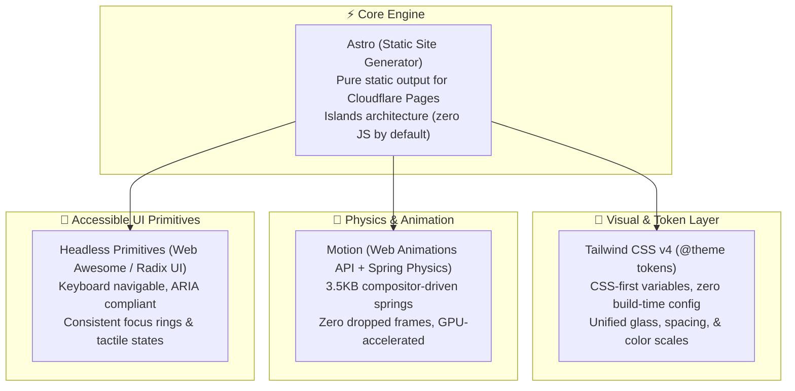
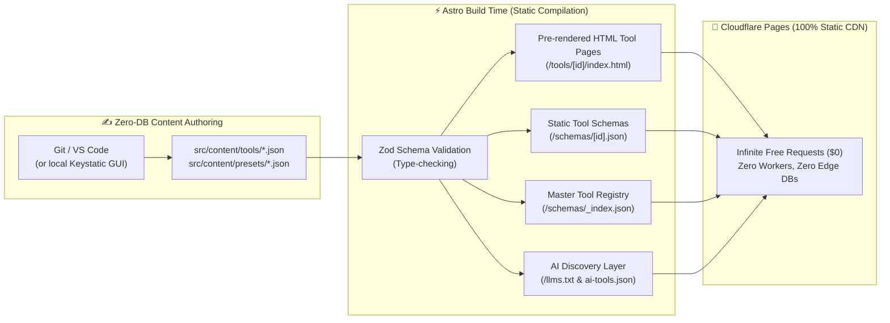

# PrivacyFold — Cohesive Design System & UI Architecture

> **The Problem:** Building 50+ tools with bespoke CSS and disconnected scripts always ends up looking like a fragmented patchwork of franken-widgets.  
> **The Solution:** A unified, production-grade **Design System & Component Kit** built on **Astro + Tailwind CSS v4 + Motion + Headless Accessible Primitives**. Every single tool shares the exact same physical language, typography, tokens, animations, and sound design.

---

## 1. The Stack: Zero-Fragment Architecture



---

## 2. Design Tokens: The "Physical Glass" Spec (`theme.css`)

In Tailwind CSS v4, we define our design system directly in CSS with `@theme`. Every tool inherits these exact tokens:

```css
@import "tailwindcss";

@theme {
  /* Surface Colors: Liquid Glass & Physical Slate */
  --color-canvas-light: #f8fafc;
  --color-canvas-dark: #09090b;

  --color-surface-glass-light: rgba(255, 255, 255, 0.72);
  --color-surface-glass-dark: rgba(18, 18, 24, 0.65);

  --color-border-glass-light: rgba(255, 255, 255, 0.6);
  --color-border-glass-dark: rgba(255, 255, 255, 0.08);

  /* Primary Brand Neon: Precision Violet */
  --color-brand-primary: #6366f1;
  --color-brand-glow: rgba(99, 102, 241, 0.25);
  --color-brand-success: #10b981;
  --color-brand-danger: #ef4444;

  /* Physics Spring Presets (for CSS transitions & Motion) */
  --spring-snappy: cubic-bezier(0.19, 1, 0.22, 1);
  --spring-bouncy: cubic-bezier(0.34, 1.56, 0.64, 1);
  --spring-smooth: cubic-bezier(0.16, 1, 0.3, 1);

  /* Radius System */
  --radius-panel: 24px;
  --radius-card: 18px;
  --radius-control: 12px;
  --radius-pill: 9999px;
}

/* Base Glassmorphic Glass Utility */
.glass-panel {
  background: light-dark(var(--color-surface-glass-light), var(--color-surface-glass-dark));
  backdrop-filter: blur(24px) saturate(180%);
  -webkit-backdrop-filter: blur(24px) saturate(180%);
  border: 1px solid light-dark(var(--color-border-glass-light), var(--color-border-glass-dark));
  box-shadow: light-dark(
    0 10px 30px -10px rgba(0, 0, 0, 0.05),
    0 20px 40px -15px rgba(0, 0, 0, 0.5)
  );
  border-radius: var(--radius-panel);
}
```

---

## 3. The Universal Tool Layout Pattern

To prevent every tool from having a random layout, **all 50+ tools follow a strict 3-column or 2-column "Cockpit" layout**:

```
┌────────────────────────────────────────────────────────────────────────┐
│  [Navigation Bar: Breadcrumb / Tool Search / Privacy Status / Theme]   │
├──────────────────────────────────┬─────────────────────────────────────┤
│  LEFT / CONTROL PANEL (40%)      │  RIGHT / LIVE VIEWPORT (60%)        │
│                                  │                                     │
│  1. Tool Metadata (Title + tags) │  [ Interactive Drop Zone ]          │
│  2. Preset Selector (Pills)      │  - Reacts to drag/hover             │
│  3. Configuration Sliders/Inputs │  - Magnetic snap to center          │
│  4. Advanced Toggle (Accordion)  │                                     │
│  5. Big Primary Action Button    │  [ Live Canvas / Preview Stage ]    │
│                                  │  - Instant WASM rendering           │
│                                  │  - Before/After comparison slider   │
│                                  │  - Download / Copy CTA badge        │
├──────────────────────────────────┴─────────────────────────────────────┤
│  BOTTOM: Zero-Upload Guarantee Banner + SEO/AEO Explanatory Guides     │
└────────────────────────────────────────────────────────────────────────┘
```

---

## 4. Reusable Core UI Components

### 4.1 Tactile File Drop Zone (`DropZone.astro` / `.tsx`)

A drop zone that feels like a physical rubber stamp that reacts to file hover, mass, and velocity.

```tsx
import React, { useState, useRef } from 'react';
import { motion, AnimatePresence } from 'motion/react';
import { UploadCloud, CheckCircle2, FileWarning } from 'lucide-react';
import { playHapticFeedback } from '../utils/sound';

export function TactileDropZone({ onFileSelected, acceptedFormats = ['image/*', '.pdf'] }) {
  const [isDragOver, setIsDragOver] = useState(false);
  const [selectedFile, setSelectedFile] = useState<File | null>(null);
  const inputRef = useRef<HTMLInputElement>(null);

  const handleDrop = (e: React.DragEvent) => {
    e.preventDefault();
    setIsDragOver(false);
    const file = e.dataTransfer.files[0];
    if (file) {
      playHapticFeedback('snap');
      setSelectedFile(file);
      onFileSelected(file);
    }
  };

  return (
    <motion.div
      whileHover={{ scale: 1.01 }}
      whileTap={{ scale: 0.99 }}
      animate={{
        scale: isDragOver ? 1.04 : 1,
        borderColor: isDragOver ? '#6366f1' : 'rgba(255,255,255,0.15)',
      }}
      transition={{ type: 'spring', stiffness: 400, damping: 25 }}
      onDragOver={(e) => { e.preventDefault(); setIsDragOver(true); }}
      onDragLeave={() => setIsDragOver(false)}
      onDrop={handleDrop}
      onClick={() => inputRef.current?.click()}
      className="glass-panel relative flex flex-col items-center justify-center p-12 cursor-pointer border-2 border-dashed transition-colors"
    >
      <input
        ref={inputRef}
        type="file"
        className="hidden"
        accept={acceptedFormats.join(',')}
        onChange={(e) => {
          const file = e.target.files?.[0];
          if (file) {
            playHapticFeedback('snap');
            setSelectedFile(file);
            onFileSelected(file);
          }
        }}
      />

      {/* Floating Spotlight glow behind cursor */}
      <div className="absolute inset-0 pointer-events-none rounded-[var(--radius-panel)] overflow-hidden">
        <div className="absolute inset-0 bg-radial from-indigo-500/10 to-transparent opacity-0 group-hover:opacity-100 transition-opacity" />
      </div>

      <motion.div
        animate={{ y: isDragOver ? -8 : 0 }}
        transition={{ type: 'spring', stiffness: 300, damping: 15 }}
        className="p-5 rounded-full bg-indigo-500/10 text-indigo-500 mb-4 shadow-inner"
      >
        {selectedFile ? (
          <CheckCircle2 className="w-10 h-10 text-emerald-500" />
        ) : (
          <UploadCloud className="w-10 h-10 text-indigo-500" />
        )}
      </motion.div>

      <div className="text-center">
        <h3 className="text-lg font-semibold tracking-tight">
          {selectedFile ? selectedFile.name : 'Drop your document here'}
        </h3>
        <p className="text-sm text-zinc-500 dark:text-zinc-400 mt-1">
          {selectedFile ? `${(selectedFile.size / 1024).toFixed(1)} KB — Ready to Process` : 'or click to browse your files'}
        </p>
      </div>

      <div className="mt-4 inline-flex items-center gap-2 px-3 py-1 rounded-full bg-emerald-500/10 text-emerald-600 dark:text-emerald-400 text-xs font-medium">
        <span className="w-1.5 h-1.5 rounded-full bg-emerald-500 animate-pulse" />
        100% Client-Side. Never Leaves Browser.
      </div>
    </motion.div>
  );
}
```

---

### 4.2 Tactile Preset Selector Pill Group (`PresetSelector.tsx`)

A unified tab selector using Motion's `layoutId` so the active background pill morphs and springs across options fluidly.

```tsx
import React, { useState } from 'react';
import { motion } from 'motion/react';
import { playHapticFeedback } from '../utils/sound';

export function PresetSelector({ presets, onChange }) {
  const [active, setActive] = useState(presets[0].id);

  return (
    <div className="flex flex-wrap gap-2 p-1.5 glass-panel rounded-[var(--radius-pill)]">
      {presets.map((preset) => {
        const isSelected = active === preset.id;
        return (
          <button
            key={preset.id}
            onClick={() => {
              playHapticFeedback('click');
              setActive(preset.id);
              onChange(preset);
            }}
            className="relative px-4 py-2 text-sm font-medium transition-colors z-10"
            style={{ color: isSelected ? '#fff' : 'inherit' }}
          >
            {isSelected && (
              <motion.div
                layoutId="activePill"
                className="absolute inset-0 bg-indigo-600 rounded-[var(--radius-pill)] -z-10 shadow-lg shadow-indigo-500/25"
                transition={{ type: 'spring', stiffness: 500, damping: 35 }}
              />
            )}
            <span className="flex items-center gap-1.5">
              {preset.flag && <span>{preset.flag}</span>}
              {preset.label}
            </span>
          </button>
        );
      })}
    </div>
  );
}
```

---

### 4.3 Tactile Audio/Haptic Synthesis (`sound.ts`)

Instead of loading heavy MP3 audio files, we use the browser's native **Web Audio API** in 25 lines of code to generate subtle, satisfying haptic clicks and pops. Zero bandwidth, 100% responsive:

```typescript
// /assets/js/sound.ts — Pure Web Audio API haptic synthesizers (0kb assets)
const ctx = typeof window !== 'undefined' ? new (window.AudioContext || (window as any).webkitAudioContext)() : null;

export function playHapticFeedback(type: 'click' | 'snap' | 'success') {
  if (!ctx || ctx.state === 'suspended') {
    ctx?.resume();
  }
  if (!ctx) return;

  const osc = ctx.createOscillator();
  const gain = ctx.createGain();
  osc.connect(gain);
  gain.connect(ctx.destination);

  const now = ctx.currentTime;

  if (type === 'click') {
    // Ultra-crisp mechanical switch click
    osc.frequency.setValueAtTime(1200, now);
    osc.frequency.exponentialRampToValueAtTime(400, now + 0.02);
    gain.gain.setValueAtTime(0.04, now);
    gain.gain.exponentialRampToValueAtTime(0.001, now + 0.02);
    osc.start(now);
    osc.stop(now + 0.02);
  } else if (type === 'snap') {
    // Satisfying magnetic suction pop
    osc.frequency.setValueAtTime(320, now);
    osc.frequency.exponentialRampToValueAtTime(80, now + 0.06);
    gain.gain.setValueAtTime(0.08, now);
    gain.gain.exponentialRampToValueAtTime(0.001, now + 0.06);
    osc.start(now);
    osc.stop(now + 0.06);
  } else if (type === 'success') {
    // Subtle chime harmonic
    osc.type = 'triangle';
    osc.frequency.setValueAtTime(587.33, now); // D5
    osc.frequency.setValueAtTime(880.00, now + 0.08); // A5
    gain.gain.setValueAtTime(0.05, now);
    gain.gain.exponentialRampToValueAtTime(0.001, now + 0.25);
    osc.start(now);
    osc.stop(now + 0.25);
  }
}
```

---

## 5. Astro Content Collections + Git: The Static CMS Engine

To ensure all 50+ tools, schemas, presets, and SEO guides remain **100% static, type-safe, and free of runtime databases or Workers**, PrivacyFold uses **Astro's native Content Collections**.



---

### 5.1 Type-Safe Tool Definition (`src/content/config.ts`)

Every tool is strictly validated at build time with Zod. If a parameter description or preset is missing, the build halts before deployment:

```typescript
// src/content/config.ts
import { defineCollection, z } from 'astro:content';

const toolsCollection = defineCollection({
  type: 'data',
  schema: z.object({
    id: z.string(),
    name: z.string(),
    shortDescription: z.string().max(160),
    category: z.enum(['image', 'pdf', 'utility', 'text', 'generators', 'privacy', 'business']),
    wasmModule: z.string(), // e.g., '/wasm/image/passport-photo-v1.wasm'
    wasmSizeKb: z.number(),
    tags: z.array(z.string()),
    
    // Input parameters schema for UI form and Agent URL queries
    params: z.record(
      z.object({
        type: z.enum(['string', 'number', 'boolean', 'enum']),
        label: z.string(),
        default: z.union([z.string(), z.number(), z.boolean()]),
        options: z.array(z.string()).optional(), // For enums
        description: z.string(),
      })
    ),

    // Agent instructions for MCP / Puppeteer discovery
    agentInstructions: z.string(),
    
    // Pre-configured templates & presets
    presets: z.array(
      z.object({
        id: z.string(),
        label: z.string(),
        flag: z.string().optional(),
        values: z.record(z.any()),
      })
    ).optional(),
    
    // AEO/SEO Content Blocks
    seo: z.object({
      faq: z.array(z.object({ q: z.string(), a: z.string() })),
      whyPrivate: z.string(),
      complianceTags: z.array(z.string()), // e.g., ['GDPR', 'CCPA', 'HIPAA Safe']
    }),
  }),
});

export const collections = {
  tools: toolsCollection,
};
```

---

### 5.2 Single Source of Truth Example (`src/content/tools/passport-photo-resizer.json`)

```json
{
  "id": "passport-photo-resizer",
  "name": "Passport Photo Resizer",
  "shortDescription": "Crop and format photos to US, UK, and Schengen passport dimensions with instant on-device face centering.",
  "category": "image",
  "wasmModule": "/wasm/image/passport-photo-v1.wasm",
  "wasmSizeKb": 200,
  "tags": ["passport", "visa", "id-photo", "crop", "resize"],
  "params": {
    "country": {
      "type": "enum",
      "label": "Target Country",
      "default": "US",
      "options": ["US", "UK", "EU_SCHENGEN", "CA", "AU"],
      "description": "Standardizes output aspect ratio, margins, and DPI requirements"
    },
    "autoCrop": {
      "type": "boolean",
      "label": "Auto Face Alignment",
      "default": true,
      "description": "Uses WASM neural landmarks to center eyes and chin"
    },
    "format": {
      "type": "enum",
      "label": "Output Format",
      "default": "jpg",
      "options": ["jpg", "png"],
      "description": "Image encoding format"
    }
  },
  "agentInstructions": "Provide an image file. Specify target country. Tool executes face alignment and returns strict biometric specs.",
  "presets": [
    {
      "id": "us-passport",
      "label": "United States (2x2 in)",
      "flag": "🇺🇸",
      "values": { "country": "US", "autoCrop": true, "format": "jpg" }
    },
    {
      "id": "uk-passport",
      "label": "United Kingdom (35x45 mm)",
      "flag": "🇬🇧",
      "values": { "country": "UK", "autoCrop": true, "format": "jpg" }
    }
  ],
  "seo": {
    "complianceTags": ["GDPR Art. 9 Biometric Safe", "No Server Transfer"],
    "whyPrivate": "Passport photos contain biometric facial landmarks. PrivacyFold processes pixels exclusively inside local memory.",
    "faq": [
      {
        "q": "Will my passport photo be uploaded to any cloud server?",
        "a": "No. The WebAssembly model executes inside your browser tab. No image data is ever transmitted over the network."
      }
    ]
  }
}
```

---

### 5.3 Automated Build-Time Generators (`scripts/build-manifests.mjs`)

Instead of maintaining `_index.json`, `ai-tools.json`, and `llms.txt` by hand, an Astro build script generates them automatically from the Content Collections:

```javascript
// scripts/build-manifests.mjs — Runs automatically during `astro build`
import fs from 'node:fs';
import path from 'node:path';

const toolsDir = path.resolve('src/content/tools');
const toolFiles = fs.readdirSync(toolsDir).filter(f => f.endsWith('.json'));

const tools = toolFiles.map(file => JSON.parse(fs.readFileSync(path.join(toolsDir, file), 'utf-8')));

// 1. Generate /public/schemas/_index.json (Master Registry for MCP)
const registry = {
  name: "PrivacyFold",
  total_tools: tools.length,
  last_updated: new Date().toISOString(),
  base_url: "https://privacyfold.com",
  tools: tools.map(t => ({
    id: t.id,
    name: t.name,
    short_description: t.shortDescription,
    category: t.category,
    wasm_module: t.wasmModule,
    wasm_size_kb: t.wasmSizeKb,
    schema_url: `/schemas/${t.id}.json`,
    tool_url: `/tools/${t.id}`
  }))
};
fs.writeFileSync('public/schemas/_index.json', JSON.stringify(registry, null, 2));

// 2. Generate per-tool schema JSONs (/public/schemas/[tool-id].json)
tools.forEach(t => {
  fs.writeFileSync(`public/schemas/${t.id}.json`, JSON.stringify(t, null, 2));
});

// 3. Generate /public/llms.txt
let llmsText = `# PrivacyFold\n> Privacy-first browser utilities. All processing via WebAssembly.\n\n## Tools\n`;
tools.forEach(t => {
  llmsText += `- [${t.name}](https://privacyfold.com/tools/${t.id}): ${t.shortDescription}\n`;
});
fs.writeFileSync('public/llms.txt', llmsText);

console.log(`✅ Generated manifests & schemas for ${tools.length} tools.`);
```

---

### 5.4 Optional Visual Authoring: Local Keystatic

If you prefer a clean Notion/WordPress-style UI to write guides or add tools without directly editing JSON files, enable **Keystatic in local mode**:

```typescript
// keystatic.config.ts
import { config, fields, collection } from '@keystatic/core';

export default config({
  storage: {
    kind: 'local', // Writes directly to your local Git directory!
  },
  collections: {
    tools: collection({
      label: 'Tools Catalog',
      slugField: 'name',
      path: 'src/content/tools/*',
      format: { data: 'json' },
      schema: {
        name: fields.slug({ name: { label: 'Tool Name' } }),
        shortDescription: fields.text({ label: 'Short Description' }),
        category: fields.select({
          label: 'Category',
          options: [
            { label: 'Image Tools', value: 'image' },
            { label: 'PDF Tools', value: 'pdf' },
            { label: 'Developer Utility', value: 'utility' },
          ],
          defaultValue: 'utility'
        }),
        // ... mapped to content collection schema
      },
    }),
  },
});
```

* Run `npm run dev` $\to$ browse to `http://localhost:4321/keystatic`.
* Visually edit tools, test changes, and save.
* Commit to Git $\to$ Cloudflare Pages deploys the pure static site in under 60 seconds.
* **Result:** You have a full CMS workflow with **zero database infrastructure, zero Workers, zero costs, and infinite scalability.**

---

## 6. Standardized Tool Template Page (`ToolLayout.astro`)

Every single tool in `src/pages/tools/[tool].astro` uses this single master layout. This guarantees 100% design consistency across all 50+ tools without code duplication:

```astro
---
// src/layouts/ToolLayout.astro
import BaseLayout from './BaseLayout.astro';
import { ShieldCheck, Cpu, Download } from 'lucide-react';

interface Props {
  title: string;
  description: string;
  category: string;
  wasmFile: string;
  toolId: string;
}

const { title, description, category, wasmFile, toolId } = Astro.props;
---

<BaseLayout title={title} description={description}>
  <main class="max-w-7xl mx-auto px-4 sm:px-6 lg:px-8 py-10">
    <!-- Breadcrumb & Tag Header -->
    <div class="flex items-center gap-2 text-xs font-semibold uppercase tracking-wider text-indigo-500 mb-3">
      <span>Tools</span>
      <span>/</span>
      <span>{category}</span>
    </div>

    <div class="flex flex-col md:flex-row md:items-end justify-between gap-4 mb-8">
      <div>
        <h1 class="text-3xl sm:text-4xl font-extrabold tracking-tight text-zinc-900 dark:text-zinc-100">
          {title}
        </h1>
        <p class="text-zinc-500 dark:text-zinc-400 mt-2 max-w-2xl">
          {description}
        </p>
      </div>

      <!-- Trust Badges -->
      <div class="flex items-center gap-3">
        <div class="flex items-center gap-1.5 text-xs text-emerald-600 dark:text-emerald-400 font-medium px-3 py-1.5 rounded-full bg-emerald-500/10 border border-emerald-500/20">
          <ShieldCheck className="w-4 h-4" />
          <span>Zero Server Upload</span>
        </div>
        <div class="flex items-center gap-1.5 text-xs text-indigo-600 dark:text-indigo-400 font-medium px-3 py-1.5 rounded-full bg-indigo-500/10 border border-indigo-500/20">
          <Cpu className="w-4 h-4" />
          <span>Local WASM Engine</span>
        </div>
      </div>
    </div>

    <!-- The 2-Column Physical Cockpit -->
    <div class="grid grid-cols-1 lg:grid-cols-12 gap-8 items-start">
      <!-- Left Column: Controls (4 cols) -->
      <div class="lg:col-span-5 flex flex-col gap-6">
        <slot name="controls" />
      </div>

      <!-- Right Column: Interactive Viewport (7 cols) -->
      <div class="lg:col-span-7 flex flex-col gap-6">
        <slot name="viewport" />
      </div>
    </div>

    <!-- Bottom SEO / AEO Answer Block -->
    <section class="mt-20 pt-10 border-t border-zinc-200 dark:border-zinc-800">
      <slot name="seo-content" />
    </section>
  </main>

  <!-- Mount Wasm Core -->
  <script define:vars={{ wasmFile, toolId }}>
    window.__TOOL_META__ = { wasmFile, toolId };
  </script>
</BaseLayout>
```

---

## 6. How this Solves the "Fragmented" Problem

| What Usually Breaks | How This Design System Fixes It |
|---|---|
| **Buttons look different across tools** | Single token class (`btn-primary`, `btn-glass`) using `@theme` in Tailwind CSS v4. |
| **Animations feel jerky or sluggish** | Motion engine with standardized spring parameters (`stiffness: 400, damping: 25`). No arbitrary CSS `ease-in-out 300ms` timing conflicts. |
| **File drops feel like web forms** | Physics-based drag-and-drop with scale bounce, magnetic indicator, and synthesized haptic clicks. |
| **Theme flashes & dark mode mismatch** | Native CSS `light-dark()` tokens paired with automated `prefers-color-scheme` synchronization. |
| **Inconsistent API/Agent URLs** | Same `normalizeParams()` bridge ensures that `?mode=agent` executes the exact same state machine as manual button clicks. |

This gives **PrivacyFold** the cohesive aesthetic of modern tools like Linear, Raycast, and Apple Human Interface Guidelines while running entirely on Cloudflare Pages for **$0/month**.
