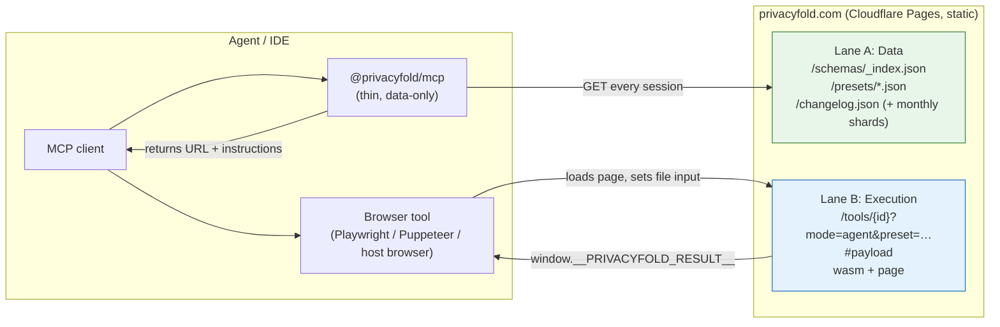

# PrivacyFold — Agent Surface (Presets, Validation, Delegation, Freshness)

> **Status:** design draft, **9 Nov 2026**. Builds on the infrastructure doc (thin bridge, `privacyfold.com` for everything) and the presets doc.
> **One-line thesis:** Agents already have AI. They come to PrivacyFold for a **trusted, current, machine-readable requirements dataset** and a **deterministic place to run the job**, and every agent interaction lands on our URL.

## 0. Decisions this doc is built on

| # | Decision | Source |
|---|---|---|
| D1 | All agent execution happens on `privacyfold.com` pages, so agent traffic is our traffic (analytics, brand). | Founder decision, 9 Nov 2026 |
| D2 | The npm bridge carries **no WASM and no tool logic**. It is a thin, data-only client. | Infra doc v3 (confirmed) |
| D3 | Agents are kept current: when a portal changes a requirement or we launch a feature, agents see it on their next session. | Founder decision |
| D4 | On-device AI models are for **human** users. The agent surface stays deterministic (Tier D), except an optional redaction gate (§7). | On-Device AI doc |

---

## 1. Two audiences, two products

| | Humans | Agents |
|---|---|---|
| **They come for** | A tool that does the job, good UI | A trusted, current spec plus somewhere deterministic to run the job |
| **Where AI fits** | Our local WebGPU models | They have their own AI; we do not compete with it |
| **Key artifact** | Tool page | Presets, validators, receipts (static data and pages) |
| **Success metric** | Task done, trust | Preset fetches, calls, citations in the agent's answer |

What agents actually need from us, in order of value:

1. **Specs:** dated, sourced, versioned requirements per portal or platform (the moat).
2. **Validators:** "check this file against this preset", no transformation (verify their own work).
3. **Executors:** "run this preset on this file" (delegate the job).
4. **Receipts and conformance vectors:** proof of what ran, and test cases to benchmark against.

---

## 2. Two lanes, both on our URL



| Lane | What | Needs a browser? | Cost |
|---|---|---|---|
| **A: Data** | Registry, presets, schemas, changelog, `llms.txt` | No (plain HTTP GET) | $0 (static) |
| **B: Execution** | Validate or run a tool on a file | Yes (any browser the agent can drive) | $0 (static page + WASM) |

**Limitation to state plainly:** hosted agents that have no browser tool can use Lane A (specs, requirements, citations) but cannot run Lane B themselves. They can hand the user the URL. That is acceptable: Lane A is where most of the agent value is.

---

## 3. Keeping agents current (D3)

### 3.1 Version stamps everywhere

| Object | Field | Example |
|---|---|---|
| Registry | `registry_version` (monotonic) + `last_updated` | `1.4.0`, `2026-11-09T10:00:00Z` |
| Preset | `version` (date-based) | `2026-11-08.1` |
| Every Lane B result | `registry_version`, `preset: {id, version}` | stamped into `__PRIVACYFOLD_RESULT__` |

An agent (or the user) can always tell **which version of the rules a result was produced under**.

### 3.2 Freshness fields on every preset

```json
{
  "preset_id": "uk-passport-photo",
  "version": "2026-11-08.1",
  "status": "active",
  "source_url": "https://www.gov.uk/photos-for-passports",
  "last_verified": "2026-11-08",
  "stale_after_days": 90,
  "supersedes": "2026-06-14.2",
  "requirements": { "width_mm": 35, "height_mm": 45 }
}
```

- `status`: `active` | `under_review` | `deprecated`. Set `under_review` the moment a portal change is suspected; agents should warn the user.
- `stale_after_days`: if `today - last_verified` exceeds it, a well-behaved agent says "this requirement was last checked on …".
- Values are illustrative; each real preset's numbers must be verified against its `source_url` (presets doc).

### 3.3 Change feed (static, no server)

Static hosting cannot answer "what changed since X", so publish **monthly shards** plus a pointer:

```
/changelog.json                  { "latest_shard": "2026-11", "registry_version": "1.4.0", "recent": [ …last 20… ] }
/changelog/2026-11.json          [ { id, date, type, preset_id, field, old, new, effective, source_url, note } ]
```

```json
{
  "id": "chg-2026-11-0007",
  "date": "2026-11-08",
  "type": "requirement_changed",
  "preset_id": "us-passport-std",
  "field": "max_file_kb",
  "old": 240,
  "new": 250,
  "effective": "2026-12-01",
  "source_url": "https://travel.state.gov/…",
  "note": "Portal limit updated."
}
```

Types: `requirement_changed`, `preset_added`, `preset_deprecated`, `tool_added`, `tool_updated`, `feature_launched`.

### 3.4 Session-start flow in the bridge

1. Fetch `/schemas/_index.json` (cache window 60 s, revalidate with ETag).
2. Compare `registry_version` with the last one seen (a tiny local state file on the agent's machine).
3. If newer: fetch the changelog shard(s) since the last seen version, then emit the MCP tool-list-changed notification and add a short `whats_changed` summary to the first tool response.
4. `whats-new` tool: returns the same summary on demand.
5. Every preset the bridge hands out includes `version`, `last_verified` and `status`.

Cache headers (adjust the existing `_headers`): registry 60 s, changelog 60 s, **presets 300 s with ETag revalidation** (the current 3600 s is too slow for requirement changes agents rely on).

---

## 4. Tools exposed to agents (MCP)

All tools return JSON with `registry_version`. None of them transform a file inside the bridge (D2).

| Tool | Lane | Purpose | Returns |
|---|---|---|---|
| `list-presets` | A | Find presets by keywords, jurisdiction, portal | Matching presets (id, name, status, last_verified) |
| `get-preset` | A | Full requirement record | The preset record (§3.2) |
| `check` | B | Validate a file against a preset (no change to the file) | `advisory_checks` (§5) + a URL to run it |
| `run` | B | Apply a preset to a file and produce the output | URL + instructions; result via the page contract (§6) |
| `whats-new` | A | Recent changes since last seen | Changelog summary |
| `list-tools` | A | Registry listing | Tools with ids and schema URLs |

`agent_instruction` fields in schemas stay **descriptive** ("Use this preset when the user mentions UK visa…"), never imperative commands aimed at the model (§8).

---

## 5. Validator contract (verify their own work)

An agent produced a file itself and wants to know whether it meets the preset. It opens `check` in the browser, supplies the file and reads the result:

```json
{
  "status": "complete",
  "tool": "check",
  "preset": { "id": "uk-passport-photo", "version": "2026-11-08.1" },
  "registry_version": "1.4.0",
  "advisory_checks": [
    { "name": "dimensions", "result": "pass", "detail": "413x531 px (35x45 mm at 300 DPI)" },
    { "name": "file_size", "result": "pass", "detail": "182 KB (limit 10 MB)" },
    { "name": "background_uniform", "result": "warn", "detail": "Edge variance above threshold" }
  ],
  "disclaimer": "Advisory only. Portals may reject for reasons not checked here."
}
```

- Results: `pass` | `warn` | `fail` | `not_checked`. Never "compliant" or "approved".
- Photo checks that need a face detector (head height, eye line) run only if the on-device model is available; otherwise `not_checked`.

---

## 6. Execution contract (Lane B: delegate the job)

### 6.1 URL

```
https://privacyfold.com/tools/{tool-id}?mode=agent&preset={preset_id}&source=mcp
```

**Rules**

- **No user data in the query string.** Anything sensitive goes in the **fragment** (`#…`), which browsers never send to the server. Only non-sensitive flags (`mode`, `preset`, `source`) stay in the query.
- Files are provided through the page's file input, not through URLs.

### 6.2 Stable hooks for automation

| Hook | Purpose |
|---|---|
| `input[type=file][data-pf="input"]` | Where an automation framework sets the file (e.g. Playwright `setInputFiles`) |
| `[data-pf="run"]` | Optional explicit start (auto-starts in agent mode once a file is set) |
| `[data-pf="download"]` | The download control (also auto-triggers in agent mode) |
| `window.__PRIVACYFOLD_READY__ = true` | Page and WASM loaded; safe to set the file |
| `window.__PRIVACYFOLD_RESULT__` | Final result object |

### 6.3 Result object

```json
{
  "status": "complete",
  "tool": "image_compress",
  "filename": "scan-compressed.jpg",
  "size": 183421,
  "sha256": "…",
  "preset": { "id": "uk-visa-vfs-docs", "version": "2026-11-08.1" },
  "registry_version": "1.4.0",
  "determinism": "D",
  "advisory_checks": [ { "name": "file_size", "result": "pass", "detail": "1.7 MB (limit 2 MB)" } ],
  "needsReview": []
}
```

Errors use `status: "error"` with a stable `code` (`unsupported_type`, `too_large`, `preset_not_found`, `preset_deprecated`, `wasm_failed`) and a human-readable `message`, so an agent can retry or explain.

### 6.4 Practical blockers to remove

- **Bot challenges:** Cloudflare bot protection or challenges can stop headless browsers. Configure the WAF to skip challenges on `/tools/*?mode=agent`, `/schemas/*`, `/presets/*`, `/changelog*` **[K: verify current Cloudflare rules]**.
- **Fresh browser profiles** re-download the WASM every run. That is acceptable (static, unmetered, and it is traffic on our URL), but keep per-tool WASM small and cache-immutable (infra doc).
- **Rate limits:** none are needed on static content; watch request volume rather than throttling.

---

## 7. The one place on-device AI helps agents: a privacy gate

An agent about to send a user's document to a cloud model can first pass it through **AI Airlock** (On-Device AI doc, §4.2): detect personal data on the device, replace it with tokens, send the sanitized text to the model, and restore the real values locally afterwards.

- It runs in a browser page (Lane B), so it lands on our URL.
- It needs the PII model (≈15 MB) and a review step, so it is flagged `needsReview` and the agent must not skip the human check.
- Coverage is limited to 7 Latin-script languages; the result states which recognizers ran.
- Position it as **data minimisation before the model**, not as "we never see your file" (the agent already has it).

---

## 8. Trust: fresh does not have to mean unverified

Fresh instructions from our domain flow into users' agents, so the registry is a supply-chain surface. Two cheap controls keep D3 intact:

1. **Signed registry.** Publish `_index.json.sig` (detached Ed25519 signature). The bridge pins the **public key** (a few bytes, no WASM) and refuses an unsigned or invalid registry. It still fetches fresh every session, so freshness is unchanged; the signature only proves the data is ours and was not altered by a CDN, cache or compromised path.
2. **Descriptive text only.** Keep tool descriptions and `agent_instruction` strings plain, length-limited and non-imperative. Clients should treat them as data, never as commands.

Also: no user data in URLs (§6.1), strip query strings and fragments in analytics, and never run session replay on tool pages (infra and On-Device AI docs).

**Data license:** publish presets and changelog under **CC BY 4.0**, so agents and answer engines can cite and reuse them with attribution. Decide this explicitly; it is part of the moat strategy.

---

## 9. Counting agent traffic on static hosting

Without Workers, the signals available are:

| Signal | How |
|---|---|
| Registry and preset fetches | Cloudflare zone analytics by path **[K: verify what the free plan exposes]** |
| Page loads and WASM downloads | Same, plus Cloudflare Web Analytics where JS runs |
| Tool runs by source | `tool_used` events with `source=mcp` (no URL params, no file data) |
| Which presets agents ask for | Preset path hits (`/presets/{id}.json` as separate files, not one blob) |

Publish one preset per file so path analytics tell you which requirements agents care about; this also drives which long-tail pages to build.

---

## 10. Conformance vectors (benchmark against us)

For each preset, publish small synthetic test cases:

```
/tests/{preset_id}/vectors.json
{ "preset": "us-passport-std", "version": "2026-11-08.1",
  "cases": [ { "input": "synthetic-600x600.png (generated, no real person)",
               "expected": { "advisory_checks": [ … ], "output_sha256": "…" } } ] }
```

Agents can compare their own implementation's results with ours, or confirm that `check` agrees with their expectations. Vectors must use synthetic or consented images only (never real people's photos).

---

## 11. What this changes in the other docs

| Doc | Change needed |
|---|---|
| Infrastructure | Keep the thin bridge; add signature verification, `whats-new` flow with changelog shards, per-preset files, ETag and 300 s preset caching, WAF exceptions for agent paths. |
| Market analysis | Remove or mark as future the remote SSE server at `mcp.privacyfold.com` (it needs server compute and contradicts D2 and "zero Workers"). |
| Growth strategy | Rewrite the `executor.ts` / "WASM runs on the agent's CPU" description to match D1 and D2. |
| Presets | Add `version`, `status`, `stale_after_days`, `supersedes` alongside `source_url` and `last_verified`. |
| Core doc | Add the stable automation hooks (§6.2) to the agent-mode section. |

---

## 12. Build order

1. Preset record v2 (version, status, freshness, source) and the changelog shards.
2. Signed registry, plus bridge verification and the `whats-new` flow.
3. `get-preset` / `list-presets` (Lane A only; ships without any browser work).
4. Stable page hooks and the result contract (§6) on the first three tools (passport photo, image compress, PDF compress).
5. `check` validator for photo and PDF presets.
6. Conformance vectors for the 10 most-searched presets.
7. WAF exceptions, then agent-traffic dashboards.
8. Optional: the AI Airlock privacy gate (§7).
