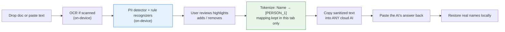
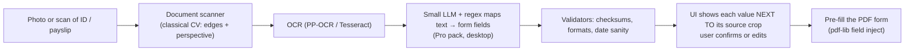

# PrivacyFold — On-Device AI Layer (Research & Spec)

> **Status:** research draft, **8 Nov 2026**. Extends the six existing docs; it does not replace them.
> **One-line thesis:** PrivacyFold can ship real AI/ML tools with **no AI API, no server GPU and no per-request cost**, because the model runs on the user's device. The only recurring cost is model-file bandwidth, and every model has to earn its download size.

**How to read the confidence tags used in this doc**

| Tag | Meaning |
|---|---|
| **[S]** | Stated in a source we read on 8 Nov 2026 (links in §12). Most sources are blog posts, some from vendors. Benchmark numbers are self-reported. |
| **[K]** | Background knowledge, not re-verified. Check before relying on it. |
| **[T]** | Must be tested on real devices and real documents before we promise anything. |

---

## 0. TL;DR and the decisions this doc asks you to make

1. **Build WebGPU-first** with a WASM fallback. WebGPU became Baseline in January 2026 **[S]**.
2. **Ship the "Exposure X-ray" first.** It needs no ML model (only metadata parsing), so it can ship in Sprint 1–2 and become the viral hero feature.
3. **Flagship AI feature: "AI Airlock"** (strip personal data on-device before pasting into any cloud AI, then restore it locally). **Second: "Fill from scan"** (scan an ID or payslip, extract fields locally, pre-fill the W-9/SA100 tools).
4. **Replace U²-Net in the background-remover plan** with a model that has a commercial-safe license. RMBG-1.x/2.0 weights are non-commercial **[S]**; BEN v2 is MIT **[S]**.
5. **Amend the "Iron Rule" of determinism** (core doc). ML output cannot honestly be promised byte-identical across GPUs. Use the three-tier guarantee in §5.6.
6. **Decide the ads/analytics policy for pages that display personal data** (§6). This is the biggest unresolved conflict between the revenue plan and the privacy promise.
7. **Never put user data in URL query strings** for agent mode. The server sees query strings; fragments (`#`) never leave the browser (§10, item 5).

---

## 1. Principle: "AI without an API"

| Property | Cloud AI (what competitors do) | On-device AI (PrivacyFold) |
|---|---|---|
| File leaves the device | Yes | No |
| Cost per request | Real, scales with usage | $0 (user's hardware does the work) |
| Our recurring cost | GPU/API bill | CDN bandwidth for model files only |
| Works offline | No | Yes, after first model download |
| Quality ceiling | Frontier models | Small models; must be scoped to narrow jobs |
| Reproducibility | Provider-controlled | Pinned model hash (except browser-built-in models, §4.8) |

**What this forces on the design**

- Models must be **narrow** (detect, segment, extract, transcribe), never general chatbots.
- Every AI output that touches personal data gets a **human-review step** (highlights the user confirms), because on-device models are imperfect (§3).
- The "zero upload" promise needs a precise wording once models are downloaded: **"your files are never uploaded; the model file is downloaded once, before any of your data is touched."**

---

## 2. What changed in 2026 (platform facts)

| Fact | Detail | Implication for PrivacyFold | Source / tag |
|---|---|---|---|
| **WebGPU is Baseline** (Jan 2026) | Chrome/Edge since 113, Safari 26, Firefox 141 (Windows) and 145 (macOS Apple silicon). Gaps: Firefox on Linux, iPhones older than A12. In-app browsers (Instagram, X, Facebook…) can fail the adapter request. | Design WebGPU-first; keep a WASM fallback; detect in-app browsers and suggest opening in the system browser. | [S] utsubo (a vendor; verify on caniuse) |
| **Transformers.js v4** (2 Apr 2026) | New C++ WebGPU runtime built with the ONNX Runtime team, tested across ~200 architectures; BERT-style embeddings up to 4x faster; MoE/Mamba architectures; models above 8B parameters supported; default web bundle up to 53% smaller. | Use it (or ONNX Runtime Web directly) as the single ML runtime. v4.3.0 was current in a later source. | [S] howaiworks, pinggy |
| **Browser built-in AI** | Chrome 148: Prompt API stable on the web (Gemini Nano; text, image and audio input, text output). Summarizer, Translator, Language Detector stable in Chrome 138+. Edge 148 uses Phi-4-mini. Safari: no. Firefox: extensions only. | A free bonus layer on Chromium desktop only. Not a foundation (§4.8). | [S] LogRocket, dev.to |
| **Built-in AI hardware gate** | Chrome needs 22 GB free storage plus a 4 GB-VRAM GPU or 16 GB RAM with 4+ cores; one author estimates this excludes ~70% of users in those browsers. | Must be capability-detected; never assume present. | [S] LogRocket (the 70% is the author's estimate) |
| **Small LLMs in a tab** | WebLLM q4f16 builds: SmolLM2 360M ≈ 204 MB, Qwen3 0.6B ≈ 335 MB, Gemma 3 1B ≈ 563 MB, Llama 3.2 1B ≈ 695 MB, Qwen3.5 2B ≈ 1.06 GB. A 1B model ran 27–67 tokens/s on an M3 Pro (varies with GPU contention). Needs `shader-f16`. | Viable for narrow extraction/classification jobs, not chat. | [S] pinggy |
| **LLM failure modes** | Exceeding GPU memory often *loses the device* instead of erroring; first start can take minutes (shader compile); phones throttle under sustained load; WASM path capped at 4 GB. | Need memory guards, a "light" mode, and desktop-only Pro packs. | [S] pinggy |
| **WebNN (NPU access)** | Chrome/Edge origin trial (M147–149); not in Safari/Firefox; W3C Candidate Recommendation Jan 2026; partial operator coverage. One source guesses 2027 for default use. | Do **not** build on it now. Keep ONNX Runtime's execution-provider list so switching is a config change. | [S] utsubo, dev.to (single-source estimates) |
| **Small OCR models** | PP-OCRv6 (1.5M–34.5M parameters, Apache 2.0, returns text and boxes, not layout). Vision-language OCR ≤1.2B: TeleOCR 1.2B, OvisOCR2 0.8B, PaddleOCR-VL-1.6 0.9B, GLM-OCR 0.9B (MIT), MinerU2.5-Pro 1.2B; reported ~95–97 on OmniDocBench v1.6 (not independently run). | Promising, but **none confirmed to run in a browser** in the sources. | [S] docsumo; browser feasibility [T] |
| **OCR on photographed pages** | Accuracy drops on phone photos (one model: 91.9 → 72.2 on a "wild" benchmark). | Our users photograph documents. Test on our own photographed corpus before shipping. | [S] docsumo |
| **Browser OCR reality** | Tesseract.js works in-browser (~14 MB for the Japanese pack), weak on noise/skew/multi-column. A Dec 2025 report found PaddleOCR JS packages failing in browsers. | Start with Tesseract.js or an ONNX PP-OCR build; re-test newer ports. | [S] lilting |
| **Speech-to-text** | Moonshine 245M (streaming, MIT for English, 8 languages, non-commercial for non-English). Parakeet V3 600M (Apache 2.0, NeMo). Whisper Large v3 is 1.5B and known to hallucinate on silence. | Moonshine for live dictation; smaller Whisper for many-language files. Browser builds of Parakeet unconfirmed. | [S] onresonant; browser status [T] |
| **Background removal** | RMBG-1.4 int8 ≈ 45 MB; the int8 variant of another tested model produced artifacts while fp16 looked identical to fp32. WebGPU fp16 ≈ 100 ms vs ≈ 2 s on 16-thread WASM and ≈ 53 s single-thread (M3 Max). BEN v2 = 94.6M parameters, MIT. SAM 3 = 848M parameters, gated license. | Use fp16 on WebGPU; keep a slower WASM path; avoid SAM-class models. | [S] img.ly, lofttools, invideo |

---

## 3. Model shortlist

> Sizes are download sizes where a source gave one; otherwise parameter counts or ballparks marked [K]. **Licenses must be re-checked on the model card before shipping.**

| # | Job | Candidate model(s) | Size | License (commercial use) | Known limits | Tags |
|---|---|---|---|---|---|---|
| 1 | **Face detect + landmarks** (passport crop, eye-line, head-size checks, face blur) | MediaPipe/BlazeFace-class detector | a few MB | Apache 2.0 **[K]** | Detection only. **No face recognition, ever** (§4.9). | [K][T] |
| 2 | **Background matting** (passport white bg, product shots) | **BEN v2** (primary) | 94.6M params | **MIT weights** | Edge quality on hair is its selling point; browser build/size [T] | [S][T] |
| 2b | alt: BiRefNet | BiRefNet | not stated | Code MIT; the RMBG-2.0 weights built on it are non-commercial | Highest edge quality; memory-hungry (RMBG-2.0 caused WebGPU out-of-memory) | [S] |
| 2c | **Avoid:** RMBG-1.4 / 2.0, Bria | — | 45 MB (int8, RMBG-1.4) | **Non-commercial** | — | [S] |
| 2d | **Avoid:** SAM 3 / 3.1 | — | 848M params | Non-standard "SAM License", gated | Too heavy; license friction | [S] |
| 3 | **PII detector** (text) | **Rampart** (MiniLM-L6, 17 entity types) + deterministic recognizers for SSN, cards, emails, URLs, IPs | **14.7 MB** | **CC BY 4.0** (attribution required) | See "PII honesty rules" below | [S] |
| 4 | **OCR (fast path)** | PP-OCRv6 small via ONNX, or Tesseract.js | 1.5M–34.5M params; Tesseract ≈ 14 MB / language | Apache 2.0 | Boxes/text only; weak on skew/noise | [S][T] |
| 4b | **OCR (accurate path, Pro pack)** | GLM-OCR 0.9B (MIT) or PaddleOCR-VL-1.6 0.9B (Apache 2.0) | ~0.9B params (q4 download likely several hundred MB **[K]**) | MIT / Apache 2.0 | Browser feasibility unconfirmed; photo accuracy drop | [S][T] |
| 5 | **Field extraction** (map OCR text to form fields) | Qwen3 0.6B or Gemma 3 1B (q4f16) + regex/checksum validation | 335 MB / 563 MB | **Not verified** (check each model card; Gemma and Llama have their own terms **[K]**) | Hallucination risk; must show source crops | [S][T] |
| 6 | **Live dictation** | Moonshine (English MIT) | 245M params | MIT (English only commercial) | Non-English models are non-commercial | [S] |
| 6b | Many-language file transcription | Whisper small/base | ~40–150 MB **[K]** | MIT **[S]** (Large v3) | Hallucinates on silence; add VAD | [S][K] |
| 7 | **Semantic photo/doc finder** | CLIP-style embeddings | ~90 MB **[K]** | Verify per checkpoint | Zero-shot accuracy is modest; frame as "likely" | [K][T] |
| 8 | **Voice cleanup** | RNNoise-class denoiser | under 1 MB **[K]** | BSD-style **[K]** | — | [K] |
| 9 | **Document scanner** (edges + perspective) | Classical computer vision (OpenCV.js), not a neural net | no model | BSD/Apache **[K]** | Not AI; high utility | [K] |

**PII honesty rules (from the Rampart model card [S])**

- Reported private-term recall ≈ 98.4% on its own held-out set (97.2% Dutch … 98.9% English). This is **not** a guarantee on real documents.
- **Non-Latin-script names: aggregate recall ≈ 14%.** Government IDs without checksums: ≈ 67.6% caught. Long names can lose their trailing parts. Inferential identifiers (a rare condition plus a ZIP) are not detected. Adversarial input (zero-width characters, prompt-injection text) can evade it.
- Covers English, Spanish, French, German, Italian, Portuguese and Dutch only (Latin script).
- The model card itself calls it **harm reduction, not a security boundary**. So: always show detections for the user to review, never say "removes all personal data", and add rule-based recognizers with checksums (Luhn, IBAN mod-97, NINO/SSN formats) as a second layer.

---

## 4. Tool concepts

### 4.1 Exposure X-ray (build first; no ML model needed)

The user drops any file and sees what it reveals before choosing a tool: a map pin for photo GPS, camera/phone model, timestamps, document author, software, tracked changes, embedded thumbnails, hidden PDF layers. The page then "folds shut" clean when the user removes it (the origami metaphor maps to inspecting and cleaning).

- **Why first:** pure parsing (EXIF/XMP/PDF/OOXML metadata), small WASM, shareable ("look what my photo tells strangers"), and a natural entry to the EXIF-stripper and metadata tools already in the catalog.
- **Honesty rule:** only claim what the parser can read. Show "no metadata found" as a result, not as proof of safety.
- **Later upgrade:** add an on-device image classifier to flag likely IDs, cards and screenshots (see 4.7).

### 4.2 AI Airlock (flagship)

People paste contracts, medical letters and payslips into cloud AI assistants. The Airlock sanitizes the text first and restores it afterwards, all on-device.



- The token→value map lives only in memory (never localStorage, never a URL) and is wiped on close or on a "Delete my data" button.
- Warn when the user's language is outside the detector's coverage (§7).
- Pair with the **redaction self-test** below for PDFs.

**Redaction self-test (any PDF redaction tool):** after redacting, re-extract the text from the *output* file and show "0 hidden words recoverable". Fake redaction that leaves the text layer underneath is a common failure, so proving it is a strong trust feature.

### 4.3 Fill from scan (ties to W-9 / SA100 / USCIS tools)



- **Never auto-submit.** The model can hallucinate; the user confirms every field against the source image.
- Runs entirely locally; nothing is uploaded.
- Highest "new generation" value in this doc, but also the highest engineering risk (OCR on photos [T], LLM weights ≈ 0.3–1 GB).

### 4.4 Requirement-first presets and advisory checks

Complements the long-tail preset strategy: instead of picking a tool, the user states a destination ("UK visa photo", "job portal, max 200 KB, PDF"), and the tool configures itself. After processing, run **advisory** checks (dimensions, file size, background uniformity, head height via the face detector). See the updated section in `privacyfold-longtail-preset-strategy.md`.

- Wording rule: **"Looks consistent with the published requirements", never "compliant" or "will be accepted".** Government rules change and portals reject for reasons we cannot see.

### 4.5 Passport photo upgrade (face detection + matting)

Live camera or upload mode with a face-oval guide, auto-crop, eye-line and head-height checks, then white-background matting with BEN v2. This is the first tool that should consume the shared model loader (§5).

### 4.6 Voice

Moonshine for live captions and dictation (streaming, English); Whisper-class for files in other languages; Silero-style voice-activity detection to trim silence; RNNoise-class denoising. Use cases: private transcription of legal, medical and personal recordings.

### 4.7 Sensitive-photo finder (later)

Drop a folder of photos; local embeddings flag *likely* IDs, cards, documents and screenshots with visible text. Distinctive and shareable, but accuracy is modest [T]; present as "might contain" and let the user decide.

### 4.8 Browser built-in AI as a bonus layer (progressive enhancement)

Use Chrome/Edge's Translator, Summarizer and Language Detector only after `availability()` says the model is ready, and only on Chromium desktop.

- **Pros:** no hosting cost, model shared across sites, zero extra download for us.
- **Cons:** Chromium desktop only; hardware gate excludes many users **[S]**; text languages limited to English, Japanese, Spanish, German and French for the Prompt API **[S]**; no schema-constrained output (validate JSON yourself) **[S]**; **we cannot pin or hash the model**, so receipts must say "browser-provided model, version unknown".
- **Hard rule:** the page must never enable any server fallback for these APIs. If the browser would fall back to a server model, do not call it.
- **Not for agent mode:** headless or automated browsers may lack the model [T].

### 4.9 What we deliberately do not build

- **Face recognition or identification.** Detection is fine; identifying people is off-brand and carries legal risk (GDPR biometric rules; Illinois BIPA **[K]**).
- **AI-text or deepfake detectors.** Unreliable; false positives harm people.
- **Image generation and general chatbots as headline features.** Heavy, mediocre on-device, and contrary to the "fast tools" promise.
- **Gamified points, streaks and badges** around privacy. Take the game feel from tactile controls, sound and physics (already in the UI docs).

---

## 5. Architecture

### 5.1 Device tiers and capability detection

Show the user what their device can run before any download. Detect once, cache the result for the session.

```javascript
// /assets/js/device-tier.js  (sketch — verify API names against current docs)
export async function detectDevice() {
  const d = { webgpu: false, shaderF16: false, maxBufferMB: 0,
              memGB: navigator.deviceMemory ?? null,        // Chromium only
              cores: navigator.hardwareConcurrency ?? 1,
              crossOriginIsolated: self.crossOriginIsolated,
              inAppBrowser: /FBAN|FBAV|Instagram|Line\/|Twitter/i.test(navigator.userAgent),
              builtinAI: {} };
  try {
    const adapter = navigator.gpu && await navigator.gpu.requestAdapter();
    if (adapter) {
      d.webgpu = true;
      d.shaderF16 = adapter.features.has('shader-f16');
      d.maxBufferMB = Math.round(adapter.limits.maxBufferSize / 2**20);
    }
  } catch { /* treat as no WebGPU */ }
  for (const [k, g] of [['prompt','LanguageModel'],['summarizer','Summarizer'],
                        ['translator','Translator'],['detector','LanguageDetector']]) {
    try { d.builtinAI[k] = g in self ? await self[g].availability() : 'unavailable'; }
    catch { d.builtinAI[k] = 'unavailable'; }
  }
  d.tier = !d.webgpu ? 'light'
         : (d.shaderF16 && d.maxBufferMB >= 1024 && (d.memGB ?? 8) >= 8) ? 'pro' : 'standard';
  return d;
}
```

| Tier | Typical device | What runs |
|---|---|---|
| **Light** | No WebGPU, phones, in-app browsers | Classical tools, X-ray, rule-based PII, Tesseract |
| **Standard** | WebGPU, modest GPU memory | Face detect, matting, PII model, PP-OCR, Moonshine |
| **Pro** | WebGPU + `shader-f16` + enough memory | Adds the 0.3–1 GB extraction model and the accurate OCR pack |

Catch `device lost` errors and fall back one tier instead of showing a blank screen **[S: pinggy]**.

### 5.2 Model manifest (single source of truth, same Zod pattern as tools)

```typescript
// src/content/config.ts — new collection
const modelsCollection = defineCollection({
  type: 'data',
  schema: z.object({
    id: z.string(),                       // "ben-v2-fp16"
    task: z.enum(['face-detect','matting','pii','ocr','extract','stt','embed','denoise']),
    pack: z.enum(['core','voice','pro']),
    minTier: z.enum(['light','standard','pro']),
    precision: z.enum(['fp32','fp16','q8','q4f16']),
    backends: z.array(z.enum(['webgpu','wasm'])),
    bytes: z.number(),
    sha256: z.string().length(64),        // verified after download, shown in receipts
    files: z.array(z.object({ path: z.string(), bytes: z.number(), sha256: z.string() })),
    license: z.string(),                  // SPDX id or name
    commercialUse: z.enum(['yes','attribution','no','unverified']),
    attribution: z.string().optional(),    // e.g. CC BY 4.0 notice for Rampart
    languages: z.array(z.string()),        // drives the i18n badge (§7)
    sourceUrl: z.string().url(),
    lastVerified: z.string(),              // ISO date of the license + size check
  }),
});
```

A build step refuses to ship any model whose `commercialUse` is `no` or `unverified`.

### 5.3 Packs, so nobody pays for what they don't use

| Pack | Contents | Target size | Where it loads |
|---|---|---|---|
| **Core** | Face detect, PII model, OCR fast path | under ~30 MB | On demand per tool |
| **Voice** | Moonshine/Whisper small, VAD, denoiser | ~50–300 MB | Only on voice tools |
| **Pro** | Matting upgrade, accurate OCR, extraction LLM | 0.3–1 GB+ | Opt-in, desktop only |

Show size and purpose **before** download ("Face model, 6 MB, one-time. None of your files are involved."), with real byte progress (no fake bars), and a "Delete downloaded models" control.

### 5.4 Hosting, caching and cost

- **Cloudflare Pages limit:** the infrastructure doc already notes a 25 MB per-file limit. Models above that must be **chunked** (≤25 MB pieces, hash-verified, reassembled in the browser) or served from **R2** **[K: verify current Pages and R2 free-tier limits and whether R2 needs a billing method on file]**.
- **Recommended:** chunk anything up to ~100–150 MB on Pages (keeps single origin, $0, no Workers); use R2 only for the Pro pack.
- **Do not commit weights to git.** Fetch, verify (SHA-256) and chunk them in the build script so the repo stays small **[K: Pages has no Git LFS support, verify]**.
- **Cache:** store downloaded files in OPFS or Cache Storage (OPFS works across browsers **[S: utsubo]**). Use immutable, versioned, hash-named files; `Cache-Control: public, max-age=31536000, immutable`.
- **Agent traffic caveat:** headless agents with a fresh profile re-download models on every run. Document `engine=light` (no model) options and persistent profiles, and keep an eye on request counts.

### 5.5 One runtime, swappable backends

Use Transformers.js v4 or ONNX Runtime Web with an ordered provider list (`webgpu` → `wasm`; add `webnn` only after it ships by default). Run inference in a Web Worker. Threaded WASM needs cross-origin isolation (COOP/COEP) **[K]**, which conflicts with third-party ad scripts (§6), so prefer the WebGPU path and accept a slower single-thread fallback on AI pages.

### 5.6 Determinism tiers (amends the core doc's Iron Rule)

The core doc promises "same WASM + same input = byte-identical output". That holds for pure-compute tools but **cannot be promised for ML tools running on different GPUs** (floating-point differences, fp16) **[K, expected but untested: run the same input on 5+ devices and compare]**. Replace the single rule with three tiers:

| Tier | Applies to | Guarantee |
|---|---|---|
| **D — Deterministic** | QR, hash, PDF merge, EXIF strip, compress… | Byte-identical output for identical input and params (unchanged). |
| **M — Model-assisted** | Face crop, matting, PII, OCR, extraction | Reproducible only for the same **model hash + same backend (WASM CPU, single thread, fixed seed)**. WebGPU results are "expected to match closely", not byte-identical. |
| **B — Browser-provided model** | Built-in AI APIs | Not reproducible; version cannot be pinned. |

### 5.7 Receipts record the model

The verifiable receipt (input hash, output hash, tool version, time) gains: `model.id`, `model.sha256`, `backend` (`webgpu`/`wasm`), `tier` (D/M/B) and `reproducible: true|false`.

### 5.8 Agent mode for AI tools

Extend `window.__PRIVACYFOLD_RESULT__`:

```json
{ "status": "complete", "filename": "photo.jpg", "sha256": "…",
  "determinism": "M", "model": { "id": "ben-v2-fp16", "sha256": "…" },
  "backend": "wasm", "reproducible": true, "needsReview": ["face-crop"] }
```

`needsReview` tells an agent which outputs require a human check (PII highlights, extracted fields) instead of letting it submit unreviewed results.

---

## 6. Trust enforcement for AI pages

The more personal data a page shows (PII highlights, extracted fields, scanned IDs), the less acceptable any third-party script on that page becomes.

| Item | Current plan (existing docs) | Problem once AI tools exist | Proposed rule |
|---|---|---|---|
| **CSP** | `connect-src 'self'` described | Must actually be shipped; ORT/WASM need `'wasm-unsafe-eval'` and usually `worker-src 'self' blob:` **[K]** | `default-src 'self'; connect-src 'self' <model origin if any>; script-src 'self' 'wasm-unsafe-eval'; worker-src 'self' blob:` on tool pages. Test with the real runtime. |
| **Session replay** | Infra doc lists PostHog session replay (5K/month) as a benefit | Replay records what is on screen, including extracted personal data | **Disable on every tool page** (or sitewide). |
| **Analytics URL capture** | `capture_pageview: true`; params sent in `tool_used` | Page URL and params can carry sensitive values | Strip query/fragment before sending; never send params from sensitive tools. **[K]** verify PostHog's property sanitization options. |
| **Ads on tool pages** | Growth doc places AdSense/Carbon around the tool workspace | Ad scripts on a page showing personal data break the promise; COOP/COEP blocks many ad embeds | **Pick one:** (a) AI tool pages ad-free; (b) ads only on landing/guide pages and a separate "done" page; (c) sandboxed ad iframes only. Recommended: (a) for AI tools. Founder decision. |
| **"Zero requests" wording** | "Zero network requests while processing" | Model download and analytics beacons exist | Say "no file data is sent; model files download once before processing"; measure requests **during processing**, as v3 already does. |

---

## 7. Language coverage vs the 25-locale plan

Growth doc targets 25 locales. Model coverage is narrower, so the UI must say what works in each language instead of implying parity.

| Capability | Covered | Not covered |
|---|---|---|
| PII model (Rampart) **[S]** | English, Spanish, French, German, Italian, Portuguese, Dutch | Nordic languages, Polish, Czech, Romanian, Finnish, Arabic, Japanese (and all non-Latin scripts) |
| Built-in Prompt API **[S]** | English, Japanese, Spanish, German, French | Others |
| Moonshine **[S]** | 8 languages (non-English models are non-commercial) | — |
| OCR (Tesseract) **[S]** | Per-language packs (~14 MB each, example: Japanese) | Layout-heavy and noisy pages |

Rule: show a "PII detection: supported languages" badge on each locale; outside the list, fall back to rule-based recognizers (IBAN, card, SSN/NINO formats) and say plainly that names may be missed.

---

## 8. Licensing matrix (summary)

| Model | License | Commercial use |
|---|---|---|
| Rampart | CC BY 4.0 | Yes, with attribution **[S]** |
| BEN v2 | MIT (weights) | Yes **[S]** |
| BiRefNet | Code MIT; RMBG-2.0 weights non-commercial | Code yes; those weights no **[S]** |
| RMBG-1.4 / 2.0, Bria | Non-commercial (CC BY-NC) | **No** **[S]** |
| SAM 3 / 3.1 | Meta SAM License (gated, non-standard) | Restricted; avoid **[S]** |
| PP-OCRv6, Tesseract | Apache 2.0 | Yes **[S]** |
| GLM-OCR | MIT | Yes **[S]** |
| PaddleOCR-VL-1.6, TeleOCR, OvisOCR2 | Apache 2.0 | Yes **[S]** |
| Chandra OCR 2 | Modified OpenRAIL-M | Restricted (revenue cap) **[S]** |
| Moonshine | MIT (English) / non-commercial (other languages) | English only **[S]** |
| Parakeet V3, Whisper | Apache 2.0 / MIT | Yes **[S]** |
| Qwen3, Gemma 3, Llama 3.2, SmolLM2 | Not covered by our sources | **Unverified: read each model card** |
| MediaPipe face, U²-Net, MODNet, CLIP, RNNoise | Not covered by our sources | **Unverified** |

---

## 9. Roadmap (mapped onto the existing phases and sprints)

| When (existing docs) | Add |
|---|---|
| **Sprint 1–2** | Device-tier detector, model manifest schema, model loader with hash check and OPFS cache, shipped CSP, **Exposure X-ray** (no model). |
| **Sprint 3 (launch week)** | Background remover on **BEN v2** (replaces the U²-Net plan); passport tool gets face detection and advisory checks. |
| **Phase 2 — AI layer** | PII model + rule recognizers, OCR fast path → **AI Airlock** and Redactor v2 with the redaction self-test. |
| **Phase 3 — Growth** | **Fill from scan** (Pro pack), voice tools (Moonshine), receipts with model hashes. |
| **Phase 4 — Dominate** | Sensitive-photo finder; re-evaluate WebNN; the browser-built-in-AI bonus layer. |

**Test matrix (before any public claim):** M-series Mac, mid-range Windows laptop with integrated GPU, mid-range Android phone, recent iPhone. Measure first-load time, inference latency, peak memory and device-lost rate. Accuracy: 200+ phone-photographed documents, non-Latin names, 200 passport-photo samples. **Kill criteria:** drop or demote any tool whose real-world accuracy or crash rate misses the bar on those sets.

---

## 10. Conflicts and gaps found while reading the existing docs

These are things to resolve, not edits already made to your strategy.

1. **Determinism Iron Rule vs ML** (core doc). Resolved by the three tiers in §5.6.
2. **WASM size table vs real model weights** (infra doc). `bg-remove-v1.wasm ~500KB "light ML"` and `passport-photo-v1.wasm ~200KB incl. face detect` are runtime sizes; model weights are separate files of several MB to hundreds of MB. The "total ~3.5MB" figure no longer holds once models ship (§5.3–5.4).
3. **"$0, no Workers, unmetered" vs large models.** Works with chunking; verify Pages and R2 limits (§5.4).
4. **Three different MCP architectures across the docs.** README and infra v3: thin npm bridge that returns a URL (human or Puppeteer then loads the page). Growth doc: `executor.ts` downloads and runs WASM locally in Node. Market doc: a remote server at `https://mcp.privacyfold.com/sse` (needs server compute, contradicting "zero Workers"). Infra v3 is labeled final; align the other two. For AI tools this decides whether models run in the agent's Node process or in a browser page.
5. **Agent payload in the query string** (core + infra docs, e.g. `?data=…`). Query strings are sent to the server and appear in CDN logs, referrers and analytics. That contradicts "nothing leaves your device" for text tools (JWTs, QR data, and future Airlock text). Use the **URL fragment** (`#data=…`), which browsers do not send to servers, and keep only non-sensitive flags (`mode=agent`) in the query.
6. **Analytics and ads on pages that show personal data** (§6).
7. **Positioning: "AI-free local redaction"** (market doc, Document Redactor row). Once the PII model ships, the honest positioning is "**on-device AI, never cloud AI**" rather than "AI-free". Reword; it is also a stronger claim.
8. **25 locales vs model language coverage** (§7).
9. **"compliance_check: passed ✅" and "returns compliant photo"** (market and presets docs). Replace with advisory wording (§4.4).
10. **Naming collision.** Growth doc Priority 4 "AI-Native Tools" means small utilities for agents (JWT, regex…); this doc's tools are "On-device AI". Keep the names separate in the catalog.
11. **Design docs disagree.** The UI design-system doc specifies violet "Liquid Glass"; `index.html` and `reference-ui.html` are identical copies of an earlier origami "desk board" iteration whose jargon ("fold it shut" etc.) users could not understand. `reference-ui-v3.html` supersedes both (plain terminology, live previews, contained animation, real result screen). Decide the direction and update the design-system doc. The README also linked docs with absolute local file paths (broken on GitHub); fixed to relative links.
12. **Preset requirement values are unsourced** (presets doc). Add `source_url` and `last_verified` to the preset schema; portal rules change.
13. **Older model picks in the growth doc:** `face-api.js` for passport photos and `U²-Net` for background removal. face-api.js is, as far as I know, not actively maintained **[K]**; U²-Net's edges are coarse on hair **[S]**. Replace with §3 candidates after testing.

---

## 11. Unverified items and risks (honest list)

- Browser feasibility of the small vision-language OCR models and of Parakeet: **not confirmed** in our sources **[T]**.
- All size figures marked [K] and all licenses in the "unverified" rows.
- Cross-device reproducibility of WebGPU model output **[T]**.
- Hardware-gate share ("~70% excluded") for built-in AI is one author's estimate.
- Several sources are vendor or blog posts; WebGPU/WebNN status should be re-checked on caniuse and Chrome Platform Status before the launch copy is written.
- No new 2026 information was found for face-detection models; the MediaPipe-class recommendation comes from background knowledge **[K]**.

---

## 12. Sources (read 8 Nov 2026)

- [Transformers.js v4 release](https://howaiworks.ai/transformers-js-v4-release/)
- [Frontier Web APIs 2026 (WebGPU, WebNN status)](https://www.utsubo.com/blog/frontier-web-apis-2026-production-ready) — published by a vendor that sells WebGPU services
- [Browser AI APIs in 2026 (LogRocket)](https://blog.logrocket.com/browser-ai-apis-2026/)
- [Chrome's Prompt API is stable (dev.to)](https://dev.to/kenyalba/chromes-prompt-api-is-stable-on-device-ai-for-your-website-no-api-key-and-no-per-token-bill-555e)
- [Run an LLM inside a browser tab in 2026 (pinggy)](https://pinggy.io/blog/run_llm_in_browser_webgpu/)
- [WebNN: the only web API that can reach your NPU (dev.to)](https://dev.to/grimicorn/webnn-the-only-web-api-that-can-reach-your-npu-2pbg)
- [Best OCR models in 2026 (Docsumo)](https://www.docsumo.com/blog/best-ocr-models)
- [Japanese OCR on the Web in 2025: limits and lessons](https://lilting.ch/en/articles/ocr-web-2025)
- [Local speech-to-text models in 2026 (Resonant)](https://www.onresonant.com/resources/local-stt-models-2026)
- [Browser background removal with ONNX Runtime WebGPU (IMG.LY)](https://img.ly/blog/browser-background-removal-using-onnx-runtime-webgpu/)
- [BiRefNet vs RMBG vs MODNet in a browser (Loft Tools)](https://lofttools.com/blog/browser-background-removal-models/)
- [Background-removal models compared, 2026 (invideo)](https://invideo.io/blog/ai-background-removal-models/)
- [Rampart model card (on-device PII detector)](https://cdn.jsdelivr.net/npm/@nationaldesignstudio/rampart@0.1.3/MODEL_CARD.md)
